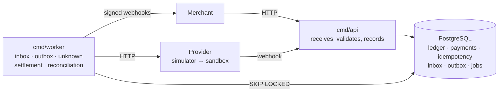

# Cross-border Pay

[](https://github.com/gengibrepower/cross-border-pay/actions/workflows/ci.yml)
[](https://github.com/gengibrepower/cross-border-pay/actions/workflows/nightly.yml)


[](LICENSE)

🇧🇷 [Leia em português](README.pt-BR.md)

**A cross-border payment gateway in Go, built to stay correct under concurrency, duplicates and partial failures.**

A foreign merchant charges in US dollars. A payer in Brazil pays in reais by PIX, boleto or card. The system converts the currency, records every cent in a double-entry ledger and pays the merchant out in dollars.

The one rule that can never break: **the money on record always matches the money that exists**, even when providers time out, events arrive twice or out of order, and workers die halfway through.

> **Learning project, not a real gateway.** Money, customers and payment providers are all simulated. Fees and rates are illustrative. It exists to practice the engineering behind correct financial systems.

## What the project sets out to prove

1. **Idempotency across the whole chain.** API, provider calls, incoming events, outgoing webhooks and jobs. Retrying never charges, posts or pays out twice.
2. **Ledger consistency under concurrency.** Thousands of simultaneous operations, duplicates included, and the ledger still sums to zero per currency.
3. **Dual writes without distributed transactions.** The database and the provider never share a transaction. Intent is recorded first, ambiguous results become `unknown` instead of failures, and inbox/outbox tables carry events in and out.
4. **Tolerance to a hostile outside world.** Providers that lag, duplicate, reorder or vanish, and merchants whose endpoints are down.

## What is proven so far

Every number below is measured, not estimated. Every test that touches the database runs against a **real PostgreSQL 18** in a container (`testcontainers-go`), never a mocked one; domain tests do no I/O at all.

| Test | What it shows | Result |
|---|---|---|
| `TestThousandsOfConcurrentTransfers` | 10 concurrent workers post 5,000 random transfers between 20 accounts in two currencies. Afterwards the database itself is asked whether every invariant holds. | 20/20 runs with `-race -count=20`, i.e. **100,000 concurrent transfers**. The ledger closes at zero per currency every time, and transfers that would overdraw are rejected, never half-applied. |
| `TestLedgerInvariantsAgainstPostgres` | Property-based: random sequences of valid and invalid transactions against Postgres. After every step, balances match an in-memory model. | 100 random sequences per run, 20/20 runs |
| Ledger domain properties | Random transactions keep the invariants in memory, and an unbalanced transaction is always rejected. | 2 properties × 100 cases per run, 20/20 runs |
| FX properties | Conversion is nearest half-even, odd-symmetric and monotonic, and round-trips when the rate is at least 1. A quote's USD legs sum to zero, and with a base rate of at least 1 the rounding account never takes more than one cent. A stored quote reads back exactly as it was computed, without repricing. | 7 properties × 100 cases per run, 20/20 runs |
| `TestTransitionIsExhaustive` | Every (status, event) pair of the payment state machine is checked against section 3.4, written out again inside the test: anything outside the table is `ErrInvalidTransition`, and a repeated event the status already reflects is a no-op. | All 49 pairs, 20/20 runs |
| `TestAuthenticate` | API keys against real Postgres: a malformed key, an unknown one, the right lookup with a wrong secret, the right key with its mode changed, and a revoked key all get the same `401`, so the response does not tell an attacker which part was wrong. | 5 rejection cases, plus a mutation check: a hash comparison that accepts any secret makes it fail |
| Contract tests (`cmd/api`) | Every request and response of `POST /v1/payments`, `GET /v1/payments/{id}` and `GET /v1/payments` goes through the real handler and a real Postgres and is checked against the hand-written `api/openapi.yaml` with `kin-openapi`. The GameStore payment returns R$ 101.50 with a US$ 0.60 fee and a 30-minute quote, and the `GET` returns byte for byte what the `POST` returned. Walking 7 payments in pages of 3 sees each one exactly once, newest first, and none of another merchant's; another merchant's payment, an unknown ID and a malformed ID all get the same `404`. | `POST`: 1 success and 14 error cases, and no rejected request stores a payment. `GET`: 4 `404`/`401` cases and 6 invalid-parameter cases, each with its stable `code`. 20/20 runs with `-race -count=20`. Changing `id <` to `id <=` in the cursor makes the pagination test fail |
| Idempotency at the store layer (`internal/idempotency`) | The eight cases of section 4.2 against a real Postgres: a stored response replayed as is, a different body rejected, a 4xx kept, a 5xx before any work releases the key, a 5xx after recorded work keeps it, keys of different merchants independent. A key left by a request that died is resumed from where it stopped once the lease ends, and the dead request can no longer complete or release it. The recovery point rolls back with the transaction of whoever wrote it. | 20 concurrent requests with one key: exactly 1 proceeds and 19 get `409`, 20/20 runs with `-race -count=20`. Dropping the `lock_token` from completion or the `recovery_point` from release makes the test for that case fail |
| Idempotency through the API (`POST /v1/payments`) | A retry gets the same 201 byte for byte, marked `Idempotent-Replayed: true`, and no new payment; the same key with another payment is a `422`; a 4xx is stored and replayed; different merchants with the same key create different payments. **Simulated crash:** the request creates the payment and dies before storing its answer; the retry gets `409` while the lease runs and, after it, `201` with that same payment, identical to the `GET`, and the database still holds 1 payment and 1 quote. In the middleware, a 5xx before any work releases the key, and a 5xx after a recovery point keeps it and lets the retry resume at once. | 10 concurrent HTTP requests with one key create exactly 1 payment, 20/20 runs with `-race -count=20`. Making `Create` ignore the recovery point makes the crash test fail |
| Key cleanup (`cmd/worker`) | Every hour, in batches of 1,000, the job deletes keys older than 24 h and nothing younger. With `FOR UPDATE SKIP LOCKED`, a key another transaction has locked is passed over without waiting and deleted on the next round. A failed round is logged and does not stop the worker. | 7 expired keys deleted in batches of 3, 20/20 runs with `-race -count=20`. Dropping `SKIP LOCKED` makes `Cleanup` wait for the lock until its deadline, and the test fails |
| `TestEntriesAreImmutable` | Postgres triggers reject `UPDATE`, `DELETE` and `TRUNCATE` on entries and transactions. Corrections are new transactions. | Enforced in the schema itself |

CI runs formatting, a strict `golangci-lint`, `go test -race` with coverage and `govulncheck` on every pull request. A nightly job reruns everything with `-race -count=100`.

## Architecture

A **modular monolith** with hexagonal modules: two binaries from one Go module, and one Postgres that is both the source of truth and the queue. No message broker until load proves one is needed.



The API only receives and records. Anything that can fail or take long runs in the worker, coordinated through Postgres. **No network call ever happens inside a database transaction.**

Each module follows `internal/<module>/{domain,app,adapters}`. The domain imports no HTTP, SQL or SDK, never calls `time.Now()` (it takes a `Clock`), and is tested in isolation.

### Reference flow: GameStore

A US$ 20.00 game; base rate 5.0000 BRL/USD; 1.5% spread gives a quoted rate of 5.0750; the payer pays R$ 101.50; the 3% fee is US$ 0.60. On confirmation the ledger posts, in minor units:

```
BRL:  provider receivables   +10150
      FX (BRL)               -10150      BRL sums to 0
USD:  FX (USD)                -2030      (10150 / 5.0000)
      merchant payable        +1940
      fee revenue               +60
      spread revenue            +30      USD sums to 0
```

## Key decisions

The full list of 57 closed decisions, with reasoning, is in [docs/escopo.md §11](docs/escopo.md) (Portuguese). These are the ones that shape the system most:

| Decision | Chosen | Discarded, and why |
|---|---|---|
| Architecture | Modular monolith: `api` and `worker` binaries, one Go module | Microservices with a broker from day one: the cost comes before anyone knows where it hurts |
| Queue | Postgres as the queue (`SELECT … FOR UPDATE SKIP LOCKED`) for outbox and jobs | Kafka: too heavy. NATS: only if load tests show a measured reason |
| Money | `int64` minor units + currency type; decimals in JSON are rejected | `float64`: `20.099999` becomes the wrong cent |
| FX rate | Integer scaled by 10⁸, overflow-free intermediate product, half-even rounding, remainder posted to a rounding account | A decimal library: a dependency for something small and fully testable |
| Ledger storage | Postgres behind a `Ledger` interface; balances derived from entries | A custom ledger engine (future project); a cached balance, until load tests justify it |
| Isolation | `READ COMMITTED` + `SELECT … FOR UPDATE` on accounts, locked in ascending ID order to prevent deadlocks | `SERIALIZABLE` with retries: planned as a comparative benchmark |
| Immutability | Ledger entries can never be updated or deleted, enforced by database triggers; corrections are new transactions | Editable rows: an audit trail you cannot trust |
| Idempotency | Keys valid for 24 h; concurrent request with the same key → immediate `409`; successes and 4xx stored, key released on 5xx unless the provider was already called | Blocking the second request until the first finishes: ties up connections under retries |
| Key lock | `INSERT ... ON CONFLICT DO NOTHING` is the lock; the key gets a 30 s lease (`locked_until`) and a `lock_token` only its holder knows | `SELECT` then `INSERT`: two concurrent requests both get through. `SELECT ... FOR UPDATE` for the whole request: a transaction left open across the provider call |
| Stored response | Stored **before** it is sent, with status, body, `Content-Type` and `Location`, on a context the client cannot cancel; a retry gets the original body, including the `request_id` of the request that did the work | Sending first and storing after: if storing fails, the client saw the 201 and the retry gets `409` for 30 s |
| Resuming after a crash | Recovery points: the key stores how far the request got and what it created, written in the same transaction as that work; a retry continues from there | Redoing everything: a request that died after creating the payment yields a second payment, and in F5 a second provider attempt |
| Ambiguous provider result | Attempt goes to `unknown` and is resolved by actively polling the provider (`GetAttempt` with backoff), with events and reconciliation as a safety net | Treating timeouts as failures: the provider may have charged the payer |
| Incoming events | Inbox table: the webhook handler only stores and returns `200`; the worker processes, tolerating duplicates and reordering | Processing inside the handler: provider retries and slow handlers turn into double processing |
| Testing | Real Postgres in every integration test; determinism only in the provider simulator, controlled by a seed | Mocked database or fully simulated world: loses real lock and isolation bugs |
| API errors | RFC 9457 `application/problem+json` with a stable `code` and the `request_id` that also appears in the logs | A custom error format: one more thing for clients to learn, and a bare status code cannot tell causes apart |
| API keys | `sk_test_`/`sk_live_` + public lookup + 256-bit secret; only the SHA-256 is stored and compared in constant time; the key is printed once by `cmd/admin` | bcrypt/argon2: built for guessable passwords, they would add tens of milliseconds to every request without protecting a random 256-bit secret any better |
| Public IDs | `pay_` + the UUIDv7 in Crockford base32 (26 characters), so IDs sort by creation time as plain strings | Hex: 32 characters for the same information. Exposing the raw UUID: no type prefix to catch a payment ID passed where a refund ID belongs |
| Quotes | A `quotes` table owned by `fx` that stores every computed amount, with `CHECK`s for the identities that make the USD legs sum to zero | Columns inside `payments`: card payments are requoted at authorization (decision 44), so one payment can have more than one quote |
| Pagination | Keyset on `(merchant_id, id)`, newest first, with an opaque cursor in `next_cursor` (`null` on the last page); `limit` from 1 to 100, default 20 | `OFFSET`: slower with every page, and skips or repeats rows when new payments arrive. `starting_after=pay_…`: works, but ties the cursor format to the ID |
| HTTP | Standard library `net/http` router; hand-written OpenAPI validated in contract tests | Frameworks and generated code: more to explain, little gained with Go's method+path patterns |

## Status

The plan is split into phases, each with a written definition of done ([docs/escopo.md §12](docs/escopo.md)).

| Phase | Delivers | Status |
|---|---|---|
| F0 | Skeleton, CI, real Postgres in tests | ✅ done |
| F1 | Money and FX: half-even conversion, quotes with spread, fee and expiry | ✅ done |
| F2 | Ledger with invariants under concurrency | ✅ done |
| F3 | Payments, state machine, base API | ✅ done |
| F4 | Idempotency | ✅ done |
| F5 | Simulated PIX, inbox, confirmation | planned |
| F6 | Outbox and webhooks; GameStore end to end over HTTP | planned |
| F7 | Refunds and settlement | planned |
| F8 | Card, boleto, chargebacks | planned |
| F9 | Hostile simulator, CNAB 240 reconciliation, Efí sandbox | planned |
| F10 | Public production deploy | planned |

## Run it locally

You need [mise](https://mise.jdx.dev) and Docker. mise pins Go, `golangci-lint`, `sqlc` and `govulncheck` to the exact versions CI uses.

```sh
mise install          # toolchain at pinned versions
mise run test         # go test -race ./... (starts Postgres containers by itself)

mise run db           # local Postgres via docker compose
mise run migrate      # apply embedded migrations
go run ./cmd/admin merchant create -name GameStore -mode test   # prints the API key once
go run ./cmd/api      # /healthz and /readyz on :8080; FX_USD_BRL_RATE sets the base rate (default 5.0000)
go run ./cmd/worker   # background jobs; for now, deleting idempotency keys older than 24 h
```

Creating the GameStore payment with the key `cmd/admin` printed:

```sh
curl -s localhost:8080/v1/payments \
  -H "Authorization: Bearer sk_test_..." -H "Idempotency-Key: order-123" \
  -d '{"amount": {"value": 2000, "currency": "USD"}, "method": "pix", "reference": "order-123"}'
# 201: pending, payer pays {"value": 10150, "currency": "BRL"}, fee 60, net 1940, quote valid 30 min
# The same command again returns the same 201 with Idempotent-Replayed: true, creating nothing

curl -s localhost:8080/v1/payments/pay_... -H "Authorization: Bearer sk_test_..."
curl -s "localhost:8080/v1/payments?limit=20&status=pending" -H "Authorization: Bearer sk_test_..."
# 200: {"data": [...], "next_cursor": null}; pass next_cursor as ?cursor= for the next page
```

The contract is [api/openapi.yaml](api/openapi.yaml).

Other tasks: `mise run lint`, `mise run fmt`, `mise run vuln`, `mise run test:stress` (the nightly `-count=100` run), `mise run gen` (`sqlc`).

## Repository layout

```
cmd/
  api/        HTTP server
  worker/     background jobs (idempotency cleanup) with graceful shutdown
  migrate/    applies embedded goose migrations
  admin/      operator tasks: create a merchant and its API key, revoke a key
internal/
  money/      Money and Currency in minor units
  fx/         rates, conversion, quotes
  ledger/     double-entry transactions, invariants, Postgres adapter
  merchants/  merchants, API keys (hash only), authentication middleware
  payments/   payment state machine, creation, HTTP handlers
  idempotency/ idempotency keys: lock, lease, recovery points
  platform/   config, logging, clock, Postgres (WithTx), worker runner, HTTP (RFC 9457 errors, request ID)
api/          openapi.yaml, the hand-written contract
migrations/   SQL migrations, embedded in the binaries
docs/         scope, rules and decisions (Portuguese)
```

## Stack

Go 1.27 · PostgreSQL 18 · `pgx/v5` · `sqlc` · `goose` (as a library) · `log/slog` · `testcontainers-go` · `rapid` (property-based tests) · `golangci-lint` v2 + `gofumpt` · GitHub Actions · mise

## Hosting (planned, F10)

A Linux VM running the same Docker Compose stack, with Caddy for automatic HTTPS, on Azure. Backups with tested restores, CI deploys, OpenTelemetry + Prometheus + Grafana with a public dashboard, k6 load numbers in `docs/benchmarks.md`, and a rate-limited demo account.

## Regulation

Not legal advice. Processing third-party money in Brazil requires Central Bank authorization as a payment institution, which is why no real money is involved here. Taxes (IOF) are at most a configurable fee. KYC/AML is out of scope, though the ledger and inbox audit trails show where it would plug in. No card numbers are stored, only fictitious tokens, and personal data is masked in logs (LGPD minimization).

## Author

**TODO: full name**, Computer Science student at PUCPR (Curitiba, Brazil).

[GitHub](https://github.com/gengibrepower) · TODO: LinkedIn

## License

MIT. See [LICENSE](LICENSE).
