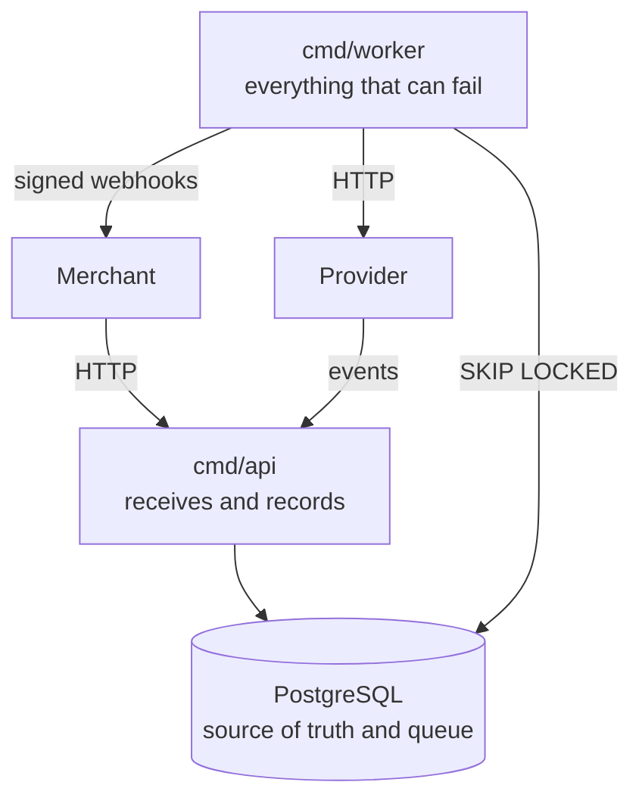
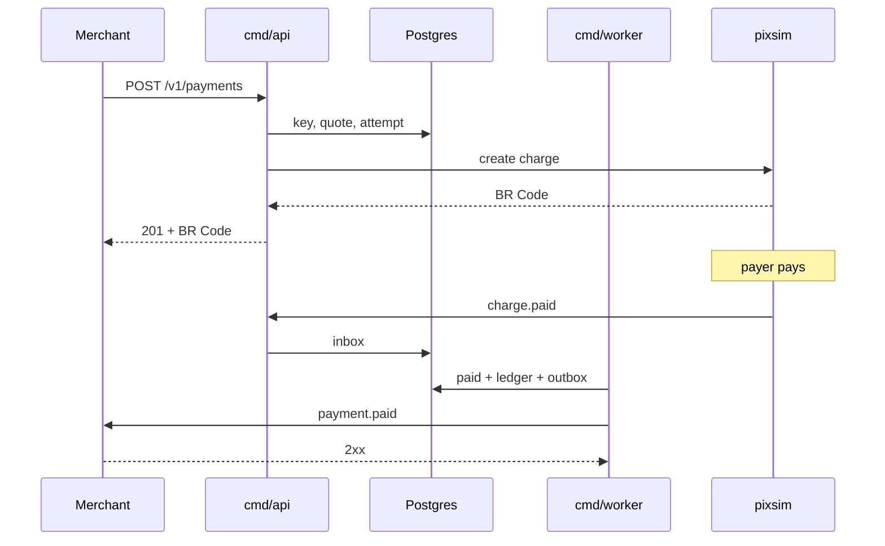

# Cross-border Pay

[](https://github.com/gengibrepower/cross-border-pay/actions/workflows/ci.yml)
[](https://github.com/gengibrepower/cross-border-pay/actions/workflows/nightly.yml)


[](LICENSE)

🇧🇷 [Leia em português](README.pt-BR.md)

**A cross-border payment gateway in Go, built to stay correct under concurrency, duplicates and partial failures.**

A foreign merchant charges in US dollars. A payer in Brazil pays in reais by PIX, boleto or card. The system converts the currency, records every cent in a double-entry ledger and pays the merchant out in dollars.

The one rule that can never break: **the money on record always matches the money that exists**, even when providers time out, events arrive twice or out of order, and workers die halfway through.

> **Learning project, not a real gateway.** Money, customers and payment providers are all simulated. Fees and rates are illustrative. It exists to practice the engineering behind correct financial systems.

## What the project sets out to prove

1. **Idempotency across the whole chain.** API, provider calls, incoming events, outgoing webhooks and jobs. Retrying never charges, posts or pays out twice.
2. **Ledger consistency under concurrency.** Thousands of simultaneous operations, duplicates included, and the ledger still sums to zero per currency.
3. **Dual writes without distributed transactions.** The database and the provider never share a transaction. Intent is recorded first, ambiguous results become `unknown` instead of failures, and inbox/outbox tables carry events in and out.
4. **Tolerance to a hostile outside world.** Providers that lag, duplicate, reorder or vanish, and merchants whose endpoints are down.

## What is proven so far

Every number below is measured, not estimated. Every test that touches the database runs against a **real PostgreSQL 18** in a container (`testcontainers-go`), never a mocked one; domain tests do no I/O at all.

| Claim | Measured |
|---|---|
| The ledger closes at zero under concurrency | 100,000 concurrent transfers, every run |
| A payment is confirmed once | 1 posting out of 1,000 concurrent confirmations |
| Refunds never pass what was paid | 4,000 concurrent refund requests |
| A retry never charges twice | 10 concurrent requests, one key: 1 payment |
| A killed worker loses no webhook | 100 events, killed mid-round: all delivered |
| A settlement pays once | Same cutoff twice, or on 8 workers: 1 payout |

Each group below opens to what every test shows and what it measured. Runs are with `-race -count=20` unless stated, and "mutants killed" are deliberate bugs each test was checked to catch.

<details>
<summary><b>Ledger and money</b> · 5 tests</summary>

**`TestThousandsOfConcurrentTransfers`**

10 concurrent workers post 5,000 random transfers between 20 accounts in two currencies. Afterwards the database itself is asked whether every invariant holds.

**Result:** 20/20 runs with `-race -count=20`, i.e. **100,000 concurrent transfers**. The ledger closes at zero per currency every time, and transfers that would overdraw are rejected, never half-applied.

---

**`TestLedgerInvariantsAgainstPostgres`**

Property-based: random sequences of valid and invalid transactions against Postgres. After every step, balances match an in-memory model.

**Result:** 100 random sequences per run, 20/20 runs.

---

**Ledger domain properties**

Random transactions keep the invariants in memory, and an unbalanced transaction is always rejected.

**Result:** 2 properties × 100 cases per run, 20/20 runs.

---

**FX properties**

Conversion is nearest half-even, odd-symmetric and monotonic, and round-trips when the rate is at least 1. A quote's USD legs sum to zero, and with a base rate of at least 1 the rounding account never takes more than one cent. A stored quote reads back exactly as it was computed, without repricing.

**Result:** 7 properties × 100 cases per run, 20/20 runs.

---

**`TestEntriesAreImmutable`**

Postgres triggers reject `UPDATE`, `DELETE` and `TRUNCATE` on entries and transactions. Corrections are new transactions.

**Result:** Enforced in the schema itself.

</details>

<details>
<summary><b>API, authentication and idempotency</b> · 6 tests</summary>

**`TestTransitionIsExhaustive`**

Every (status, event) pair of the payment state machine is checked against section 3.4, written out again inside the test: anything outside the table is `ErrInvalidTransition`, and a repeated event the status already reflects is a no-op.

**Result:** All 49 pairs, 20/20 runs.

---

**`TestAuthenticate`**

API keys against real Postgres: a malformed key, an unknown one, the right lookup with a wrong secret, the right key with its mode changed, and a revoked key all get the same `401`, so the response does not tell an attacker which part was wrong.

**Result:** 5 rejection cases, plus a mutation check: a hash comparison that accepts any secret makes it fail.

---

**Contract tests (`cmd/api`)**

Every request and response of `POST /v1/payments`, `GET /v1/payments/{id}`, `GET /v1/payments`, `POST /v1/payments/{id}/cancel` and `POST /v1/payments/{id}/refunds` goes through the real handler and a real Postgres and is checked against the hand-written `api/openapi.yaml` with `kin-openapi`. The GameStore payment returns R$ 101.50 with a US$ 0.60 fee and a 30-minute quote, and the `GET` returns byte for byte what the `POST` returned. Walking 7 payments in pages of 3 sees each one exactly once, newest first, and none of another merchant's; another merchant's payment, an unknown ID and a malformed ID all get the same `404`.

**Result:** `POST`: 1 success and 14 error cases, and no rejected request stores a payment. `GET`: 4 `404`/`401` cases and 6 invalid-parameter cases, each with its stable `code`. 20/20 runs with `-race -count=20`. Changing `id <` to `id <=` in the cursor makes the pagination test fail.

---

**Idempotency at the store layer (`internal/idempotency`)**

The eight cases of section 4.2 against a real Postgres: a stored response replayed as is, a different body rejected, a 4xx kept, a 5xx before any work releases the key, a 5xx after recorded work keeps it, keys of different merchants independent. A key left by a request that died is resumed from where it stopped once the lease ends, and the dead request can no longer complete or release it. The recovery point rolls back with the transaction of whoever wrote it.

**Result:** 20 concurrent requests with one key: exactly 1 proceeds and 19 get `409`, 20/20 runs with `-race -count=20`. Dropping the `lock_token` from completion or the `recovery_point` from release makes the test for that case fail.

---

**Idempotency through the API (`POST /v1/payments`)**

A retry gets the same 201 byte for byte, marked `Idempotent-Replayed: true`, and no new payment; the same key with another payment is a `422`; a 4xx is stored and replayed; different merchants with the same key create different payments. **Simulated crash:** the request creates the payment and dies before storing its answer; the retry gets `409` while the lease runs and, after it, `201` with that same payment, identical to the `GET`, and the database still holds 1 payment and 1 quote. In the middleware, a 5xx before any work releases the key, and a 5xx after a recovery point keeps it and lets the retry resume at once.

**Result:** 10 concurrent HTTP requests with one key create exactly 1 payment, 20/20 runs with `-race -count=20`. Making `Create` ignore the recovery point makes the crash test fail.

---

**Key cleanup (`cmd/worker`)**

Every hour, in batches of 1,000, the job deletes keys older than 24 h and nothing younger. With `FOR UPDATE SKIP LOCKED`, a key another transaction has locked is passed over without waiting and deleted on the next round. A failed round is logged and does not stop the worker.

**Result:** 7 expired keys deleted in batches of 3, 20/20 runs with `-race -count=20`. Dropping `SKIP LOCKED` makes `Cleanup` wait for the lock until its deadline, and the test fails.

</details>

<details>
<summary><b>PIX and the provider</b> · 7 tests</summary>

**BR Code (`internal/brcode`)**

The 5 complete examples of the Banco Central's [Manual de Padrões para Iniciação do Pix v2.10.0](https://www.bcb.gov.br/content/estabilidadefinanceira/pix/Regulamento_Pix/II_ManualdePadroesparaIniciacaodoPix.pdf) parse with their CRC checked, and the encoder reproduces the static and dynamic ones character for character. The CRC16 covers the `6304`, as the manual says; a CRC computed without it is rejected. Field 54 without floats (`10150` ↔ `"101.50"`).

**Result:** Property test `Parse(Encode(c)) == c`: 100 cases per run, 20/20 runs; 14 invalid payloads and 14 invalid codes rejected, each for the right reason.

---

**Provider attempts (`payments`)**

Every (status, event) pair of the attempt state machine is checked against section 3.5, written out again inside the test; an ambiguous answer never rejects an attempt, and the payment event may arrive before the create response. Against a real Postgres, a payment has at most one live attempt (a partial unique index: only a rejection frees it), and events on one attempt are serialized by a row lock.

**Result:** All 30 pairs. 20 concurrent creates for one payment leave exactly 1 attempt, and 8 concurrent accept/reject events on one attempt change it exactly once, 25 attempts per run, 20/20 runs with `-race -count=20`. Dropping the `FOR UPDATE` or the index's `WHERE` makes these tests fail.

---

**PIX simulator (`cmd/pixsim`)**

A real HTTP provider with charges in memory and faults on command: `reject`, `fail_before` (500, nothing done), `timeout_after` (the charge is created and the answer never comes) and `delay`. After a `timeout_after`, looking the charge up by our attempt ID finds it, and retrying with the same key returns that same charge. Every BR Code it issues parses with `internal/brcode`. Only an explicit refusal reaches the payments port as `Rejected`; a 500, a timeout or an unknown answer is an error, so the attempt goes to `unknown`.

**Result:** Same seed and same 50 keys sent concurrently in reverse order give the same charges, byte for byte, as sent one by one; 8 malformed requests refused with `400`. 20/20 runs with `-race -count=20`. 10 mutants killed, among them seeding by arrival order, creating the charge after the hang instead of before, and reading a 500 as a refusal.

---

**Simulator refunds (`cmd/pixsim`)**

A paid charge can be refunded in parts, as a PIX devolução, once per our refund ID: the same key returns the same refund, another amount under it is `idempotency_key_reused`. The simulator holds invariant 8 on its own side: it refuses a refund of an unpaid charge, in another currency or above what is left, and stores the refusal with its reason, so a lookup by our ID finds the same decision. The same faults apply (`refund`, `get_refund`): after a `timeout_after` the money went back and the lookup finds it `completed`. The payments port gains `Refund` and `GetRefund`, with the same rule as attempts: only a refusal is a result, anything else is ambiguous.

**Result:** 50 concurrent refunds of R$ 10.00 on a R$ 101.50 charge: exactly 10 completed. 20/20 runs with `-race -count=20`. 7 mutants killed, among them not checking or not consuming what is left, not storing a refusal, refunding an unpaid charge, accepting a reused key with another amount, a refund ID not derived from its key, and answering a `timeout_after`

---

**Simulator events**

Paying a charge posts one `charge.paid` event to `PIXSIM_WEBHOOK_URL`, signed with HMAC-SHA256 over the timestamp and the body. `pixsim.VerifyEvent` refuses a tampered body, a wrong secret, a changed timestamp and any signature more than 5 minutes away from now, so a captured delivery cannot be replayed later. The event ID comes from the seed and a redelivery (`/control/events/{id}/deliver`) sends the same bytes signed again, so the receiver can drop duplicates by ID. Paying twice sends nothing new; a webhook that fails does not undo the payment; a payer that gives up does not cut the delivery. The gateway receives them at `POST /v1/providers/pixsim/events` (the inbox, below).

**Result:** 8 forgeries refused and 5 malformed signed bodies refused, among them a decimal amount. 20/20 runs with `-race -count=20`. 17 mutants killed, among them comparing only the last signature, dropping the timestamp or the body from the MAC, deriving the event ID without the charge key, and delivering with the payer's context.

---

**PIX attempt on create (`POST /v1/payments`)**

Each payment gets its provider attempt and a BR Code that parses for R$ 101.50, identical in the `POST`, the `GET` and the list. A refusal is a `201` with `pix.status: failed`; a timeout after the provider acted, or a `500` from it, is a `201` with `processing` and the attempt in `unknown`, bounded by the 300 ms test timeout. **Crashes at each step:** after the first transaction (attempt `created`) the retry calls the provider once; after `sent` it does not call again and marks `unknown`; after the answer is stored it only replies. A client that disconnects mid-call does not stop it: the attempt still ends `accepted`.

**Result:** 10 concurrent requests with one key and a retry: 1 provider call, 1 attempt. 20/20 runs with `-race -count=20`. 11 mutants killed, among them calling again from `sent`, dropping `WithoutCancel`, dropping the service's timeout, reading a provider error as a refusal and showing the oldest attempt instead of the latest.

---

**Unknown resolver (`cmd/worker`)**

Ambiguous attempts are looked up at the provider, never created again (decision 17). A charge the provider made while our call timed out ends `accepted` with its BR Code, or `succeeded` if paid meanwhile. Not found is retried during a 1-minute grace and then means `rejected`. A request that died after writing `sent` is picked up once it is a minute stale. Failed lookups wait 5 s, 10 s, 20 s… up to 5 min, and at 24 h the attempt is escalated and never looked up again. A worker that dies holding a claim only delays the attempt until its lease ends.

**Result:** Backoff: 292 lookups over 24 h, every wait checked. 4 concurrent resolvers over 50 attempts: 50 claims and 50 lookups, one per attempt. 20/20 runs with `-race -count=20`. 10 mutants killed, among them dropping `SKIP LOCKED` (90 lookups for 50 attempts), not pushing the lease (85), rejecting on the first not found and never escalating.

</details>

<details>
<summary><b>Inbox, confirmation and outbox</b> · 3 tests</summary>

**Inbox (`internal/events`)**

The webhook checks the signature, stores the event with the exact bytes and header it came with, and answers `200`, for a duplicate too; only a failure to store asks for a redelivery. A worker claims due events with `FOR UPDATE SKIP LOCKED` and applies each one in the transaction that records its status, so the effect and the status commit together or not at all. `charge.paid` succeeds the attempt it names once the amount matches the quote. One for an attempt not stored yet is retried after 5 s, 10 s, 20 s… up to 5 min, and fails at 24 h; one that contradicts the attempt (another amount or charge ID, a rejected attempt) fails at once and changes nothing. Events of one payment are applied one at a time behind its row lock, and that lock does not wait for a foreign key check.

**Result:** 100 concurrent deliveries of one event: all `200`, 1 row. 5 refused requests (signature, unreadable, no ID, unknown provider, over 64 KiB), none stored. 4 processors over 50 events: each applied once. 6 divergent events leave the attempt as it was. 20/20 runs with `-race -count=20`. 25 mutants killed, among them dropping `SKIP LOCKED`, the `ON CONFLICT` or the `pending` guard of a late retry, recording the status after the handler failed, stopping the batch at the first error, skipping the amount check, and `FOR UPDATE` in place of `FOR NO KEY UPDATE`

---

**`TestThousandConcurrentConfirmationsPostOnce`**

Confirmation (`payments` + `ledger`): an attempt that becomes `succeeded`, by the provider's event or by the resolver, moves the payment to `paid` and posts section 3.3's transaction in that same database transaction. 1,000 confirmations of one charge run at once, half through each path. A ledger that cannot post leaves the attempt and the payment as they were; a payment already `paid` is not posted again; each merchant is owed on its own account, created by its first confirmation. Every path locks the payment, then the attempt, then the accounts: a test holds the payment's lock and checks with `NOWAIT` that a waiting confirmation has not taken the attempt's.

**Result:** **Exactly 1 ledger transaction and 1 `payment.paid` out of 1,000 confirmations**, with the GameStore balances to the cent (R$ 101.50 in, US$ 19.40 owed, US$ 0.60 fee, US$ 0.30 spread), 20/20 runs with `-race -count=20`. Any quote confirms into a balanced transaction with no zero leg: 100 cases per run, 20/20 runs. 50 concurrent first confirmations of one merchant create 1 account. 14 mutants killed, among them locking the attempt before the payment, `FOR KEY SHARE` on the payment, posting a payment already paid, dropping the ledger reference and one payable shared by all merchants.

---

**Outbox (`payment.paid`)**

The confirmation appends `payment.paid` to `outbox_events` in its own transaction (section 4.5), with `payment_version` bumped by the same `UPDATE` that changes the status. The payload is stored as the exact bytes every delivery will send and sign, and validated against the `PaymentEvent` schema in `api/openapi.yaml`; its `payment_id`, `status` and `amount` match the `GET` of the payment. An outbox that refuses the event undoes the attempt, the payment and the ledger posting. Delivery is in the "Webhook delivery" row.

**Result:** 1 event per payment under the 1,000 concurrent confirmations above, 20/20 runs with `-race -count=20`. 10 mutants killed, among them not appending the event, ignoring the outbox's error, not bumping the version, the stale version in the payload, the payer's BRL amount in `data`, and storing the payload as `jsonb`

</details>

<details>
<summary><b>Expiry, cancel and late money</b> · 3 tests</summary>

**Expiry (`cmd/worker`)**

A job claims pending payments whose quote has expired (`FOR NO KEY UPDATE SKIP LOCKED`, then a 1-minute lease) and asks the provider before deciding: paid on time means confirmed, otherwise expired with `payment.expired` in the outbox. On time is the provider's `paid_at` against the quote's `expires_at`, never when the news reached us, and `confirm` applies the same rule to events, so the job and the event agree whichever comes first. A provider that does not answer decides nothing: the payment waits for the lease. **The race:** the payer pays 2 s before expiry and the event has not arrived when the job runs; the job finds the payment and confirms it, and the event that comes 3 s later is a no-op. Paid 1 s late, by job or by event, it is never confirmed: the money is held for review (next row).

**Result:** 4 concurrent jobs over 50 payments: each expired once, with one lookup each. 20/20 runs with `-race -count=20`. 17 mutants killed, among them judging lateness by our clock, expiring without asking the provider or after a failed lookup, treating the expiry instant as on time, `Expire` without re-checking status or deadline under the lock, dropping `SKIP LOCKED` and not pushing the lease.

---

**Cancel (`POST /v1/payments/{id}/cancel`)**

A pending payment becomes `canceled` with `payment.canceled` in the outbox. Like the expiry job, the cancel asks the provider first: a payer who already paid while the news was on its way is confirmed and the cancel answers `409 payment_not_cancelable`. A provider that does not answer gets `503 provider_unavailable` and nothing changes. Canceling twice answers `200` with no second event, so no `Idempotency-Key` is needed. Money sent after the cancel is late money: held for review, the payment stays canceled. **The race:** the cancel and an on-time confirmation take the same payment lock, so exactly one wins.

**Result:** `TestCancelAndConfirmationRace`: 400 rounds of cancel × confirmation, 20/20 runs with `-race -count=20`: 356 canceled with the money held, 44 paid with one posting, never both. 3 mutants killed: canceling without asking the provider, reading the status without the lock, a second event on a repeated cancel.

---

**Money without a destination (section 4.4)**

Money the provider confirmed always enters the ledger; what is in doubt is only where it goes. A payment that cannot confirm its payment (late, another amount, for a rejected attempt, or a second charge) is posted from `provider_receivables:BRL` to `divergence:BRL` and opens a review case in `review_cases` (the `reconciliation` module, in the same transaction). The payment is untouched and the attempt `succeeded` when the state machine allows it. One case per provider charge: its unique key is the first barrier and the ledger's unique reference the second, so the event, the resolver and the expiry job post once together. The amount check now runs in the domain for all three paths; before, only the event compared amounts, and the resolver confirmed any payment the provider reported as paid. An event that cannot be held (another currency) is `failed` and writes nothing: a savepoint undoes what it wrote before, since the inbox commits the failed status.

**Result:** Paid 1 s late, by job first, by event first and both at once: 1 case and R$ 101.50 held each time, ledger summing to zero per currency. 20 concurrent deliveries of one divergent event: 1 case, 1 posting. Through the worker with the simulator's own event: payment `expired`, attempt `succeeded`, R$ 101.50 on `divergence:BRL`. 20/20 runs with `-race -count=20`. 16 mutants killed, among them posting when the case was already open, dropping the amount check, holding the quoted amount instead of the paid one, no savepoint, the expiry job stopping after settling, and confirming on any change of a succeeded attempt.

</details>

<details>
<summary><b>Refunds and settlement</b> · 5 tests</summary>

**Refund pricing and postings (`payments`, decision 13)**

A refund is priced by the proportion of the original payment: US$ 10.00 of the GameStore returns R$ 50.75 to the payer and US$ 0.15 of the spread. It posts in three steps: the hold takes the refunded dollars from the merchant into "refunds in flight" when the refund is created; the completion sends the reais back from the provider, buys them back at today's base rate and puts the difference into the exchange result (at 5.5000 the gateway gains US$ 0.92, at 4.5000 it loses US$ 1.13); a refusal releases the hold. **The rounding bug it avoids:** rounding each refund on its own, two halves of R$ 101.51 are R$ 50.76 each, R$ 101.52 in all; each share is cumulative instead, what all refunds so far should have returned minus what the earlier ones did, so they add up to the exact total. The refund state machine is every (status, event) pair checked against a table written out again in the test.

**Result:** `TestRefundsOfAnyPaymentAddUp`: 10,000 random payments (rate, spread, fee, amount) with up to 12 refunds each, some refused afterwards: what counts never passes what was paid, every posting balances per currency, and refunding the rest returns exactly the reais and the spread. 20/20 runs with `-race -count=20`. 14 mutants killed, among them rounding each refund on its own (reais or spread), an off-by-one in invariant 8, refusing a full refund, the exchange result with its sign flipped, the cost ignoring today's rate, and an ambiguous answer rejecting a refund.

---

**`TestConcurrentPartialRefundsNeverExceedThePayment` (`POST /v1/payments/{id}/refunds`)**

Invariant 8 through the whole API: the refund locks the payment (`FOR NO KEY UPDATE`), sums the refunds that still count (all but the refused), prices the new one and posts its hold in one transaction; the provider is called after the commit, and its answer posts the money gone back or releases the hold, moving the payment to `partially_refunded` or `refunded` with `refund.succeeded` or `refund.failed` in the outbox. 40 refunds of random amounts hit one paid payment at once, over HTTP with their own `Idempotency-Key`s. A refusal by the provider is a `201` with `failed`, the hold back with the merchant; a timeout leaves the refund `pending`, the hold kept; a retry with the same key replays the answer; a request that died after its first transaction resumes without calling the provider twice, and after `sent` does not call it at all.

**Result:** **4,000 concurrent refund requests** (5 payments × 40 per run, 20/20 runs with `-race -count=20`): never more than US$ 20.00 or R$ 101.50 refunded per payment, every refund the gateway accepted completed at the provider, and every refusal still would not fit in what was left. Afterwards the books close to the cent: nothing in flight, the merchant owes back exactly what was refunded, the provider holds what was not returned. 11 mutants killed, among them pricing without the payment's lock, counting only succeeded refunds or also refused ones, never reaching `refunded`, not posting the hold or the release, resuming by creating a second refund, calling again after `sent`, and reading a timeout as a refusal.

---

**Refund resolver (`cmd/worker`, decision 17)**

A refund left without an answer does not wait for the merchant to retry: the same queue as attempts (`next_check_at` as schedule and lease, `SKIP LOCKED`) finishes what the request left. A refund `created` for 1 min, from a request that died before calling the provider, is sent, and only by whoever moves it to `sent`, so a worker and a retried request never both call the provider. A stale `sent` becomes `unknown` and is never sent again; `unknown` is looked up with the attempts' backoff. "Not found" rejects the refund only 1 min after its last change, not its creation: a refund sent late may be arriving right now. Rejected, the hold goes back to the merchant with `refund.failed`; completed, it posts as the request would, with `refund.succeeded`. With no answer in 24 h it goes to a person, the hold kept.

**Result:** 8 tests against the simulator and Postgres, 20/20 runs with `-race -count=20`. 10 mutants killed, among them sending after losing the race to `sent`, counting the grace from creation, rejecting on any lookup error, not queuing `created`, not restarting the schedule on a status change and never escalating.

---

**Daily settlement (`cmd/worker`, section 4.7, decisions 20 and 25)**

Once per merchant and cutoff date in `America/Sao_Paulo`, what is available becomes a payout in USD: it leaves `merchant_payable` for `settlements_paid`, and the payments that became available point at the settlement, each in exactly one. A PIX paid on local day P is available on P+1 (boleto P+2, card P+30, calendar days). Available is the payable's balance less what is still pending, each pending payment at its net less the refunds that count; so a refund of a pending payment comes out of it, and one of a payment already settled comes out of the next payout. A negative available pays nothing and waits for more money. The transaction locks the payments first and the payable after, the order of every path, and with the payable locked nothing else posts to it; `UNIQUE (merchant_id, cutoff_date)` makes a second run pay nothing.

**Result:** **F7's criterion**: running the same cutoff twice, or on 8 workers at once, makes one payout. A model of 4 rounds × 6 days with random payments and refunds before and after each cutoff checks every payout to the cent and with the right payments; 4 workers settling while payments are confirmed and refunded end with everything paid once and the payable at zero. 20/20 runs with `-race -count=20`. 11 mutants killed, among them ignoring what is pending, availability a day early or late, the cutoff in UTC, pending without refunds or with the rejected ones, paying a negative available, listing settled payments again and locking the payable before the payments (deadlock)

---

**Balance and settlements (`GET /v1/balance`, `GET /v1/settlements`)**

The balance splits the merchant's payable as the settlement job does at that moment: pending is the net of the payments not available yet less their refunds, available is the rest, negative after a refund of settled money that exceeds what came in since; reserved is zero until F8's reserve. Both sums come from one `REPEATABLE READ` snapshot without the payable's lock, so a read never waits on a confirmation or holds up a settlement. The list shows the settlements newest cutoff first, each with its payments, read in the same snapshot as the page; the cursor is the cutoff date, unique per merchant, on the `UNIQUE (merchant_id, cutoff_date)` index; the payments come from a new partial index on `payments.settlement_id` (migration 00020)

**Result:** A balance checked at 9 points across 3 São Paulo days, among them 23:30 local, when the date in UTC has already turned, always adding up to the payable. 3 settlements in pages of 1: each seen once, newest first, with the same amount and payments as stored, none of another merchant's settled in the same runs. 5 invalid parameters and 2 `401`s. 20/20 runs with `-race -count=20`. 11 mutants killed, among them available without the pending, availability a day early or late, the cutoff in UTC, the cursor with `<=`, the list without the merchant filter, the payments of every settlement, and an error for a merchant with no payable yet.

</details>

<details>
<summary><b>Webhooks</b> · 4 tests</summary>

**Webhook endpoint and SSRF at registration**

`PUT /v1/webhook-endpoint` stores the merchant's URL, refused when it is not `https` or points inside a network: loopback, private ranges, link-local and cloud metadata (`169.254.169.254`, also as `::ffff:169.254.169.254`), CGNAT, reserved ranges, `localhost`/`.internal`/`.local` names and numeric hosts such as `2130706433`, which some resolvers read as `127.0.0.1`. No DNS at registration: a name can resolve elsewhere later, so delivery checks the IP after DNS (row below). The signing secret is not stored: it is derived from a key outside the database, the merchant and a version; rotating is conditional on the current version, so a retried rotation shows the same secret instead of rotating twice.

**Result:** 35 IPs at the edges of each range and 31 URLs, each under the strict and the development policy. 20 concurrent rotations from one version: 1 rotation, the same secret in all 20 answers. A URL change that read the version before a concurrent rotation does not undo it, forced by holding the change open until the rotation waits on the lock. No `whsec_` in the stored row or the logs. 20/20 runs with `-race -count=20`. 22 mutants killed, among them dropping the merchant's lock, the `::ffff:` unmapping, the private or CGNAT check, the numeric-host check, metadata opened in development, a retried rotation rotating again, and `Cache-Control: no-store`

---

**Webhook delivery (`internal/webhooks`)**

The worker claims due outbox events with `FOR UPDATE SKIP LOCKED` and a lease (`next_attempt_at` pushed past the timeout + 1 min), commits and only then posts, outside any transaction (section 4.3); the result goes into another short transaction. `attempts` fences the claim: once the lease ran out and another worker took the event, the first can no longer reschedule or fail it, while a 2xx, being a fact, is still recorded. Every post carries `Webhook-Signature: t=…,v1=…` (HMAC-SHA256 of the timestamp and the stored body), with a second `v1` from the previous secret for 24 h after a rotation. Only a 2xx is success: redirects are not followed, and the IP is checked again at `connect`, after DNS, under the same policy as registration. A failure waits a draw from [0, 30 s · 2ⁿ⁻¹], up to 6 h (decision 23), and becomes `failed` 72 h after creation. Each round takes up to 4 events per merchant, merchants with the oldest event first.

**Result:** **Cited test 4:** the worker is killed mid-way through the second round over 100 events of 5 merchants, with 10 posts received by the merchant and never answered; after the restart and the lease running out, all 100 are delivered, the 10 cut off twice and the other 90 once, and the cut-off ones get no retry or error recorded. 4 workers over 300 events of 10 merchants: each posted once, no bad signature. 13 decision cases, 7 forgeries refused, 10 addresses through the post-DNS check. 20/20 runs with `-race -count=20`. 21 mutants killed, among them dropping `FOR UPDATE SKIP LOCKED`, the per-merchant cap, the `attempts` fence, the lease margin, the 2xx's decoupled context, `CheckRedirect`, the post-DNS check, the timestamp in the MAC and the previous secret's deadline.

---

**Disabled destination and cleanup (decision 24)**

Each round tells each merchant's breaker once: a 2xx ends the run of failures, and a failure 72 h after the first one with no success between disables the endpoint, in one conditional `UPDATE`, so only one of many concurrent failures disables and warns. Disabled, the endpoint gets no post: its events wait with the usual backoff and fail at 72 h, and failures cut short by shutdown do not count. The notice is `GET /v1/webhook-endpoint`, which shows `failing_since`, `disabled_at` and `disabled_reason`, plus an `ERROR` log line for the operator; any `PUT`, with the same URL too, turns it back on. An hourly job deletes, in batches of 1,000 with `SKIP LOCKED`, events delivered more than 30 days ago; `pending` and `failed` stay. The `GET` test found a bug from #32: times read from the database came out in the local zone (`-03:00`); they now come out in UTC (section 4.9).

**Result:** 20 concurrent failures at the 72 h mark: 1 disables. No post to a disabled destination, and delivery resumes after the `PUT`. A round with 2xx and 500 mixed ends the run. 5 delivered at the cutoff deleted over 3 batches; the one delivered 1 µs after it, the `failed` and the `pending` stay. 20/20 runs with `-race -count=20`. 15 mutants killed, among them `<` instead of `<=` at the mark, every failure restarting the run, a success turning a disabled destination back on, posting to a disabled destination, counting shutdown failures, the cleanup deleting `failed`, a 3-day retention and reading without UTC.

---

**Events and manual redelivery (`GET /v1/events`, `POST /v1/events/{id}/redeliver`)**

The list shows the merchant's events, newest first, with an opaque cursor and a `delivery_status` filter: each with the exact body every delivery sends and where its delivery stands (attempts, next attempt, last status and error). Redelivery works from any status: `failed` is retried, `delivered` sent again, `pending` sent without waiting for its backoff; it answers `202`, with no `Idempotency-Key`, since repeating it only queues the event again. It opens a new retry window: the backoff restarts at 30 s and the 72 h count from it, without resetting `attempts`, which keeps fencing claims. A post in flight before the redelivery cannot push the "now" back to its own backoff. With no endpoint or a disabled one, `409`; another merchant's event, an unknown one or a malformed ID, the same `404`. `evt_`/`pay_`/`att_` now come from one place, `internal/platform/publicid`.

**Result:** 7 events in pages of 3: each seen once, newest first, none of another merchant's, each `event` equal to the stored bytes. 6 invalid parameters refused. Redelivery from all 3 statuses. An event that failed its whole window (over 20 attempts), redelivered, waits 30 s after its first failure, stays `pending` until 72 h after the redelivery and is delivered. 20/20 runs with `-race -count=20`. 15 mutants killed, among them redelivery not reopening the deadline or not restarting the backoff, dropping the window fence, redelivering another merchant's event, the cursor with `<=`, backoff by the total attempt and rewriting the event's JSON.

</details>

<details>
<summary><b>Card</b> · 2 tests</summary>

**Card simulator (`cmd/cardsim`)**

An acquirer over real HTTP, with authorizations in memory and the faults of `internal/providers/simkit`, shared with the PIX simulator. Only a fictitious token reaches it, never a card number: `tok_approved` is captured, `tok_declined` and `tok_insufficient_funds` are declined, any other token is declined as invalid. An authorization is captured once, up to what was authorized: the same capture again gets the same answer, another amount is refused, and 7 days on (decision 52) it has expired, whoever reads it first. Refunds hold invariant 8 on the acquirer's side, and a refusal is stored for the lookup.

**Result:** 50 concurrent refunds of R$ 10.00 on R$ 101.50: exactly 10 completed. The same seed and 50 keys sent concurrently in reverse order give the same authorizations as sent one by one. A `timeout_after` authorizes and the lookup by key finds it; a `500` is neither a decline nor a refusal. 5/5 runs with `-race`.

---

**Card payment on create (`POST /v1/payments`, decision 18)**

`method: card` with `card.token` is authorized and captured as the payment is created, so the `201` is already `paid` with `card.status: captured`, the GameStore's books posted and `payment.paid` in the outbox, byte for byte the same as the `GET` and as a retry. The payments module picks the provider by method (`pix` → `pixsim`, `card` → `cardsim`) and, once an attempt exists, by the name stored with it, so a refund goes back through the acquirer that captured. The token is stored with the attempt, refused by a `CHECK` unless it is a token, so a request that died before calling the acquirer is completed by its retry. A decline is a `201` pending with `declined`; a lost answer is `processing`, and the resolver finds the capture by the attempt's key.

**Result:** 6 tests against a real Postgres and both simulators: captured on create, 3 declines, 5 refused requests that store nothing (a card number among them), the resolver confirming a lost capture with 1 authorization, a resumed create authorizing once with the stored token, and a card refund posting as a PIX one. 6 mutants killed: not rereading the paid payment, not capturing at once, the token not sent or not stored, a decline read as an error and the refund routed by method instead of by the paid attempt.

</details>

<details>
<summary><b>End to end</b> · 1 test</summary>

**GameStore walkthrough end to end (`e2e/`, section 4.1)**

The real `api`, `worker` and `pixsim` as processes, on a database migrated by `cmd/migrate` and a merchant created by `cmd/admin`, over HTTP only. The US$ 20.00 charge comes back with the BR Code for R$ 101.50; repeating it with the same key answers the same bytes; the payer pays through the simulator; the worker confirms, posts to the ledger and delivers `payment.paid`, which the merchant checks by its signature and which matches the charge's `GET`. The provider sending the same event again changes nothing. Deviations: the provider takes the creation and never answers, the attempt stays `processing` and the worker's resolver finds it by its key; a merchant that is down does not delay the other, and a manual redelivery reaches it without waiting for the backoff. At the end all three stop on `SIGTERM` and exit cleanly.

**Result:** 3 walkthroughs in ~18 s, in parallel. 5/5 runs with `-race -count=5`. Ledger summing to zero per currency with 1 posting per paid charge, checked by SQL, and the merchant's US$ 19.40 by `GET /v1/balance`. 0 signatures refused by the merchant. 8 wiring mutants killed: the worker without its resolver, inbox or delivery, signing with another key, the API or the worker ignoring `SIGTERM`, the API without the provider inbox or the event routes.

</details>

CI runs formatting, a strict `golangci-lint`, `go test -race` with coverage and `govulncheck` on every pull request. A nightly job reruns everything with `-race -count=100`, and the end-to-end walkthrough with `-count=10`.

## Architecture

A **modular monolith** with hexagonal modules: two binaries from one Go module, and one Postgres that is both the source of truth and the queue. No message broker until load proves one is needed.



The API only receives and records. Anything that can fail or take long runs in the worker, coordinated through Postgres, which holds the ledger, payments, idempotency keys, the inbox and the outbox. The worker applies provider events, resolves `unknown` attempts and refunds, expires payments, settles merchants and delivers webhooks. **No network call ever happens inside a database transaction.**

Each module follows `internal/<module>/{domain,app,adapters}`. The domain imports no HTTP, SQL or SDK, never calls `time.Now()` (it takes a `Clock`), and is tested in isolation.

### Reference flow: GameStore

A US$ 20.00 game; base rate 5.0000 BRL/USD; 1.5% spread gives a quoted rate of 5.0750; the payer pays R$ 101.50; the 3% fee is US$ 0.60. On confirmation the ledger posts, in minor units:

```
BRL:  provider receivables   +10150
      FX (BRL)               -10150      BRL sums to 0
USD:  FX (USD)                -2030      (10150 / 5.0000)
      merchant payable        +1940
      fee revenue               +60
      spread revenue            +30      USD sums to 0
```

End to end, the walkthrough `e2e/` runs against the real binaries:



1. The request carries an `Idempotency-Key`; repeating it answers the same `201`, byte for byte.
2. The attempt is written before the provider is called, and its ID is the provider's idempotency key.
3. The provider's event is signed and stored in the inbox, unique by its external ID, so a duplicate is a no-op.
4. One transaction moves the payment to `paid`, posts the ledger and appends `payment.paid` to the outbox.
5. The webhook is signed with HMAC; a merchant that does not answer `2xx` gets retries with backoff.


## Key decisions

The full list of 57 closed decisions, with reasoning, is in [docs/escopo.md §11](docs/escopo.md) (Portuguese). Below are the choices made while building it, each with the alternative it beat, grouped by area:

<details>
<summary><b>Architecture and testing</b> · 5 decisions</summary>

- **Architecture:** Modular monolith: `api` and `worker` binaries, one Go module.<br>*Discarded:* Microservices with a broker from day one: the cost comes before anyone knows where it hurts.

- **Queue:** Postgres as the queue (`SELECT … FOR UPDATE SKIP LOCKED`) for outbox and jobs.<br>*Discarded:* Kafka: too heavy. NATS: only if load tests show a measured reason.

- **Testing:** Real Postgres in every integration test; determinism only in the provider simulator, controlled by a seed.<br>*Discarded:* Mocked database or fully simulated world: loses real lock and isolation bugs.

- **End-to-end test:** `api`, `worker` and `pixsim` built with `-race` and run as processes, with Postgres from `testcontainers` and a fake merchant checking every signature; all three stop on `SIGTERM` and must exit cleanly.<br>*Discarded:* `docker compose` with a Dockerfile per binary: closer to the deploy, but brings F10 forward and is slower and flakier in CI. Wiring everything in one process: duplicates the `main` wiring and stops testing real config, signals and HTTP.

- **HTTP:** Standard library `net/http` router; hand-written OpenAPI validated in contract tests.<br>*Discarded:* Frameworks and generated code: more to explain, little gained with Go's method+path patterns.

</details>

<details>
<summary><b>Money, FX and ledger</b> · 7 decisions</summary>

- **Money:** `int64` minor units + currency type; decimals in JSON are rejected.<br>*Discarded:* `float64`: `20.099999` becomes the wrong cent.

- **FX rate:** Integer scaled by 10⁸, overflow-free intermediate product, half-even rounding, remainder posted to a rounding account.<br>*Discarded:* A decimal library: a dependency for something small and fully testable.

- **Ledger storage:** Postgres behind a `Ledger` interface; balances derived from entries.<br>*Discarded:* A custom ledger engine (future project); a cached balance, until load tests justify it.

- **Isolation:** `READ COMMITTED` + `SELECT … FOR UPDATE` on accounts, locked in ascending ID order to prevent deadlocks.<br>*Discarded:* `SERIALIZABLE` with retries: planned as a comparative benchmark.

- **Immutability:** Ledger entries can never be updated or deleted, enforced by database triggers; corrections are new transactions.<br>*Discarded:* Editable rows: an audit trail you cannot trust.

- **Chart of accounts:** The gateway's accounts come from a migration with fixed codes; each merchant's payable is created by its first confirmation (`INSERT … ON CONFLICT DO NOTHING`, then `SELECT`)<br>*Discarded:* Creating the payable with the merchant: `merchants` would have to know the ledger, and existing merchants would need a backfill.

- **Quotes:** A `quotes` table owned by `fx` that stores every computed amount, with `CHECK`s for the identities that make the USD legs sum to zero.<br>*Discarded:* Columns inside `payments`: card payments are requoted at authorization (decision 44), so one payment can have more than one quote.

</details>

<details>
<summary><b>Idempotency</b> · 4 decisions</summary>

- **Idempotency:** Keys valid for 24 h; concurrent request with the same key → immediate `409`; successes and 4xx stored, key released on 5xx unless the provider was already called.<br>*Discarded:* Blocking the second request until the first finishes: ties up connections under retries.

- **Key lock:** `INSERT ... ON CONFLICT DO NOTHING` is the lock; the key gets a 30 s lease (`locked_until`) and a `lock_token` only its holder knows.<br>*Discarded:* `SELECT` then `INSERT`: two concurrent requests both get through. `SELECT ... FOR UPDATE` for the whole request: a transaction left open across the provider call.

- **Stored response:** Stored **before** it is sent, with status, body, `Content-Type` and `Location`, on a context the client cannot cancel; a retry gets the original body, including the `request_id` of the request that did the work.<br>*Discarded:* Sending first and storing after: if storing fails, the client saw the 201 and the retry gets `409` for 30 s.

- **Resuming after a crash:** Recovery points: the key stores how far the request got and what it created, written in the same transaction as that work; a retry continues from there.<br>*Discarded:* Redoing everything: a request that died after creating the payment yields a second payment, and in F5 a second provider attempt.

</details>

<details>
<summary><b>Public API</b> · 6 decisions</summary>

- **API errors:** RFC 9457 `application/problem+json` with a stable `code` and the `request_id` that also appears in the logs.<br>*Discarded:* A custom error format: one more thing for clients to learn, and a bare status code cannot tell causes apart.

- **API keys:** `sk_test_`/`sk_live_` + public lookup + 256-bit secret; only the SHA-256 is stored and compared in constant time; the key is printed once by `cmd/admin`<br>*Discarded:* bcrypt/argon2: built for guessable passwords, they would add tens of milliseconds to every request without protecting a random 256-bit secret any better.

- **Public IDs:** `pay_` + the UUIDv7 in Crockford base32 (26 characters), so IDs sort by creation time as plain strings.<br>*Discarded:* Hex: 32 characters for the same information. Exposing the raw UUID: no type prefix to catch a payment ID passed where a refund ID belongs.

- **Public IDs across modules:** `internal/platform/publicid`, pure, used by `payments` and `webhooks`<br>*Discarded:* Copying the alphabet into each module: two encodings to keep equal forever.

- **Pagination:** Keyset on `(merchant_id, id)`, newest first, with an opaque cursor in `next_cursor` (`null` on the last page); `limit` from 1 to 100, default 20.<br>*Discarded:* `OFFSET`: slower with every page, and skips or repeats rows when new payments arrive. `starting_after=pay_…`: works, but ties the cursor format to the ID.

- **Create response:** Always `201` once the payment exists, with `pix.status` `ready` (with the BR Code), `processing` or `failed`; internal attempt statuses never leak.<br>*Discarded:* A `5xx` while `unknown`: clients would retry a request that already did its work. A `422` on refusal: it would hide a payment that exists.

</details>

<details>
<summary><b>Providers, PIX and card</b> · 15 decisions</summary>

- **Choosing the provider:** By method for a new payment; by the name stored with the attempt or refund afterwards, so money goes back where it came in.<br>*Discarded:* One provider for everything: no card or boleto. Routing every call by method: a route changed in a deploy would send a refund to a provider that never had the money.

- **Card simulator:** A separate acquirer, `cmd/cardsim`, with faults, seed and signing shared through `internal/providers/simkit`.<br>*Discarded:* Card endpoints inside `pixsim`: PIX and card would look like one provider, and the routing would never be tested.

- **Card data:** Only a fictitious token, kept with the attempt under a `CHECK` that refuses anything else, so a retried request can finish a create that died before calling the acquirer.<br>*Discarded:* A card number: PCI DSS scope (section 7). Not storing the token: a crashed create could never be completed.

- **Card answer on create:** Authorized and captured at once (decision 18), so the `201` is reread and shows the payment `paid`.<br>*Discarded:* Answering `pending` and confirming later: the merchant would wait for news the gateway already has.

- **Card quote:** 30 minutes while capture is automatic: the quote is used as the payment is created, and a declined card expires as a PIX payment does.<br>*Discarded:* The 7 days of an authorization: a declined card would sit pending for a week. Those 7 days come with the separate capture.

- **Ambiguous provider result:** Attempt goes to `unknown` and is resolved by actively polling the provider (`GetAttempt` with backoff), with events and reconciliation as a safety net.<br>*Discarded:* Treating timeouts as failures: the provider may have charged the payer.

- **Provider attempts:** Written as `created` before the provider is called, one live attempt per payment enforced by a partial unique index, every change through the state machine under a row lock.<br>*Discarded:* Calling first and writing after: a crash mid-call leaves no trace of a payer who may have been charged. Uniqueness checked only in code: two concurrent requests both pass.

- **Provider errors:** A refusal is a result (`Rejected`); any error, and any result the adapter left unset, moves the attempt to `unknown`<br>*Discarded:* An `ErrAmbiguous` sentinel from the adapter: an error it forgets to wrap would read as a definitive failure, the expensive mistake.

- **Writes around the provider call:** Payment, quote, attempt `created` and the recovery point in one transaction; `sent` written before the call; the answer written after it. `created` therefore proves the provider was never called, and only `sent` is ambiguous.<br>*Discarded:* Not writing `sent`: a crash after the first transaction could not tell "never called" from "maybe called", so every crash would end in `unknown`

- **Claiming provider lookups:** `UPDATE … SET next_check_at = now + 1 min WHERE id IN (SELECT … FOR UPDATE SKIP LOCKED)`: the row lock lasts only that short transaction, and the pushed `next_check_at` is a lease that keeps other workers away during the call.<br>*Discarded:* `FOR UPDATE` held during the lookup: a transaction open across the network. A separate `claimed_until` column: two columns for what `next_check_at` already does.

- **Provider says not found:** Treated as ambiguous for 1 minute after the attempt was created, then `rejected`: our create gave up after 5 s, so nothing can still arrive.<br>*Discarded:* Calling create again with the same key: the provider would dedupe it, but a QR code appearing minutes after the merchant saw `processing` is behavior nobody asked for.

- **Provider simulator:** Real HTTP server with charges in memory; every random choice comes from a generator seeded by the seed and the idempotency key; failures scripted through `/control/faults`. The client speaks only the simulator's types and a ~60-line translation in `payments` adapts them to the port.<br>*Discarded:* An in-process fake: never produces a real timeout. One generator for the whole simulator: concurrent requests would draw in a different order each run. The adapter inside `providers` returning `payments` types: inverts the module dependency of the scope.

- **PIX txid:** Chosen by the simulator (25 characters from the seed) and returned with the charge; our attempt ID travels as the `Idempotency-Key`<br>*Discarded:* Packing the 26-character attempt ID into 25 by dropping the UUIDv7 version and variant bits: lossless, but cleverness with nothing gained.

- **Simulator event signature:** `Pixsim-Signature: t=<unix>,v1=<hex HMAC-SHA256(secret, t.body)>`, compared with `hmac.Equal` and a 5-minute tolerance; several `v1` allowed, so a secret can rotate.<br>*Discarded:* Signing only the body: a captured delivery replays forever. A plain shared token in a header: proves nothing about the body. mTLS: the real provider's job (F9), not the simulator's.

- **BR Code:** Own codec, printable ASCII only; the simulator issues the static code with amount and txid.<br>*Discarded:* A third-party library: a dependency for ~380 lines testable against the manual. A dynamic code in the simulator: the amount lives in a signed JSON (JWS) hosted at the URL, unrelated to what F5 proves.

</details>

<details>
<summary><b>Incoming events and confirmation</b> · 10 decisions</summary>

- **Incoming events:** Inbox table: the webhook handler only stores and returns `200`; the worker processes, tolerating duplicates and reordering.<br>*Discarded:* Processing inside the handler: provider retries and slow handlers turn into double processing.

- **Applying an event:** The handler runs inside the transaction that claimed the event and records its status.<br>*Discarded:* Two transactions: a crash between them leaves the effect applied with the event still pending, or the event done without its effect.

- **Event that cannot be applied:** For an attempt not stored yet: retried with backoff, `failed` at 24 h (decision 52). Contradicting what the gateway knows: `failed` at once, for a person. A type nobody handles: `ignored`<br>*Discarded:* Retrying everything: a wrong amount would be retried for a day and never become right.

- **Redelivery with another body:** The first body stays as the proof; the second goes only to the log.<br>*Discarded:* Overwriting: the stored proof would stop being what the provider signed first.

- **Payment lock for events:** `FOR NO KEY UPDATE`, the lock a plain `UPDATE` takes: events of one payment run one at a time.<br>*Discarded:* `FOR UPDATE`: it also waits for the `KEY SHARE` held by every insert of a row that points at the payment, such as a new attempt.

- **Where confirmation happens:** In the one function that moves attempts, when one becomes `succeeded`: the provider's event and the resolver both pass through it.<br>*Discarded:* Only in the event handler: a payment the resolver found would never reach the ledger.

- **Lock order:** Payment (`FOR NO KEY UPDATE`), then attempt, then ledger accounts ascending, on every path.<br>*Discarded:* Each path in its own order: the event locked payment then attempt, and the resolver, once confirming, would lock attempt then payment, which is a deadlock waiting to happen.

- **Invariant 7, one confirmation per payment:** Two barriers: the payment's lock with the state machine (`paid` + `confirm` is a no-op), and a unique ledger reference `payment:<id>:confirm` that refuses a second post if the first barrier ever breaks.<br>*Discarded:* Trusting the status alone: one bug in a path and the money is counted twice.

- **Who owns the review queue:** The `reconciliation` module (section 2.1), with only `review_cases` for now; payments opens cases through a port bridged in `cmd`, as with the outbox.<br>*Discarded:* A table in payments: F9 would need a second queue or a data migration. The inbox's `failed`: it holds no ledger posting, and the expiry job has no event.

- **Payment of a closed payment:** Late or another amount: the attempt `succeeded` (the provider has the money), the payment untouched, the money held.<br>*Discarded:* Undoing everything, as before: the money stayed outside the ledger, and a late event left the attempt halfway.

</details>

<details>
<summary><b>Outbox and event format</b> · 5 decisions</summary>

- **Outbox across modules:** `payments` declares an `Outbox` port that takes its transaction; `cmd` plugs in the `events` adapter through a bridge, so neither module imports the other.<br>*Discarded:* `payments` importing `events`: a dependency the module table does not have. An outbox table owned by `payments`: the outbox belongs to `events`

- **Stored event:** The whole event as `bytea`, exactly the bytes every delivery sends, with an ID from `uuidv7()` taken in the same transaction before the JSON is built.<br>*Discarded:* `jsonb`: reorders keys and drops whitespace, so the stored bytes stop being the signed ones. Building the envelope at delivery: the row stops being the event.

- **Event ordering:** `payments.version`, bumped by the `UPDATE` that changes the status and sent as `payment_version`<br>*Discarded:* Counting events: not every transition will emit one.

- **Event format:** `PaymentEvent` in `components/schemas` of the OpenAPI 3.0 document, checked against the stored bytes in a contract test.<br>*Discarded:* OpenAPI 3.1 `webhooks:`: the right place, but it means migrating the whole document and its validator for one schema.

- **Refund events:** `refund.succeeded` and `refund.failed`, a `RefundEvent` schema of their own with the `refund_id`, the amount, the payment's status and its `payment_version`: one event per fact, ordered with the payment's events.<br>*Discarded:* Only `payment.refunded` and `payment.partially_refunded` in the existing schema: says nothing about which refund it was, and nothing at all when a refund fails.

</details>

<details>
<summary><b>Expiry and cancel</b> · 5 decisions</summary>

- **What counts as late:** The provider's `paid_at` at or after the quote's `expires_at`; a payment without `paid_at` is late.<br>*Discarded:* Our processing time: the payer would pay for our queue's delay and the provider's.

- **Expiring:** Only after the provider says the payment was not made on time; no answer, no decision, retried after the lease.<br>*Discarded:* A grace period: makes the race rarer, not impossible. Allowing `expired → paid`: section 3.4 makes `expired` terminal, and the merchant would see a payment come back.

- **"Every read checks the deadline" (section 4.6):** Applied to decisions: `confirm` checks `paid_at` even if the job has not run; `GET` shows the stored status.<br>*Discarded:* Computing `expired` on read: a payment shown as expired could still be confirmed by the job, a status going backwards.

- **Expiry queue:** `payments.expiry_check_at`, set to the quote's expiry and used as the lease, with a `CHECK` that only a pending payment has one and a partial index.<br>*Discarded:* A `JOIN` with `quotes` every round: no index serves it, so it reads every pending payment.

- **Cancel:** Asks the provider first, as expiry does, and decides nothing without an answer; no `Idempotency-Key`, because a repeated cancel is a no-op by the state machine.<br>*Discarded:* Canceling locally only: a payer who paid on time, with the event still on its way, would have the money held for review instead of the payment confirmed.

</details>

<details>
<summary><b>Refunds and settlement</b> · 9 decisions</summary>

- **Who pays for a refund:** The merchant pays the refunded amount whole: the fee is not returned. The spread returns its share, since the payer gets back the same reais they paid. The gateway absorbs the rate change in the exchange result.<br>*Discarded:* Returning the fee too: generous, but fee revenue could go negative. Paying back reais at today's rate: the payer would get a different amount than they paid.

- **When a refund leaves the balance:** On creation, held on "refunds in flight" until the provider answers; the payment changes status only on success.<br>*Discarded:* Posting only on success: the merchant's balance would count money already on its way back.

- **Refund left `created`:** The worker sends it: the provider certainly got nothing, and the merchant already asked for the refund.<br>*Discarded:* Waiting for a retried request: without one, the hold would stay forever. Rejecting it: the merchant would have to ask again for a refund nothing prevented.

- **Where settlement lives:** In `payments`, as refunds do: it reads payments, refunds and the merchant's payable in one transaction.<br>*Discarded:* Section 2.1's `settlement` module with a port into `payments`: the port would need the transaction and to lock another module's payments.

- **Available:** Derived: the payable's balance less what is pending, computed under the payable's lock.<br>*Discarded:* An available account per merchant and a job moving each payment on the right day: one more posting per payment and one more job to get the date wrong.

- **Start of availability:** When the confirmation is posted (`paid_at`)<br>*Discarded:* The provider's paid time: late news would make money available in a cutoff that already ran.

- **Negative available:** Pays nothing and waits for more money; the available payments go into the first positive payout.<br>*Discarded:* A negative payout: charging the merchant is decision 27's rule, with the reserve and a debt limit, in F8.

- **Reading the balance:** One `REPEATABLE READ` snapshot, without the payable's lock: the payable and what is pending agree because every change to what is pending posts to the payable in the same transaction.<br>*Discarded:* The payable's lock, as the settlement takes it: every `GET /v1/balance` would queue behind confirmations and refunds of the merchant.

- **Payments of a settlement:** Their IDs inline in `GET /v1/settlements`, one settlement a day per merchant, read through a partial index on `payments.settlement_id`<br>*Discarded:* A `?settlement=` filter on `GET /v1/payments` or a `GET /v1/settlements/{id}`: one more endpoint, worth it when a day holds more payments than a page should carry.

</details>

<details>
<summary><b>Webhooks</b> · 17 decisions</summary>

- **Webhook secret:** Derived: HMAC-SHA256 of a key kept outside the database (`WEBHOOK_SIGNING_KEY`), the merchant and a version; the table stores only the version.<br>*Discarded:* Hashed, as section 6 asked for API keys: a hash cannot sign, and HMAC needs the secret. Encrypted with AES-GCM: the same protection against a dump, with nonce, format and key rotation to get right.

- **Retrying a rotation:** Conditional on the current version (`rotate_secret_from`): a repeat finds it rotated and shows the same secret.<br>*Discarded:* `Idempotency-Key`: the stored answer would hold the secret in plaintext.

- **Where the SSRF rule lives:** `internal/platform/ssrf`, pure, used by merchants at registration and by webhooks at delivery.<br>*Discarded:* Inside webhooks: merchants would import it, against section 2.1. A copy in each: two lists of blocked ranges to keep equal.

- **Development webhooks:** `WEBHOOK_ALLOW_PRIVATE` opens private ranges and `http`, never cloud metadata; false by default.<br>*Discarded:* Opening them for `sk_test_` keys: a test key in production would open SSRF.

- **Delivering with no open transaction:** Lease: the claim pushes `next_attempt_at` past the timeout + 1 min and bumps `attempts`, commits, and the POST runs outside any transaction; a worker that dies lets the lease run out.<br>*Discarded:* Holding `FOR UPDATE` through the POST: network inside the transaction (section 4.3), and a slow merchant holds pool connections.

- **Delivery state:** Columns on `outbox_events`: one endpoint per merchant, one delivery per event.<br>*Discarded:* A `webhook_deliveries` table per attempt: history, but one more join and one more cleanup, only worth it with several endpoints per merchant.

- **Per-merchant isolation:** In the claim: up to 4 events per merchant per round, merchants with the oldest event first, and a short timeout. The cap holds per worker process.<br>*Discarded:* An in-memory semaphore: also per process, and one merchant could take a whole batch. A global cap: counting live leases under a per-merchant advisory lock, once there is more than one worker.

- **Webhook signature:** `Webhook-Signature: t=…,v1=…`, the simulator's scheme; after a rotation, a second `v1` from the previous secret for 24 h.<br>*Discarded:* Standard Webhooks: a second scheme in the repository. Signing with the previous one until the next rotation: a leaked secret that was rotated away would keep working.

- **SSRF at delivery:** `net.Dialer.Control` checks the resolved IP right before `connect`, with no proxy and no redirects followed.<br>*Discarded:* Resolve, check, then connect: the name can answer another IP between the two lookups.

- **Delivery order:** Not guaranteed: the merchant ignores a `payment_version` below the last one (section 4.5)<br>*Discarded:* Serializing per payment: less throughput for a guarantee the envelope already gives.

- **Notice of a disabled destination:** The state in `GET /v1/webhook-endpoint` and an `ERROR` log line.<br>*Discarded:* A webhook: that is the destination that is down. A notifications table: a channel nobody reads until there is a dashboard. Email: out of scope.

- **Turning back on:** Any `PUT` of the endpoint, with the same URL too; if it is not fixed, it is disabled again in 72 h.<br>*Discarded:* An `enabled` field: a merchant who only fixes the URL forgets it and stays disabled.

- **Events of a disabled destination:** Wait with the usual backoff, with no post, and fail at 72 h.<br>*Discarded:* Filtering in the claim with a `JOIN` on `webhook_endpoints`: the `events` query would read a `merchants` table (section 2.1)

- **Retention of delivered events:** 30 days, in batches of 1,000 per hour; never `failed` or `pending`<br>*Discarded:* 7 days: fewer rows, less time for the merchant to look back.

- **Manual redelivery:** A new 72 h window with the backoff restarting at 30 s, kept in `window_started_at` and `window_first_attempt`; `attempts` never goes back.<br>*Discarded:* One attempt only: a separate mode in the worker, and the merchant would have to watch the result. Resetting `attempts`: an old claim would match the fence again.

- **Redelivery with nowhere to go:** `409` with the reason's code; the merchant does a `PUT` first.<br>*Discarded:* Accepting and waiting: a `202` for an event that would fail again in 72 h.

- **Body in the event list:** The stored bytes, in `event`, next to `delivery`<br>*Discarded:* Flattening event and delivery into one object: it would no longer be the signed body.

</details>

## Status

The plan is split into phases, each with a written definition of done ([docs/escopo.md §12](docs/escopo.md)).

| Phase | Delivers | Status |
|---|---|---|
| F0 | Skeleton, CI, real Postgres in tests | ✅ done |
| F1 | Money and FX: half-even conversion, quotes with spread, fee and expiry | ✅ done |
| F2 | Ledger with invariants under concurrency | ✅ done |
| F3 | Payments, state machine, base API | ✅ done |
| F4 | Idempotency | ✅ done |
| F5 | Simulated PIX, inbox, confirmation | ✅ done |
| F6 | Outbox and webhooks; GameStore end to end over HTTP | ✅ done |
| F7 | Refunds and settlement | ✅ done |
| F8 | Card, boleto, chargebacks | 🚧 in progress |
| F9 | Hostile simulator, CNAB 240 reconciliation, Efí sandbox | planned |
| F10 | Public production deploy | planned |

## Run it locally

You need [mise](https://mise.jdx.dev) and Docker. mise pins Go, `golangci-lint`, `sqlc` and `govulncheck` to the exact versions CI uses.

```sh
mise install          # toolchain at pinned versions
mise run test         # go test -race ./..., Postgres in containers

mise run db           # local Postgres via docker compose
mise run migrate      # apply embedded migrations
# create a merchant; prints its API key once
go run ./cmd/admin merchant create -name GameStore -mode test
mise run pixsim       # PIX simulator on :8090
mise run cardsim      # card simulator on :8091
go run ./cmd/api      # API on :8080
go run ./cmd/worker   # background jobs
```

The worker applies inbox events, resolves `unknown` attempts and refunds, expires payments, settles merchants and delivers webhooks; every hour it deletes idempotency keys older than 24 h and events delivered more than 30 days ago. The variables they read; `mise.toml` sets the development ones:

| Variable | Default | What it does |
|---|---|---|
| `DATABASE_URL` | set by mise | The Postgres of `mise run db` |
| `FX_USD_BRL_RATE` | `5.0000` | Base rate (API, worker) |
| `PIXSIM_URL` | `http://localhost:8090` | Where the PIX simulator is |
| `CARDSIM_URL` | `http://localhost:8091` | Where the card simulator is |
| `PIXSIM_SEED`, `CARDSIM_SEED` | `1` | Seed of every random choice of each simulator |
| `PIXSIM_WEBHOOK_URL` | set by mise | Where the simulator posts its events: the API's inbox |
| `PIXSIM_WEBHOOK_SECRET` | set by mise | Signs the simulator's events; the API verifies them |
| `WEBHOOK_SIGNING_KEY` | set by mise | 32 bytes or more; derives each merchant's webhook secret |
| `WEBHOOK_TIMEOUT` | `5s` | Timeout of each webhook post |
| `WEBHOOK_ALLOW_PRIVATE` | `false` (mise: `true`) | Lets webhooks reach `http` and private networks, never cloud metadata |

Creating the GameStore payment with the key `cmd/admin` printed:

```sh
KEY=sk_test_...   # the key cmd/admin printed
API=localhost:8080

curl -s $API/v1/payments -H "Authorization: Bearer $KEY" \
  -H "Idempotency-Key: order-123" \
  -d '{"amount": {"value": 2000, "currency": "USD"},
       "method": "pix", "reference": "order-123"}'
# 201 pending: the payer pays R$ 101.50, fee 60, net 1940,
# quote valid 30 min, pix.br_code "000201...6304XXXX".
# Again with the same key: the same 201, Idempotent-Replayed: true.

curl -s $API/v1/payments/pay_... -H "Authorization: Bearer $KEY"
curl -s "$API/v1/payments?limit=20&status=pending" \
  -H "Authorization: Bearer $KEY"
# 200 {"data": [...], "next_cursor": null}
# Pass next_cursor as ?cursor= for the next page.

curl -s $API/v1/balance -H "Authorization: Bearer $KEY"
# 200 available, pending and reserved, in USD
curl -s "$API/v1/settlements?limit=20" -H "Authorization: Bearer $KEY"
# 200 payouts by cutoff date, each with its payments
```

Registering the webhook endpoint, and rotating its secret:

```sh
curl -s -X PUT $API/v1/webhook-endpoint -H "Authorization: Bearer $KEY" \
  -d '{"url": "https://gamestore.example/hooks"}'
# 200 secret_version 1 and secret "whsec_...", shown only here

curl -s -X PUT $API/v1/webhook-endpoint -H "Authorization: Bearer $KEY" \
  -d '{"url": "https://gamestore.example/hooks", "rotate_secret_from": 1}'
# 200 secret_version 2 and its secret; repeating shows it, no new rotation

curl -s $API/v1/webhook-endpoint -H "Authorization: Bearer $KEY"
# 200 without the secret; disabled_at and disabled_reason after 72 h
# of only failures (any PUT turns it back on)

curl -s "$API/v1/events?delivery_status=failed" \
  -H "Authorization: Bearer $KEY"
# 200 each event with the body sent and where its delivery stands

curl -s -X POST $API/v1/events/evt_.../redeliver \
  -H "Authorization: Bearer $KEY"
# 202 pending, due now, in a new 72 h window
```

With the worker running, every event reaches that URL with `Webhook-Signature: t=<unix>,v1=<hex>`, the HMAC-SHA256 of `t`, a dot and the body, keyed by the secret; the `PaymentEvent` schema in the OpenAPI describes the body and how to verify it.

The contract is [api/openapi.yaml](api/openapi.yaml).

Other tasks: `mise run lint`, `mise run fmt`, `mise run vuln`, `mise run e2e` (only the end-to-end walkthrough), `mise run test:stress` (the nightly `-count=100` run), `mise run gen` (`sqlc`).

## Repository layout

```
cmd/
  api/        HTTP server
  worker/     background jobs, with graceful shutdown
  migrate/    applies embedded goose migrations
  admin/      operator tasks: create a merchant and its API key, revoke a key
  pixsim/     PIX simulator: seed, faults, "pay now", events
  cardsim/    card simulator: tokens, authorization, capture
internal/
  money/      Money and Currency in minor units
  brcode/     PIX BR Code: EMV TLV and CRC16, encoder and parser
  fx/         rates, conversion, quotes
  ledger/     double-entry transactions, invariants, Postgres adapter
  merchants/  merchants, API keys, webhook endpoints
  payments/   payments, attempts, refunds, settlement
  events/     provider inbox and the outbox
  webhooks/   webhook delivery to merchants
  reconciliation/ review cases
  providers/  simulators (pixsim, cardsim) and what they share (simkit)
  idempotency/ idempotency keys: lock, lease, recovery points
  platform/   config, logs, clock, Postgres, HTTP, SSRF, public IDs
api/          openapi.yaml, the hand-written contract
migrations/   SQL migrations, embedded in the binaries
docs/         scope, rules and decisions (Portuguese)
e2e/          GameStore walkthrough against the real binaries
```

## Stack

Go 1.27 · PostgreSQL 18 · `pgx/v5` · `sqlc` · `goose` (as a library) · `log/slog` · `testcontainers-go` · `rapid` (property-based tests) · `golangci-lint` v2 + `gofumpt` · GitHub Actions · mise

## Hosting (planned, F10)

A Linux VM running the same Docker Compose stack, with Caddy for automatic HTTPS, on Azure. Backups with tested restores, CI deploys, OpenTelemetry + Prometheus + Grafana with a public dashboard, k6 load numbers in `docs/benchmarks.md`, and a rate-limited demo account.

## Regulation

Not legal advice. Processing third-party money in Brazil requires Central Bank authorization as a payment institution, which is why no real money is involved here. Taxes (IOF) are at most a configurable fee. KYC/AML is out of scope, though the ledger and inbox audit trails show where it would plug in. No card numbers are stored, only fictitious tokens, and personal data is masked in logs (LGPD minimization).

## Author

**TODO: full name**, Computer Science student at PUCPR (Curitiba, Brazil).

[GitHub](https://github.com/gengibrepower) · TODO: LinkedIn

## License

MIT. See [LICENSE](LICENSE).
