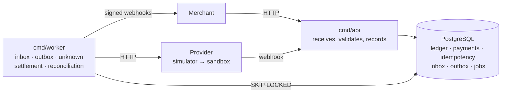
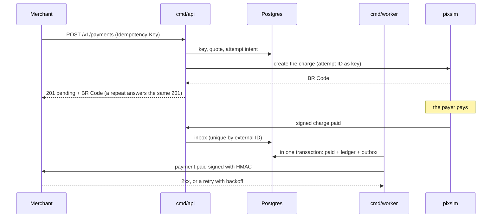

# Cross-border Pay

[](https://github.com/gengibrepower/cross-border-pay/actions/workflows/ci.yml)
[](https://github.com/gengibrepower/cross-border-pay/actions/workflows/nightly.yml)


[](LICENSE)

🇧🇷 [Leia em português](README.pt-BR.md)

**A cross-border payment gateway in Go, built to stay correct under concurrency, duplicates and partial failures.**

A foreign merchant charges in US dollars. A payer in Brazil pays in reais by PIX, boleto or card. The system converts the currency, records every cent in a double-entry ledger and pays the merchant out in dollars.

The one rule that can never break: **the money on record always matches the money that exists**, even when providers time out, events arrive twice or out of order, and workers die halfway through.

> **Learning project, not a real gateway.** Money, customers and payment providers are all simulated. Fees and rates are illustrative. It exists to practice the engineering behind correct financial systems.

## What the project sets out to prove

1. **Idempotency across the whole chain.** API, provider calls, incoming events, outgoing webhooks and jobs. Retrying never charges, posts or pays out twice.
2. **Ledger consistency under concurrency.** Thousands of simultaneous operations, duplicates included, and the ledger still sums to zero per currency.
3. **Dual writes without distributed transactions.** The database and the provider never share a transaction. Intent is recorded first, ambiguous results become `unknown` instead of failures, and inbox/outbox tables carry events in and out.
4. **Tolerance to a hostile outside world.** Providers that lag, duplicate, reorder or vanish, and merchants whose endpoints are down.

## What is proven so far

Every number below is measured, not estimated. Every test that touches the database runs against a **real PostgreSQL 18** in a container (`testcontainers-go`), never a mocked one; domain tests do no I/O at all.

| Test | What it shows | Result |
|---|---|---|
| `TestThousandsOfConcurrentTransfers` | 10 concurrent workers post 5,000 random transfers between 20 accounts in two currencies. Afterwards the database itself is asked whether every invariant holds. | 20/20 runs with `-race -count=20`, i.e. **100,000 concurrent transfers**. The ledger closes at zero per currency every time, and transfers that would overdraw are rejected, never half-applied. |
| `TestLedgerInvariantsAgainstPostgres` | Property-based: random sequences of valid and invalid transactions against Postgres. After every step, balances match an in-memory model. | 100 random sequences per run, 20/20 runs |
| Ledger domain properties | Random transactions keep the invariants in memory, and an unbalanced transaction is always rejected. | 2 properties × 100 cases per run, 20/20 runs |
| FX properties | Conversion is nearest half-even, odd-symmetric and monotonic, and round-trips when the rate is at least 1. A quote's USD legs sum to zero, and with a base rate of at least 1 the rounding account never takes more than one cent. A stored quote reads back exactly as it was computed, without repricing. | 7 properties × 100 cases per run, 20/20 runs |
| `TestTransitionIsExhaustive` | Every (status, event) pair of the payment state machine is checked against section 3.4, written out again inside the test: anything outside the table is `ErrInvalidTransition`, and a repeated event the status already reflects is a no-op. | All 49 pairs, 20/20 runs |
| `TestAuthenticate` | API keys against real Postgres: a malformed key, an unknown one, the right lookup with a wrong secret, the right key with its mode changed, and a revoked key all get the same `401`, so the response does not tell an attacker which part was wrong. | 5 rejection cases, plus a mutation check: a hash comparison that accepts any secret makes it fail |
| Contract tests (`cmd/api`) | Every request and response of `POST /v1/payments`, `GET /v1/payments/{id}`, `GET /v1/payments` and `POST /v1/payments/{id}/cancel` goes through the real handler and a real Postgres and is checked against the hand-written `api/openapi.yaml` with `kin-openapi`. The GameStore payment returns R$ 101.50 with a US$ 0.60 fee and a 30-minute quote, and the `GET` returns byte for byte what the `POST` returned. Walking 7 payments in pages of 3 sees each one exactly once, newest first, and none of another merchant's; another merchant's payment, an unknown ID and a malformed ID all get the same `404`. | `POST`: 1 success and 14 error cases, and no rejected request stores a payment. `GET`: 4 `404`/`401` cases and 6 invalid-parameter cases, each with its stable `code`. 20/20 runs with `-race -count=20`. Changing `id <` to `id <=` in the cursor makes the pagination test fail |
| Idempotency at the store layer (`internal/idempotency`) | The eight cases of section 4.2 against a real Postgres: a stored response replayed as is, a different body rejected, a 4xx kept, a 5xx before any work releases the key, a 5xx after recorded work keeps it, keys of different merchants independent. A key left by a request that died is resumed from where it stopped once the lease ends, and the dead request can no longer complete or release it. The recovery point rolls back with the transaction of whoever wrote it. | 20 concurrent requests with one key: exactly 1 proceeds and 19 get `409`, 20/20 runs with `-race -count=20`. Dropping the `lock_token` from completion or the `recovery_point` from release makes the test for that case fail |
| Idempotency through the API (`POST /v1/payments`) | A retry gets the same 201 byte for byte, marked `Idempotent-Replayed: true`, and no new payment; the same key with another payment is a `422`; a 4xx is stored and replayed; different merchants with the same key create different payments. **Simulated crash:** the request creates the payment and dies before storing its answer; the retry gets `409` while the lease runs and, after it, `201` with that same payment, identical to the `GET`, and the database still holds 1 payment and 1 quote. In the middleware, a 5xx before any work releases the key, and a 5xx after a recovery point keeps it and lets the retry resume at once. | 10 concurrent HTTP requests with one key create exactly 1 payment, 20/20 runs with `-race -count=20`. Making `Create` ignore the recovery point makes the crash test fail |
| Key cleanup (`cmd/worker`) | Every hour, in batches of 1,000, the job deletes keys older than 24 h and nothing younger. With `FOR UPDATE SKIP LOCKED`, a key another transaction has locked is passed over without waiting and deleted on the next round. A failed round is logged and does not stop the worker. | 7 expired keys deleted in batches of 3, 20/20 runs with `-race -count=20`. Dropping `SKIP LOCKED` makes `Cleanup` wait for the lock until its deadline, and the test fails |
| BR Code (`internal/brcode`) | The 5 complete examples of the Banco Central's [Manual de Padrões para Iniciação do Pix v2.10.0](https://www.bcb.gov.br/content/estabilidadefinanceira/pix/Regulamento_Pix/II_ManualdePadroesparaIniciacaodoPix.pdf) parse with their CRC checked, and the encoder reproduces the static and dynamic ones character for character. The CRC16 covers the `6304`, as the manual says; a CRC computed without it is rejected. Field 54 without floats (`10150` ↔ `"101.50"`). | Property test `Parse(Encode(c)) == c`: 100 cases per run, 20/20 runs; 14 invalid payloads and 14 invalid codes rejected, each for the right reason |
| Provider attempts (`payments`) | Every (status, event) pair of the attempt state machine is checked against section 3.5, written out again inside the test; an ambiguous answer never rejects an attempt, and the payment event may arrive before the create response. Against a real Postgres, a payment has at most one live attempt (a partial unique index: only a rejection frees it), and events on one attempt are serialized by a row lock. | All 30 pairs. 20 concurrent creates for one payment leave exactly 1 attempt, and 8 concurrent accept/reject events on one attempt change it exactly once, 25 attempts per run, 20/20 runs with `-race -count=20`. Dropping the `FOR UPDATE` or the index's `WHERE` makes these tests fail |
| PIX simulator (`cmd/pixsim`) | A real HTTP provider with charges in memory and faults on command: `reject`, `fail_before` (500, nothing done), `timeout_after` (the charge is created and the answer never comes) and `delay`. After a `timeout_after`, looking the charge up by our attempt ID finds it, and retrying with the same key returns that same charge. Every BR Code it issues parses with `internal/brcode`. Only an explicit refusal reaches the payments port as `Rejected`; a 500, a timeout or an unknown answer is an error, so the attempt goes to `unknown`. | Same seed and same 50 keys sent concurrently in reverse order give the same charges, byte for byte, as sent one by one; 8 malformed requests refused with `400`. 20/20 runs with `-race -count=20`. 10 mutants killed, among them seeding by arrival order, creating the charge after the hang instead of before, and reading a 500 as a refusal |
| Simulator refunds (`cmd/pixsim`) | A paid charge can be refunded in parts, as a PIX devolução, once per our refund ID: the same key returns the same refund, another amount under it is `idempotency_key_reused`. The simulator holds invariant 8 on its own side: it refuses a refund of an unpaid charge, in another currency or above what is left, and stores the refusal with its reason, so a lookup by our ID finds the same decision. The same faults apply (`refund`, `get_refund`): after a `timeout_after` the money went back and the lookup finds it `completed`. The payments port gains `Refund` and `GetRefund`, with the same rule as attempts: only a refusal is a result, anything else is ambiguous | 50 concurrent refunds of R$ 10.00 on a R$ 101.50 charge: exactly 10 completed. 20/20 runs with `-race -count=20`. 7 mutants killed, among them not checking or not consuming what is left, not storing a refusal, refunding an unpaid charge, accepting a reused key with another amount, a refund ID not derived from its key, and answering a `timeout_after` |
| Simulator events | Paying a charge posts one `charge.paid` event to `PIXSIM_WEBHOOK_URL`, signed with HMAC-SHA256 over the timestamp and the body. `pixsim.VerifyEvent` refuses a tampered body, a wrong secret, a changed timestamp and any signature more than 5 minutes away from now, so a captured delivery cannot be replayed later. The event ID comes from the seed and a redelivery (`/control/events/{id}/deliver`) sends the same bytes signed again, so the receiver can drop duplicates by ID. Paying twice sends nothing new; a webhook that fails does not undo the payment; a payer that gives up does not cut the delivery. The gateway receives them at `POST /v1/providers/pixsim/events` (the inbox, below). | 8 forgeries refused and 5 malformed signed bodies refused, among them a decimal amount. 20/20 runs with `-race -count=20`. 17 mutants killed, among them comparing only the last signature, dropping the timestamp or the body from the MAC, deriving the event ID without the charge key, and delivering with the payer's context |
| PIX attempt on create (`POST /v1/payments`) | Each payment gets its provider attempt and a BR Code that parses for R$ 101.50, identical in the `POST`, the `GET` and the list. A refusal is a `201` with `pix.status: failed`; a timeout after the provider acted, or a `500` from it, is a `201` with `processing` and the attempt in `unknown`, bounded by the 300 ms test timeout. **Crashes at each step:** after the first transaction (attempt `created`) the retry calls the provider once; after `sent` it does not call again and marks `unknown`; after the answer is stored it only replies. A client that disconnects mid-call does not stop it: the attempt still ends `accepted`. | 10 concurrent requests with one key and a retry: 1 provider call, 1 attempt. 20/20 runs with `-race -count=20`. 11 mutants killed, among them calling again from `sent`, dropping `WithoutCancel`, dropping the service's timeout, reading a provider error as a refusal and showing the oldest attempt instead of the latest |
| Unknown resolver (`cmd/worker`) | Ambiguous attempts are looked up at the provider, never created again (decision 17). A charge the provider made while our call timed out ends `accepted` with its BR Code, or `succeeded` if paid meanwhile. Not found is retried during a 1-minute grace and then means `rejected`. A request that died after writing `sent` is picked up once it is a minute stale. Failed lookups wait 5 s, 10 s, 20 s… up to 5 min, and at 24 h the attempt is escalated and never looked up again. A worker that dies holding a claim only delays the attempt until its lease ends. | Backoff: 292 lookups over 24 h, every wait checked. 4 concurrent resolvers over 50 attempts: 50 claims and 50 lookups, one per attempt. 20/20 runs with `-race -count=20`. 10 mutants killed, among them dropping `SKIP LOCKED` (90 lookups for 50 attempts), not pushing the lease (85), rejecting on the first not found and never escalating |
| Inbox (`internal/events`) | The webhook checks the signature, stores the event with the exact bytes and header it came with, and answers `200`, for a duplicate too; only a failure to store asks for a redelivery. A worker claims due events with `FOR UPDATE SKIP LOCKED` and applies each one in the transaction that records its status, so the effect and the status commit together or not at all. `charge.paid` succeeds the attempt it names once the amount matches the quote. One for an attempt not stored yet is retried after 5 s, 10 s, 20 s… up to 5 min, and fails at 24 h; one that contradicts the attempt (another amount or charge ID, a rejected attempt) fails at once and changes nothing. Events of one payment are applied one at a time behind its row lock, and that lock does not wait for a foreign key check. | 100 concurrent deliveries of one event: all `200`, 1 row. 5 refused requests (signature, unreadable, no ID, unknown provider, over 64 KiB), none stored. 4 processors over 50 events: each applied once. 6 divergent events leave the attempt as it was. 20/20 runs with `-race -count=20`. 25 mutants killed, among them dropping `SKIP LOCKED`, the `ON CONFLICT` or the `pending` guard of a late retry, recording the status after the handler failed, stopping the batch at the first error, skipping the amount check, and `FOR UPDATE` in place of `FOR NO KEY UPDATE` |
| `TestThousandConcurrentConfirmationsPostOnce` | Confirmation (`payments` + `ledger`): an attempt that becomes `succeeded`, by the provider's event or by the resolver, moves the payment to `paid` and posts section 3.3's transaction in that same database transaction. 1,000 confirmations of one charge run at once, half through each path. A ledger that cannot post leaves the attempt and the payment as they were; a payment already `paid` is not posted again; each merchant is owed on its own account, created by its first confirmation. Every path locks the payment, then the attempt, then the accounts: a test holds the payment's lock and checks with `NOWAIT` that a waiting confirmation has not taken the attempt's. | **Exactly 1 ledger transaction and 1 `payment.paid` out of 1,000 confirmations**, with the GameStore balances to the cent (R$ 101.50 in, US$ 19.40 owed, US$ 0.60 fee, US$ 0.30 spread), 20/20 runs with `-race -count=20`. Any quote confirms into a balanced transaction with no zero leg: 100 cases per run, 20/20 runs. 50 concurrent first confirmations of one merchant create 1 account. 14 mutants killed, among them locking the attempt before the payment, `FOR KEY SHARE` on the payment, posting a payment already paid, dropping the ledger reference and one payable shared by all merchants |
| Outbox (`payment.paid`) | The confirmation appends `payment.paid` to `outbox_events` in its own transaction (section 4.5), with `payment_version` bumped by the same `UPDATE` that changes the status. The payload is stored as the exact bytes every delivery will send and sign, and validated against the `PaymentEvent` schema in `api/openapi.yaml`; its `payment_id`, `status` and `amount` match the `GET` of the payment. An outbox that refuses the event undoes the attempt, the payment and the ledger posting. Delivery is in the "Webhook delivery" row. | 1 event per payment under the 1,000 concurrent confirmations above, 20/20 runs with `-race -count=20`. 10 mutants killed, among them not appending the event, ignoring the outbox's error, not bumping the version, the stale version in the payload, the payer's BRL amount in `data`, and storing the payload as `jsonb` |
| Expiry (`cmd/worker`) | A job claims pending payments whose quote has expired (`FOR NO KEY UPDATE SKIP LOCKED`, then a 1-minute lease) and asks the provider before deciding: paid on time means confirmed, otherwise expired with `payment.expired` in the outbox. On time is the provider's `paid_at` against the quote's `expires_at`, never when the news reached us, and `confirm` applies the same rule to events, so the job and the event agree whichever comes first. A provider that does not answer decides nothing: the payment waits for the lease. **The race:** the payer pays 2 s before expiry and the event has not arrived when the job runs; the job finds the payment and confirms it, and the event that comes 3 s later is a no-op. Paid 1 s late, by job or by event, it is never confirmed: the money is held for review (next row). | 4 concurrent jobs over 50 payments: each expired once, with one lookup each. 20/20 runs with `-race -count=20`. 17 mutants killed, among them judging lateness by our clock, expiring without asking the provider or after a failed lookup, treating the expiry instant as on time, `Expire` without re-checking status or deadline under the lock, dropping `SKIP LOCKED` and not pushing the lease |
| Cancel (`POST /v1/payments/{id}/cancel`) | A pending payment becomes `canceled` with `payment.canceled` in the outbox. Like the expiry job, the cancel asks the provider first: a payer who already paid while the news was on its way is confirmed and the cancel answers `409 payment_not_cancelable`. A provider that does not answer gets `503 provider_unavailable` and nothing changes. Canceling twice answers `200` with no second event, so no `Idempotency-Key` is needed. Money sent after the cancel is late money: held for review, the payment stays canceled. **The race:** the cancel and an on-time confirmation take the same payment lock, so exactly one wins | `TestCancelAndConfirmationRace`: 400 rounds of cancel × confirmation, 20/20 runs with `-race -count=20`: 356 canceled with the money held, 44 paid with one posting, never both. 3 mutants killed: canceling without asking the provider, reading the status without the lock, a second event on a repeated cancel |
| Refund pricing and postings (`payments`, decision 13) | A refund is priced by the proportion of the original payment: US$ 10.00 of the GameStore returns R$ 50.75 to the payer and US$ 0.15 of the spread. It posts in three steps: the hold takes the refunded dollars from the merchant into "refunds in flight" when the refund is created; the completion sends the reais back from the provider, buys them back at today's base rate and puts the difference into the exchange result (at 5.5000 the gateway gains US$ 0.92, at 4.5000 it loses US$ 1.13); a refusal releases the hold. **The rounding bug it avoids:** rounding each refund on its own, two halves of R$ 101.51 are R$ 50.76 each, R$ 101.52 in all; each share is cumulative instead, what all refunds so far should have returned minus what the earlier ones did, so they add up to the exact total. The refund state machine is every (status, event) pair checked against a table written out again in the test | `TestRefundsOfAnyPaymentAddUp`: 10,000 random payments (rate, spread, fee, amount) with up to 12 refunds each, some refused afterwards: what counts never passes what was paid, every posting balances per currency, and refunding the rest returns exactly the reais and the spread. 20/20 runs with `-race -count=20`. 14 mutants killed, among them rounding each refund on its own (reais or spread), an off-by-one in invariant 8, refusing a full refund, the exchange result with its sign flipped, the cost ignoring today's rate, and an ambiguous answer rejecting a refund |
| Money without a destination (section 4.4) | Money the provider confirmed always enters the ledger; what is in doubt is only where it goes. A payment that cannot confirm its payment (late, another amount, for a rejected attempt, or a second charge) is posted from `provider_receivables:BRL` to `divergence:BRL` and opens a review case in `review_cases` (the `reconciliation` module, in the same transaction). The payment is untouched and the attempt `succeeded` when the state machine allows it. One case per provider charge: its unique key is the first barrier and the ledger's unique reference the second, so the event, the resolver and the expiry job post once together. The amount check now runs in the domain for all three paths; before, only the event compared amounts, and the resolver confirmed any payment the provider reported as paid. An event that cannot be held (another currency) is `failed` and writes nothing: a savepoint undoes what it wrote before, since the inbox commits the failed status. | Paid 1 s late, by job first, by event first and both at once: 1 case and R$ 101.50 held each time, ledger summing to zero per currency. 20 concurrent deliveries of one divergent event: 1 case, 1 posting. Through the worker with the simulator's own event: payment `expired`, attempt `succeeded`, R$ 101.50 on `divergence:BRL`. 20/20 runs with `-race -count=20`. 16 mutants killed, among them posting when the case was already open, dropping the amount check, holding the quoted amount instead of the paid one, no savepoint, the expiry job stopping after settling, and confirming on any change of a succeeded attempt |
| Webhook endpoint and SSRF at registration | `PUT /v1/webhook-endpoint` stores the merchant's URL, refused when it is not `https` or points inside a network: loopback, private ranges, link-local and cloud metadata (`169.254.169.254`, also as `::ffff:169.254.169.254`), CGNAT, reserved ranges, `localhost`/`.internal`/`.local` names and numeric hosts such as `2130706433`, which some resolvers read as `127.0.0.1`. No DNS at registration: a name can resolve elsewhere later, so delivery checks the IP after DNS (row below). The signing secret is not stored: it is derived from a key outside the database, the merchant and a version; rotating is conditional on the current version, so a retried rotation shows the same secret instead of rotating twice. | 35 IPs at the edges of each range and 31 URLs, each under the strict and the development policy. 20 concurrent rotations from one version: 1 rotation, the same secret in all 20 answers. A URL change that read the version before a concurrent rotation does not undo it, forced by holding the change open until the rotation waits on the lock. No `whsec_` in the stored row or the logs. 20/20 runs with `-race -count=20`. 22 mutants killed, among them dropping the merchant's lock, the `::ffff:` unmapping, the private or CGNAT check, the numeric-host check, metadata opened in development, a retried rotation rotating again, and `Cache-Control: no-store` |
| Webhook delivery (`internal/webhooks`) | The worker claims due outbox events with `FOR UPDATE SKIP LOCKED` and a lease (`next_attempt_at` pushed past the timeout + 1 min), commits and only then posts, outside any transaction (section 4.3); the result goes into another short transaction. `attempts` fences the claim: once the lease ran out and another worker took the event, the first can no longer reschedule or fail it, while a 2xx, being a fact, is still recorded. Every post carries `Webhook-Signature: t=…,v1=…` (HMAC-SHA256 of the timestamp and the stored body), with a second `v1` from the previous secret for 24 h after a rotation. Only a 2xx is success: redirects are not followed, and the IP is checked again at `connect`, after DNS, under the same policy as registration. A failure waits a draw from [0, 30 s · 2ⁿ⁻¹], up to 6 h (decision 23), and becomes `failed` 72 h after creation. Each round takes up to 4 events per merchant, merchants with the oldest event first. | **Cited test 4:** the worker is killed mid-way through the second round over 100 events of 5 merchants, with 10 posts received by the merchant and never answered; after the restart and the lease running out, all 100 are delivered, the 10 cut off twice and the other 90 once, and the cut-off ones get no retry or error recorded. 4 workers over 300 events of 10 merchants: each posted once, no bad signature. 13 decision cases, 7 forgeries refused, 10 addresses through the post-DNS check. 20/20 runs with `-race -count=20`. 21 mutants killed, among them dropping `FOR UPDATE SKIP LOCKED`, the per-merchant cap, the `attempts` fence, the lease margin, the 2xx's decoupled context, `CheckRedirect`, the post-DNS check, the timestamp in the MAC and the previous secret's deadline |
| Disabled destination and cleanup (decision 24) | Each round tells each merchant's breaker once: a 2xx ends the run of failures, and a failure 72 h after the first one with no success between disables the endpoint, in one conditional `UPDATE`, so only one of many concurrent failures disables and warns. Disabled, the endpoint gets no post: its events wait with the usual backoff and fail at 72 h, and failures cut short by shutdown do not count. The notice is `GET /v1/webhook-endpoint`, which shows `failing_since`, `disabled_at` and `disabled_reason`, plus an `ERROR` log line for the operator; any `PUT`, with the same URL too, turns it back on. An hourly job deletes, in batches of 1,000 with `SKIP LOCKED`, events delivered more than 30 days ago; `pending` and `failed` stay. The `GET` test found a bug from #32: times read from the database came out in the local zone (`-03:00`); they now come out in UTC (section 4.9). | 20 concurrent failures at the 72 h mark: 1 disables. No post to a disabled destination, and delivery resumes after the `PUT`. A round with 2xx and 500 mixed ends the run. 5 delivered at the cutoff deleted over 3 batches; the one delivered 1 µs after it, the `failed` and the `pending` stay. 20/20 runs with `-race -count=20`. 15 mutants killed, among them `<` instead of `<=` at the mark, every failure restarting the run, a success turning a disabled destination back on, posting to a disabled destination, counting shutdown failures, the cleanup deleting `failed`, a 3-day retention and reading without UTC |
| Events and manual redelivery (`GET /v1/events`, `POST /v1/events/{id}/redeliver`) | The list shows the merchant's events, newest first, with an opaque cursor and a `delivery_status` filter: each with the exact body every delivery sends and where its delivery stands (attempts, next attempt, last status and error). Redelivery works from any status: `failed` is retried, `delivered` sent again, `pending` sent without waiting for its backoff; it answers `202`, with no `Idempotency-Key`, since repeating it only queues the event again. It opens a new retry window: the backoff restarts at 30 s and the 72 h count from it, without resetting `attempts`, which keeps fencing claims. A post in flight before the redelivery cannot push the "now" back to its own backoff. With no endpoint or a disabled one, `409`; another merchant's event, an unknown one or a malformed ID, the same `404`. `evt_`/`pay_`/`att_` now come from one place, `internal/platform/publicid`. | 7 events in pages of 3: each seen once, newest first, none of another merchant's, each `event` equal to the stored bytes. 6 invalid parameters refused. Redelivery from all 3 statuses. An event that failed its whole window (over 20 attempts), redelivered, waits 30 s after its first failure, stays `pending` until 72 h after the redelivery and is delivered. 20/20 runs with `-race -count=20`. 15 mutants killed, among them redelivery not reopening the deadline or not restarting the backoff, dropping the window fence, redelivering another merchant's event, the cursor with `<=`, backoff by the total attempt and rewriting the event's JSON |
| GameStore walkthrough end to end (`e2e/`, section 4.1) | The real `api`, `worker` and `pixsim` as processes, on a database migrated by `cmd/migrate` and a merchant created by `cmd/admin`, over HTTP only. The US$ 20.00 charge comes back with the BR Code for R$ 101.50; repeating it with the same key answers the same bytes; the payer pays through the simulator; the worker confirms, posts to the ledger and delivers `payment.paid`, which the merchant checks by its signature and which matches the charge's `GET`. The provider sending the same event again changes nothing. Deviations: the provider takes the creation and never answers, the attempt stays `processing` and the worker's resolver finds it by its key; a merchant that is down does not delay the other, and a manual redelivery reaches it without waiting for the backoff. At the end all three stop on `SIGTERM` and exit cleanly | 3 walkthroughs in ~18 s, in parallel. 5/5 runs with `-race -count=5`. Ledger summing to zero per currency with 1 posting per paid charge, checked by SQL until the F7 balance API. 0 signatures refused by the merchant. 8 wiring mutants killed: the worker without its resolver, inbox or delivery, signing with another key, the API or the worker ignoring `SIGTERM`, the API without the provider inbox or the event routes |
| `TestEntriesAreImmutable` | Postgres triggers reject `UPDATE`, `DELETE` and `TRUNCATE` on entries and transactions. Corrections are new transactions. | Enforced in the schema itself |

CI runs formatting, a strict `golangci-lint`, `go test -race` with coverage and `govulncheck` on every pull request. A nightly job reruns everything with `-race -count=100`, and the end-to-end walkthrough with `-count=10`.

## Architecture

A **modular monolith** with hexagonal modules: two binaries from one Go module, and one Postgres that is both the source of truth and the queue. No message broker until load proves one is needed.



The API only receives and records. Anything that can fail or take long runs in the worker, coordinated through Postgres. **No network call ever happens inside a database transaction.**

Each module follows `internal/<module>/{domain,app,adapters}`. The domain imports no HTTP, SQL or SDK, never calls `time.Now()` (it takes a `Clock`), and is tested in isolation.

### Reference flow: GameStore

A US$ 20.00 game; base rate 5.0000 BRL/USD; 1.5% spread gives a quoted rate of 5.0750; the payer pays R$ 101.50; the 3% fee is US$ 0.60. On confirmation the ledger posts, in minor units:

```
BRL:  provider receivables   +10150
      FX (BRL)               -10150      BRL sums to 0
USD:  FX (USD)                -2030      (10150 / 5.0000)
      merchant payable        +1940
      fee revenue               +60
      spread revenue            +30      USD sums to 0
```

End to end, the walkthrough `e2e/` runs against the real binaries:




## Key decisions

The full list of 57 closed decisions, with reasoning, is in [docs/escopo.md §11](docs/escopo.md) (Portuguese). These are the ones that shape the system most:

| Decision | Chosen | Discarded, and why |
|---|---|---|
| Architecture | Modular monolith: `api` and `worker` binaries, one Go module | Microservices with a broker from day one: the cost comes before anyone knows where it hurts |
| Queue | Postgres as the queue (`SELECT … FOR UPDATE SKIP LOCKED`) for outbox and jobs | Kafka: too heavy. NATS: only if load tests show a measured reason |
| Money | `int64` minor units + currency type; decimals in JSON are rejected | `float64`: `20.099999` becomes the wrong cent |
| FX rate | Integer scaled by 10⁸, overflow-free intermediate product, half-even rounding, remainder posted to a rounding account | A decimal library: a dependency for something small and fully testable |
| Ledger storage | Postgres behind a `Ledger` interface; balances derived from entries | A custom ledger engine (future project); a cached balance, until load tests justify it |
| Isolation | `READ COMMITTED` + `SELECT … FOR UPDATE` on accounts, locked in ascending ID order to prevent deadlocks | `SERIALIZABLE` with retries: planned as a comparative benchmark |
| Immutability | Ledger entries can never be updated or deleted, enforced by database triggers; corrections are new transactions | Editable rows: an audit trail you cannot trust |
| Idempotency | Keys valid for 24 h; concurrent request with the same key → immediate `409`; successes and 4xx stored, key released on 5xx unless the provider was already called | Blocking the second request until the first finishes: ties up connections under retries |
| Key lock | `INSERT ... ON CONFLICT DO NOTHING` is the lock; the key gets a 30 s lease (`locked_until`) and a `lock_token` only its holder knows | `SELECT` then `INSERT`: two concurrent requests both get through. `SELECT ... FOR UPDATE` for the whole request: a transaction left open across the provider call |
| Stored response | Stored **before** it is sent, with status, body, `Content-Type` and `Location`, on a context the client cannot cancel; a retry gets the original body, including the `request_id` of the request that did the work | Sending first and storing after: if storing fails, the client saw the 201 and the retry gets `409` for 30 s |
| Resuming after a crash | Recovery points: the key stores how far the request got and what it created, written in the same transaction as that work; a retry continues from there | Redoing everything: a request that died after creating the payment yields a second payment, and in F5 a second provider attempt |
| Ambiguous provider result | Attempt goes to `unknown` and is resolved by actively polling the provider (`GetAttempt` with backoff), with events and reconciliation as a safety net | Treating timeouts as failures: the provider may have charged the payer |
| Incoming events | Inbox table: the webhook handler only stores and returns `200`; the worker processes, tolerating duplicates and reordering | Processing inside the handler: provider retries and slow handlers turn into double processing |
| Applying an event | The handler runs inside the transaction that claimed the event and records its status | Two transactions: a crash between them leaves the effect applied with the event still pending, or the event done without its effect |
| Event that cannot be applied | For an attempt not stored yet: retried with backoff, `failed` at 24 h (decision 52). Contradicting what the gateway knows: `failed` at once, for a person. A type nobody handles: `ignored` | Retrying everything: a wrong amount would be retried for a day and never become right |
| Redelivery with another body | The first body stays as the proof; the second goes only to the log | Overwriting: the stored proof would stop being what the provider signed first |
| Payment lock for events | `FOR NO KEY UPDATE`, the lock a plain `UPDATE` takes: events of one payment run one at a time | `FOR UPDATE`: it also waits for the `KEY SHARE` held by every insert of a row that points at the payment, such as a new attempt |
| Where confirmation happens | In the one function that moves attempts, when one becomes `succeeded`: the provider's event and the resolver both pass through it | Only in the event handler: a payment the resolver found would never reach the ledger |
| Lock order | Payment (`FOR NO KEY UPDATE`), then attempt, then ledger accounts ascending, on every path | Each path in its own order: the event locked payment then attempt, and the resolver, once confirming, would lock attempt then payment, which is a deadlock waiting to happen |
| Invariant 7, one confirmation per payment | Two barriers: the payment's lock with the state machine (`paid` + `confirm` is a no-op), and a unique ledger reference `payment:<id>:confirm` that refuses a second post if the first barrier ever breaks | Trusting the status alone: one bug in a path and the money is counted twice |
| Chart of accounts | The gateway's accounts come from a migration with fixed codes; each merchant's payable is created by its first confirmation (`INSERT … ON CONFLICT DO NOTHING`, then `SELECT`) | Creating the payable with the merchant: `merchants` would have to know the ledger, and existing merchants would need a backfill |
| Outbox across modules | `payments` declares an `Outbox` port that takes its transaction; `cmd` plugs in the `events` adapter through a bridge, so neither module imports the other | `payments` importing `events`: a dependency the module table does not have. An outbox table owned by `payments`: the outbox belongs to `events` |
| Stored event | The whole event as `bytea`, exactly the bytes every delivery sends, with an ID from `uuidv7()` taken in the same transaction before the JSON is built | `jsonb`: reorders keys and drops whitespace, so the stored bytes stop being the signed ones. Building the envelope at delivery: the row stops being the event |
| Event ordering | `payments.version`, bumped by the `UPDATE` that changes the status and sent as `payment_version` | Counting events: not every transition will emit one |
| Event format | `PaymentEvent` in `components/schemas` of the OpenAPI 3.0 document, checked against the stored bytes in a contract test | OpenAPI 3.1 `webhooks:`: the right place, but it means migrating the whole document and its validator for one schema |
| What counts as late | The provider's `paid_at` at or after the quote's `expires_at`; a payment without `paid_at` is late | Our processing time: the payer would pay for our queue's delay and the provider's |
| Expiring | Only after the provider says the payment was not made on time; no answer, no decision, retried after the lease | A grace period: makes the race rarer, not impossible. Allowing `expired → paid`: section 3.4 makes `expired` terminal, and the merchant would see a payment come back |
| "Every read checks the deadline" (section 4.6) | Applied to decisions: `confirm` checks `paid_at` even if the job has not run; `GET` shows the stored status | Computing `expired` on read: a payment shown as expired could still be confirmed by the job, a status going backwards |
| Expiry queue | `payments.expiry_check_at`, set to the quote's expiry and used as the lease, with a `CHECK` that only a pending payment has one and a partial index | A `JOIN` with `quotes` every round: no index serves it, so it reads every pending payment |
| Cancel | Asks the provider first, as expiry does, and decides nothing without an answer; no `Idempotency-Key`, because a repeated cancel is a no-op by the state machine | Canceling locally only: a payer who paid on time, with the event still on its way, would have the money held for review instead of the payment confirmed |
| Who pays for a refund | The merchant pays the refunded amount whole: the fee is not returned. The spread returns its share, since the payer gets back the same reais they paid. The gateway absorbs the rate change in the exchange result | Returning the fee too: generous, but fee revenue could go negative. Paying back reais at today's rate: the payer would get a different amount than they paid |
| When a refund leaves the balance | On creation, held on "refunds in flight" until the provider answers; the payment changes status only on success | Posting only on success: the merchant's balance would count money already on its way back |
| Who owns the review queue | The `reconciliation` module (section 2.1), with only `review_cases` for now; payments opens cases through a port bridged in `cmd`, as with the outbox | A table in payments: F9 would need a second queue or a data migration. The inbox's `failed`: it holds no ledger posting, and the expiry job has no event |
| Payment of a closed payment | Late or another amount: the attempt `succeeded` (the provider has the money), the payment untouched, the money held | Undoing everything, as before: the money stayed outside the ledger, and a late event left the attempt halfway |
| Webhook secret | Derived: HMAC-SHA256 of a key kept outside the database (`WEBHOOK_SIGNING_KEY`), the merchant and a version; the table stores only the version | Hashed, as section 6 asked for API keys: a hash cannot sign, and HMAC needs the secret. Encrypted with AES-GCM: the same protection against a dump, with nonce, format and key rotation to get right |
| Retrying a rotation | Conditional on the current version (`rotate_secret_from`): a repeat finds it rotated and shows the same secret | `Idempotency-Key`: the stored answer would hold the secret in plaintext |
| Where the SSRF rule lives | `internal/platform/ssrf`, pure, used by merchants at registration and by webhooks at delivery | Inside webhooks: merchants would import it, against section 2.1. A copy in each: two lists of blocked ranges to keep equal |
| Delivering with no open transaction | Lease: the claim pushes `next_attempt_at` past the timeout + 1 min and bumps `attempts`, commits, and the POST runs outside any transaction; a worker that dies lets the lease run out | Holding `FOR UPDATE` through the POST: network inside the transaction (section 4.3), and a slow merchant holds pool connections |
| Delivery state | Columns on `outbox_events`: one endpoint per merchant, one delivery per event | A `webhook_deliveries` table per attempt: history, but one more join and one more cleanup, only worth it with several endpoints per merchant |
| Per-merchant isolation | In the claim: up to 4 events per merchant per round, merchants with the oldest event first, and a short timeout. The cap holds per worker process | An in-memory semaphore: also per process, and one merchant could take a whole batch. A global cap: counting live leases under a per-merchant advisory lock, once there is more than one worker |
| Webhook signature | `Webhook-Signature: t=…,v1=…`, the simulator's scheme; after a rotation, a second `v1` from the previous secret for 24 h | Standard Webhooks: a second scheme in the repository. Signing with the previous one until the next rotation: a leaked secret that was rotated away would keep working |
| SSRF at delivery | `net.Dialer.Control` checks the resolved IP right before `connect`, with no proxy and no redirects followed | Resolve, check, then connect: the name can answer another IP between the two lookups |
| Delivery order | Not guaranteed: the merchant ignores a `payment_version` below the last one (section 4.5) | Serializing per payment: less throughput for a guarantee the envelope already gives |
| Notice of a disabled destination | The state in `GET /v1/webhook-endpoint` and an `ERROR` log line | A webhook: that is the destination that is down. A notifications table: a channel nobody reads until there is a dashboard. Email: out of scope |
| Turning back on | Any `PUT` of the endpoint, with the same URL too; if it is not fixed, it is disabled again in 72 h | An `enabled` field: a merchant who only fixes the URL forgets it and stays disabled |
| Events of a disabled destination | Wait with the usual backoff, with no post, and fail at 72 h | Filtering in the claim with a `JOIN` on `webhook_endpoints`: the `events` query would read a `merchants` table (section 2.1) |
| Retention of delivered events | 30 days, in batches of 1,000 per hour; never `failed` or `pending` | 7 days: fewer rows, less time for the merchant to look back |
| Manual redelivery | A new 72 h window with the backoff restarting at 30 s, kept in `window_started_at` and `window_first_attempt`; `attempts` never goes back | One attempt only: a separate mode in the worker, and the merchant would have to watch the result. Resetting `attempts`: an old claim would match the fence again |
| Redelivery with nowhere to go | `409` with the reason's code; the merchant does a `PUT` first | Accepting and waiting: a `202` for an event that would fail again in 72 h |
| Body in the event list | The stored bytes, in `event`, next to `delivery` | Flattening event and delivery into one object: it would no longer be the signed body |
| Public IDs across modules | `internal/platform/publicid`, pure, used by `payments` and `webhooks` | Copying the alphabet into each module: two encodings to keep equal forever |
| Development webhooks | `WEBHOOK_ALLOW_PRIVATE` opens private ranges and `http`, never cloud metadata; false by default | Opening them for `sk_test_` keys: a test key in production would open SSRF |
| Testing | Real Postgres in every integration test; determinism only in the provider simulator, controlled by a seed | Mocked database or fully simulated world: loses real lock and isolation bugs |
| API errors | RFC 9457 `application/problem+json` with a stable `code` and the `request_id` that also appears in the logs | A custom error format: one more thing for clients to learn, and a bare status code cannot tell causes apart |
| API keys | `sk_test_`/`sk_live_` + public lookup + 256-bit secret; only the SHA-256 is stored and compared in constant time; the key is printed once by `cmd/admin` | bcrypt/argon2: built for guessable passwords, they would add tens of milliseconds to every request without protecting a random 256-bit secret any better |
| Public IDs | `pay_` + the UUIDv7 in Crockford base32 (26 characters), so IDs sort by creation time as plain strings | Hex: 32 characters for the same information. Exposing the raw UUID: no type prefix to catch a payment ID passed where a refund ID belongs |
| Quotes | A `quotes` table owned by `fx` that stores every computed amount, with `CHECK`s for the identities that make the USD legs sum to zero | Columns inside `payments`: card payments are requoted at authorization (decision 44), so one payment can have more than one quote |
| Pagination | Keyset on `(merchant_id, id)`, newest first, with an opaque cursor in `next_cursor` (`null` on the last page); `limit` from 1 to 100, default 20 | `OFFSET`: slower with every page, and skips or repeats rows when new payments arrive. `starting_after=pay_…`: works, but ties the cursor format to the ID |
| BR Code | Own codec, printable ASCII only; the simulator issues the static code with amount and txid | A third-party library: a dependency for ~380 lines testable against the manual. A dynamic code in the simulator: the amount lives in a signed JSON (JWS) hosted at the URL, unrelated to what F5 proves |
| Provider attempts | Written as `created` before the provider is called, one live attempt per payment enforced by a partial unique index, every change through the state machine under a row lock | Calling first and writing after: a crash mid-call leaves no trace of a payer who may have been charged. Uniqueness checked only in code: two concurrent requests both pass |
| Provider errors | A refusal is a result (`Rejected`); any error, and any result the adapter left unset, moves the attempt to `unknown` | An `ErrAmbiguous` sentinel from the adapter: an error it forgets to wrap would read as a definitive failure, the expensive mistake |
| Provider simulator | Real HTTP server with charges in memory; every random choice comes from a generator seeded by the seed and the idempotency key; failures scripted through `/control/faults`. The client speaks only the simulator's types and a ~60-line translation in `payments` adapts them to the port | An in-process fake: never produces a real timeout. One generator for the whole simulator: concurrent requests would draw in a different order each run. The adapter inside `providers` returning `payments` types: inverts the module dependency of the scope |
| End-to-end test | `api`, `worker` and `pixsim` built with `-race` and run as processes, with Postgres from `testcontainers` and a fake merchant checking every signature; all three stop on `SIGTERM` and must exit cleanly | `docker compose` with a Dockerfile per binary: closer to the deploy, but brings F10 forward and is slower and flakier in CI. Wiring everything in one process: duplicates the `main` wiring and stops testing real config, signals and HTTP |
| PIX txid | Chosen by the simulator (25 characters from the seed) and returned with the charge; our attempt ID travels as the `Idempotency-Key` | Packing the 26-character attempt ID into 25 by dropping the UUIDv7 version and variant bits: lossless, but cleverness with nothing gained |
| Simulator event signature | `Pixsim-Signature: t=<unix>,v1=<hex HMAC-SHA256(secret, t.body)>`, compared with `hmac.Equal` and a 5-minute tolerance; several `v1` allowed, so a secret can rotate | Signing only the body: a captured delivery replays forever. A plain shared token in a header: proves nothing about the body. mTLS: the real provider's job (F9), not the simulator's |
| Writes around the provider call | Payment, quote, attempt `created` and the recovery point in one transaction; `sent` written before the call; the answer written after it. `created` therefore proves the provider was never called, and only `sent` is ambiguous | Not writing `sent`: a crash after the first transaction could not tell "never called" from "maybe called", so every crash would end in `unknown` |
| Create response | Always `201` once the payment exists, with `pix.status` `ready` (with the BR Code), `processing` or `failed`; internal attempt statuses never leak | A `5xx` while `unknown`: clients would retry a request that already did its work. A `422` on refusal: it would hide a payment that exists |
| Claiming provider lookups | `UPDATE … SET next_check_at = now + 1 min WHERE id IN (SELECT … FOR UPDATE SKIP LOCKED)`: the row lock lasts only that short transaction, and the pushed `next_check_at` is a lease that keeps other workers away during the call | `FOR UPDATE` held during the lookup: a transaction open across the network. A separate `claimed_until` column: two columns for what `next_check_at` already does |
| Provider says not found | Treated as ambiguous for 1 minute after the attempt was created, then `rejected`: our create gave up after 5 s, so nothing can still arrive | Calling create again with the same key: the provider would dedupe it, but a QR code appearing minutes after the merchant saw `processing` is behavior nobody asked for |
| HTTP | Standard library `net/http` router; hand-written OpenAPI validated in contract tests | Frameworks and generated code: more to explain, little gained with Go's method+path patterns |

## Status

The plan is split into phases, each with a written definition of done ([docs/escopo.md §12](docs/escopo.md)).

| Phase | Delivers | Status |
|---|---|---|
| F0 | Skeleton, CI, real Postgres in tests | ✅ done |
| F1 | Money and FX: half-even conversion, quotes with spread, fee and expiry | ✅ done |
| F2 | Ledger with invariants under concurrency | ✅ done |
| F3 | Payments, state machine, base API | ✅ done |
| F4 | Idempotency | ✅ done |
| F5 | Simulated PIX, inbox, confirmation | ✅ done |
| F6 | Outbox and webhooks; GameStore end to end over HTTP | ✅ done |
| F7 | Refunds and settlement | ⏳ in progress: cancel and refund pricing done |
| F8 | Card, boleto, chargebacks | planned |
| F9 | Hostile simulator, CNAB 240 reconciliation, Efí sandbox | planned |
| F10 | Public production deploy | planned |

## Run it locally

You need [mise](https://mise.jdx.dev) and Docker. mise pins Go, `golangci-lint`, `sqlc` and `govulncheck` to the exact versions CI uses.

```sh
mise install          # toolchain at pinned versions
mise run test         # go test -race ./... (starts Postgres containers by itself)

mise run db           # local Postgres via docker compose
mise run migrate      # apply embedded migrations
go run ./cmd/admin merchant create -name GameStore -mode test   # prints the API key once
mise run pixsim      # PIX simulator on :8090; PIXSIM_SEED picks the seed (default 1); events go to the API's webhook (PIXSIM_WEBHOOK_URL) signed with PIXSIM_WEBHOOK_SECRET, both set by mise.toml
go run ./cmd/api      # :8080; FX_USD_BRL_RATE sets the base rate (default 5.0000), PIXSIM_URL the simulator (default http://localhost:8090); PIXSIM_WEBHOOK_SECRET verifies its events; WEBHOOK_SIGNING_KEY (at least 32 bytes) derives the merchants' webhook secrets
go run ./cmd/worker   # background jobs: applying inbox events, resolving unknown attempts, expiring payments and delivering webhooks every second (WEBHOOK_TIMEOUT per post, default 5s), deleting idempotency keys older than 24 h and events delivered more than 30 days ago
```

Creating the GameStore payment with the key `cmd/admin` printed:

```sh
curl -s localhost:8080/v1/payments \
  -H "Authorization: Bearer sk_test_..." -H "Idempotency-Key: order-123" \
  -d '{"amount": {"value": 2000, "currency": "USD"}, "method": "pix", "reference": "order-123"}'
# 201: pending, payer pays {"value": 10150, "currency": "BRL"}, fee 60, net 1940, quote valid 30 min,
#      pix {"status": "ready", "br_code": "000201...6304XXXX"}
# The same command again returns the same 201 with Idempotent-Replayed: true, creating nothing

curl -s localhost:8080/v1/payments/pay_... -H "Authorization: Bearer sk_test_..."
curl -s "localhost:8080/v1/payments?limit=20&status=pending" -H "Authorization: Bearer sk_test_..."
# 200: {"data": [...], "next_cursor": null}; pass next_cursor as ?cursor= for the next page
```

Registering the webhook endpoint, and rotating its secret:

```sh
curl -s -X PUT localhost:8080/v1/webhook-endpoint -H "Authorization: Bearer sk_test_..." \
  -d '{"url": "https://gamestore.example/hooks"}'
# 200: {"url": ..., "secret_version": 1, "secret": "whsec_..."}; the secret is shown only here
curl -s -X PUT localhost:8080/v1/webhook-endpoint -H "Authorization: Bearer sk_test_..." \
  -d '{"url": "https://gamestore.example/hooks", "rotate_secret_from": 1}'
# 200: secret_version 2 with its secret; the same command again shows it again without rotating
curl -s localhost:8080/v1/webhook-endpoint -H "Authorization: Bearer sk_test_..."
# 200: without the secret; with disabled_at and disabled_reason if 72 h of only failures stopped deliveries (any PUT turns it back on)
curl -s "localhost:8080/v1/events?delivery_status=failed" -H "Authorization: Bearer sk_test_..."
# 200: {"data": [{"event": {...the body sent...}, "delivery": {"status": "failed", "attempts": 22, ...}}], "next_cursor": null}
curl -s -X POST localhost:8080/v1/events/evt_.../redeliver -H "Authorization: Bearer sk_test_..."
# 202: pending, due now, in a new 72 h window
```

With the worker running, every event reaches that URL with `Webhook-Signature: t=<unix>,v1=<hex>`, the HMAC-SHA256 of `t`, a dot and the body, keyed by the secret; the `PaymentEvent` schema in the OpenAPI describes the body and how to verify it.

The contract is [api/openapi.yaml](api/openapi.yaml).

Other tasks: `mise run lint`, `mise run fmt`, `mise run vuln`, `mise run e2e` (only the end-to-end walkthrough), `mise run test:stress` (the nightly `-count=100` run), `mise run gen` (`sqlc`).

## Repository layout

```
cmd/
  api/        HTTP server
  worker/     background jobs (inbox, unknown attempts, expiry, webhook delivery, cleanups) with graceful shutdown
  migrate/    applies embedded goose migrations
  admin/      operator tasks: create a merchant and its API key, revoke a key
  pixsim/     PIX provider simulator: seed, faults on command, "pay now", signed events
internal/
  money/      Money and Currency in minor units
  brcode/     PIX BR Code: EMV TLV and CRC16, encoder and parser
  fx/         rates, conversion, quotes
  ledger/     double-entry transactions, invariants, Postgres adapter
  merchants/  merchants, API keys (hash only), authentication middleware
  payments/   payment and attempt state machines, creation, HTTP handlers, provider port
  providers/  provider clients and simulators (pixsim)
  idempotency/ idempotency keys: lock, lease, recovery points
  platform/   config, logging, clock, Postgres (WithTx), worker runner, HTTP (RFC 9457 errors, request ID)
api/          openapi.yaml, the hand-written contract
migrations/   SQL migrations, embedded in the binaries
docs/         scope, rules and decisions (Portuguese)
e2e/          GameStore walkthrough against the real binaries
```

## Stack

Go 1.27 · PostgreSQL 18 · `pgx/v5` · `sqlc` · `goose` (as a library) · `log/slog` · `testcontainers-go` · `rapid` (property-based tests) · `golangci-lint` v2 + `gofumpt` · GitHub Actions · mise

## Hosting (planned, F10)

A Linux VM running the same Docker Compose stack, with Caddy for automatic HTTPS, on Azure. Backups with tested restores, CI deploys, OpenTelemetry + Prometheus + Grafana with a public dashboard, k6 load numbers in `docs/benchmarks.md`, and a rate-limited demo account.

## Regulation

Not legal advice. Processing third-party money in Brazil requires Central Bank authorization as a payment institution, which is why no real money is involved here. Taxes (IOF) are at most a configurable fee. KYC/AML is out of scope, though the ledger and inbox audit trails show where it would plug in. No card numbers are stored, only fictitious tokens, and personal data is masked in logs (LGPD minimization).

## Author

**TODO: full name**, Computer Science student at PUCPR (Curitiba, Brazil).

[GitHub](https://github.com/gengibrepower) · TODO: LinkedIn

## License

MIT. See [LICENSE](LICENSE).
