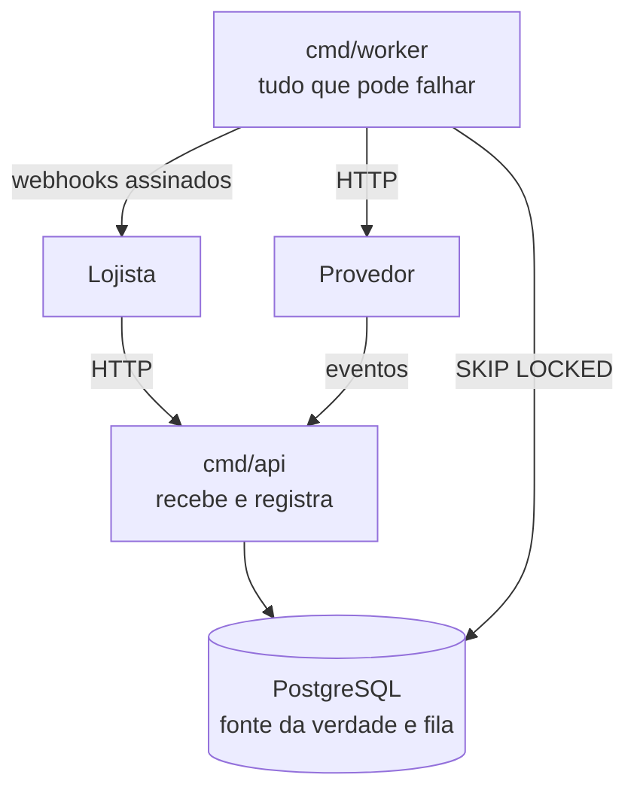
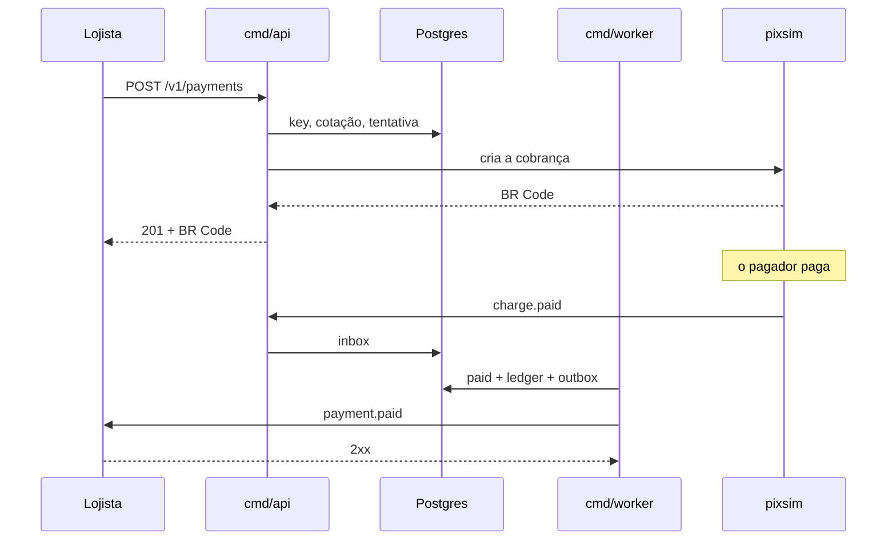

# Cross-border Pay

[](https://github.com/gengibrepower/cross-border-pay/actions/workflows/ci.yml)
[](https://github.com/gengibrepower/cross-border-pay/actions/workflows/nightly.yml)


[](LICENSE)

🇺🇸 [Read in English](README.md)

**Gateway de pagamentos cross-border em Go, feito para continuar correto sob concorrência, duplicidade e falhas parciais.**

Um lojista estrangeiro cobra em dólar. O pagador no Brasil paga em reais por PIX, boleto ou cartão. O sistema converte a moeda, registra cada centavo num ledger de partidas dobradas e repassa ao lojista em dólar.

A regra que nunca pode quebrar: **o dinheiro registrado sempre bate com o dinheiro que existe**, mesmo quando o provedor dá timeout, eventos chegam duplicados ou fora de ordem e workers morrem no meio do caminho.

> **Projeto de aprendizado, não um gateway real.** Dinheiro, clientes e provedores de pagamento são todos simulados. Taxas e cotações são ilustrativas. O projeto existe para praticar a engenharia por trás de sistemas financeiros corretos.

## O que o projeto se propõe a provar

1. **Idempotência em toda a cadeia.** API, chamadas ao provedor, eventos recebidos, webhooks enviados e jobs. Repetir nunca cobra, lança ou repassa duas vezes.
2. **Consistência do ledger sob concorrência.** Milhares de operações simultâneas, com duplicatas, e o ledger continua fechando em zero por moeda.
3. **Escrita dupla sem transação distribuída.** O banco e o provedor nunca participam da mesma transação. A intenção é gravada antes, resultado ambíguo vira `unknown` em vez de falha, e tabelas de inbox e outbox carregam os eventos de entrada e saída.
4. **Tolerância a um mundo externo hostil.** Provedores que atrasam, duplicam, reordenam ou somem, e lojistas com o endpoint fora do ar.

## O que já está provado

Todos os números abaixo são medidos, não estimados. Todo teste que toca o banco roda contra um **PostgreSQL 18 real** em container (`testcontainers-go`), nunca contra um banco mockado; os testes de domínio não fazem I/O nenhum.

| Garantia | Medido |
|---|---|
| O ledger fecha em zero sob concorrência | 100.000 transferências concorrentes, em toda execução |
| Uma cobrança é confirmada uma vez | 1 lançamento em 1.000 confirmações concorrentes |
| Estornos nunca passam do pago | 4.000 pedidos de estorno concorrentes |
| Repetir nunca cobra duas vezes | 10 requests concorrentes, uma key: 1 cobrança |
| Worker morto não perde webhook | 100 eventos, morto no meio da rodada: todos entregues |
| A liquidação paga uma vez | Mesmo corte duas vezes, ou em 8 workers: 1 repasse |

Cada grupo abaixo abre com o que cada teste mostra e o que mediu. As execuções são com `-race -count=20`, salvo quando indicado, e "mutantes mortos" são bugs de propósito que cada teste foi conferido para pegar.

<details>
<summary><b>Ledger e dinheiro</b> · 5 testes</summary>

**`TestThousandsOfConcurrentTransfers`**

10 workers concorrentes lançam 5.000 transferências aleatórias entre 20 contas em duas moedas. No fim, o próprio banco é consultado sobre cada invariante.

**Resultado:** 20/20 rodadas com `-race -count=20`, ou seja, **100.000 transferências concorrentes**. O ledger fecha em zero por moeda em todas, e transferências que estourariam o saldo são rejeitadas, nunca aplicadas pela metade.

---

**`TestLedgerInvariantsAgainstPostgres`**

Teste de propriedade: sequências aleatórias de transações válidas e inválidas contra o Postgres. Depois de cada passo, os saldos batem com um modelo em memória.

**Resultado:** 100 sequências aleatórias por rodada, 20/20 rodadas.

---

**Propriedades do domínio do ledger**

Transações aleatórias mantêm as invariantes em memória, e uma transação desbalanceada é sempre rejeitada.

**Resultado:** 2 propriedades × 100 casos por rodada, 20/20 rodadas.

---

**Propriedades de câmbio**

A conversão é half-even ao mais próximo, simétrica para negativos, monotônica e faz ida e volta quando a taxa é pelo menos 1. As pernas em USD de uma cotação somam zero, e, com taxa base de pelo menos 1, a conta de arredondamento nunca recebe mais de um centavo. Uma cotação gravada é relida exatamente como foi calculada, sem recálculo.

**Resultado:** 7 propriedades × 100 casos por rodada, 20/20 rodadas.

---

**`TestEntriesAreImmutable`**

Triggers do Postgres rejeitam `UPDATE`, `DELETE` e `TRUNCATE` em lançamentos e transações. Correção é nova transação.

**Resultado:** Garantido no próprio esquema.

</details>

<details>
<summary><b>API, autenticação e idempotência</b> · 6 testes</summary>

**`TestTransitionIsExhaustive`**

Cada par (estado, evento) da máquina de estados da cobrança é comparado com a seção 3.4, reescrita dentro do teste: o que está fora da tabela é `ErrInvalidTransition`, e um evento repetido que o estado já reflete é no-op.

**Resultado:** Os 49 pares, 20/20 rodadas.

---

**`TestAuthenticate`**

API keys contra Postgres real: chave malformada, chave desconhecida, lookup certo com segredo errado, chave certa com o modo trocado e chave revogada recebem o mesmo `401`, então a resposta não diz a um atacante qual parte errou.

**Resultado:** 5 casos de recusa, mais um teste de mutação: uma comparação de hash que aceita qualquer segredo faz o teste falhar.

---

**Testes de contrato (`cmd/api`)**

Cada request e resposta de `POST /v1/payments`, `GET /v1/payments/{id}`, `GET /v1/payments`, `POST /v1/payments/{id}/cancel` e `POST /v1/payments/{id}/refunds` passa pelo handler real e por um Postgres real e é conferido contra o `api/openapi.yaml` escrito à mão, com o `kin-openapi`. A cobrança da GameStore devolve R$ 101,50, taxa de US$ 0,60 e cotação de 30 minutos, e o `GET` devolve byte a byte o que o `POST` devolveu. Percorrer 7 cobranças em páginas de 3 vê cada uma exatamente uma vez, da mais nova para a mais antiga, e nenhuma de outro lojista; a cobrança de outro lojista, um ID desconhecido e um ID malformado recebem o mesmo `404`.

**Resultado:** `POST`: 1 caso de sucesso e 14 de erro, e nenhum request recusado grava cobrança. `GET`: 4 casos de `404`/`401` e 6 de parâmetro inválido, cada um com seu `code` estável. 20/20 rodadas com `-race -count=20`. Trocar `id <` por `id <=` no cursor faz o teste de paginação falhar.

---

**Idempotência na camada de store (`internal/idempotency`)**

Os oito casos da seção 4.2 contra Postgres real: resposta guardada devolvida igual, corpo diferente recusado, 4xx guardado, 5xx sem trabalho feito libera a key, 5xx depois de trabalho registrado mantém a key, keys de lojistas diferentes independentes. Uma key largada por um request que morreu é retomada do ponto em que ele parou quando a lease vence, e o request morto não consegue mais concluir nem liberar a key. O ponto de retomada desfaz junto com a transação de quem o gravou.

**Resultado:** 20 requests simultâneos com a mesma key: exatamente 1 segue e 19 recebem `409`, 20/20 rodadas com `-race -count=20`. Tirar o `lock_token` da conclusão ou o `recovery_point` da liberação faz o teste do caso correspondente falhar.

---

**Idempotência pela API (`POST /v1/payments`)**

A repetição recebe o mesmo 201 byte a byte, marcado com `Idempotent-Replayed: true`, e nenhuma cobrança nova; a mesma key com outra cobrança é `422`; um 4xx é guardado e devolvido de novo; lojistas diferentes com a mesma key criam cobranças diferentes. **Queda simulada:** o request cria a cobrança e morre sem guardar a resposta; a repetição recebe `409` enquanto a lease vale e, depois dela, `201` com a mesma cobrança, idêntica ao `GET`, e o banco continua com 1 cobrança e 1 cotação. No middleware, um 5xx sem trabalho feito libera a key, e um 5xx depois de um ponto de retomada a mantém e deixa a repetição retomar na hora.

**Resultado:** 10 requests HTTP simultâneos com a mesma key criam exatamente 1 cobrança, 20/20 rodadas com `-race -count=20`. Fazer o `Create` ignorar o ponto de retomada faz o teste da queda falhar.

---

**Limpeza das keys (`cmd/worker`)**

O job apaga, a cada hora e em lotes de 1.000, as keys com mais de 24 h, e nenhuma mais nova. Com `FOR UPDATE SKIP LOCKED`, uma key travada por outra transação é pulada sem espera e apagada na rodada seguinte. Uma rodada que falha vai para o log e não derruba o worker.

**Resultado:** 7 keys vencidas apagadas em lotes de 3, 20/20 rodadas com `-race -count=20`. Tirar o `SKIP LOCKED` faz o `Cleanup` esperar o lock até estourar o prazo, e o teste falha.

</details>

<details>
<summary><b>PIX e o provedor</b> · 7 testes</summary>

**BR Code (`internal/brcode`)**

Os 5 exemplos completos do [Manual de Padrões para Iniciação do Pix v2.10.0](https://www.bcb.gov.br/content/estabilidadefinanceira/pix/Regulamento_Pix/II_ManualdePadroesparaIniciacaodoPix.pdf) do BC são lidos com o CRC conferido, e o estático e o dinâmico são reproduzidos caractere por caractere pelo gerador. O CRC16 inclui o `6304`, como o manual manda; o CRC calculado sem ele é recusado. Valor no campo 54 sem float (`10150` ↔ `"101.50"`).

**Resultado:** Teste de propriedade `Parse(Encode(c)) == c`: 100 casos por rodada, 20/20 rodadas; 14 payloads e 14 códigos inválidos recusados, cada um pelo motivo certo.

---

**Tentativas no provedor (`payments`)**

Cada par (estado, evento) da máquina de estados da tentativa é comparado com a seção 3.5, reescrita dentro do teste; uma resposta ambígua nunca recusa a tentativa, e o evento de pagamento pode chegar antes da resposta da criação. Contra Postgres real, uma cobrança tem no máximo uma tentativa viva (índice único parcial: só a recusa libera), e os eventos de uma tentativa são serializados por lock de linha.

**Resultado:** Os 30 pares. 20 criações simultâneas para a mesma cobrança deixam exatamente 1 tentativa, e 8 eventos accept/reject simultâneos na mesma tentativa a mudam exatamente uma vez, 25 tentativas por rodada, 20/20 rodadas com `-race -count=20`. Tirar o `FOR UPDATE` ou o `WHERE` do índice faz esses testes falharem.

---

**Simulador PIX (`cmd/pixsim`)**

Um provedor HTTP real, com cobranças em memória e falhas sob comando: `reject`, `fail_before` (500 sem fazer nada), `timeout_after` (a cobrança é criada e a resposta nunca chega) e `delay`. Depois de um `timeout_after`, a busca pelo ID da nossa tentativa encontra a cobrança, e repetir com a mesma key devolve essa mesma cobrança. Todo BR Code emitido é lido pelo `internal/brcode`. Só a recusa explícita chega à porta de pagamentos como `Rejected`; um 500, um timeout ou uma resposta desconhecida é erro, e a tentativa vai para `unknown`.

**Resultado:** Mesma seed e as mesmas 50 keys enviadas em paralelo e em ordem inversa geram as mesmas cobranças, byte a byte, que enviadas uma a uma; 8 requests malformados recusados com `400`. 20/20 rodadas com `-race -count=20`. 10 mutantes mortos, entre eles semear pela ordem de chegada, criar a cobrança depois do travamento em vez de antes e ler um 500 como recusa.

---

**Devoluções no simulador (`cmd/pixsim`)**

Uma cobrança paga pode ser devolvida em partes, como uma devolução PIX, uma vez por ID do nosso estorno: a mesma key devolve o mesmo estorno, e outro valor com ela é `idempotency_key_reused`. O simulador mantém a invariante 8 do lado dele: recusa devolver cobrança não paga, em outra moeda ou acima do que resta, e guarda a recusa com o motivo, então a consulta pelo nosso ID encontra a mesma decisão. As mesmas falhas valem (`refund`, `get_refund`): depois de um `timeout_after` o dinheiro voltou e a consulta o encontra `completed`. A porta de pagamentos ganha `Refund` e `GetRefund`, com a mesma regra das tentativas: só a recusa é resultado, o resto é ambíguo.

**Resultado:** 50 devoluções simultâneas de R$ 10,00 numa cobrança de R$ 101,50: exatamente 10 concluídas. 20/20 rodadas com `-race -count=20`. 7 mutantes mortos, entre eles não conferir ou não consumir o que resta, não guardar a recusa, devolver cobrança não paga, aceitar key repetida com outro valor, ID de devolução que não sai da key e responder a um `timeout_after`

---

**Eventos do simulador**

Pagar uma cobrança envia um evento `charge.paid` para `PIXSIM_WEBHOOK_URL`, assinado com HMAC-SHA256 sobre o timestamp e o corpo. O `pixsim.VerifyEvent` recusa corpo adulterado, segredo errado, timestamp trocado e qualquer assinatura a mais de 5 minutos de agora, então uma entrega capturada não pode ser reenviada depois. O ID do evento sai da seed, e a reentrega (`/control/events/{id}/deliver`) manda os mesmos bytes assinados de novo, para que o receptor descarte duplicatas pelo ID. Pagar duas vezes não envia nada novo; um webhook que falha não desfaz o pagamento; um pagador que desiste não corta a entrega. O gateway os recebe em `POST /v1/providers/pixsim/events` (o inbox, abaixo).

**Resultado:** 8 falsificações recusadas e 5 corpos assinados malformados recusados, entre eles um valor decimal. 20/20 rodadas com `-race -count=20`. 17 mutantes mortos, entre eles comparar só a última assinatura, tirar o timestamp ou o corpo do MAC, derivar o ID do evento sem a key da cobrança e entregar com o contexto do pagador.

---

**Tentativa PIX na criação (`POST /v1/payments`)**

Cada cobrança ganha sua tentativa no provedor e um BR Code que é lido como R$ 101,50, idêntico no `POST`, no `GET` e na lista. Uma recusa é `201` com `pix.status: failed`; um timeout depois de o provedor agir, ou um `500` dele, é `201` com `processing` e a tentativa em `unknown`, limitado pelo timeout de 300 ms do teste. **Quedas em cada passo:** depois da primeira transação (tentativa `created`), a repetição chama o provedor uma vez; depois de `sent`, não chama de novo e marca `unknown`; depois da resposta gravada, só responde. Um cliente que desconecta no meio da chamada não a interrompe: a tentativa termina `accepted`.

**Resultado:** 10 requests simultâneos com a mesma key e uma repetição: 1 chamada ao provedor, 1 tentativa. 20/20 rodadas com `-race -count=20`. 11 mutantes mortos, entre eles chamar de novo a partir de `sent`, tirar o `WithoutCancel`, tirar o timeout do serviço, ler erro do provedor como recusa e mostrar a tentativa mais antiga em vez da mais recente.

---

**Resolvedor de `unknown` (`cmd/worker`)**

Tentativas ambíguas são consultadas no provedor, nunca criadas de novo (decisão 17). Uma cobrança que o provedor criou enquanto a nossa chamada estourava o tempo termina `accepted` com o BR Code, ou `succeeded` se foi paga no meio-tempo. "Não encontrada" é repetida durante 1 minuto de carência e depois vira `rejected`. Um request que morreu depois de gravar `sent` é retomado quando passa 1 minuto parado. Consultas que falham esperam 5 s, 10 s, 20 s… até 5 min, e às 24 h a tentativa é escalada e não é mais consultada. Um worker que morre segurando uma tentativa só a atrasa até a lease vencer.

**Resultado:** Backoff: 292 consultas ao longo de 24 h, cada espera conferida. 4 resolvedores simultâneos sobre 50 tentativas: 50 reivindicações e 50 consultas, uma por tentativa. 20/20 rodadas com `-race -count=20`. 10 mutantes mortos, entre eles tirar o `SKIP LOCKED` (90 consultas para 50 tentativas), não empurrar a lease (85), recusar no primeiro "não encontrada" e nunca escalar.

</details>

<details>
<summary><b>Inbox, confirmação e outbox</b> · 3 testes</summary>

**Inbox (`internal/events`)**

O webhook confere a assinatura, grava o evento com os bytes e o cabeçalho exatos com que chegou e responde `200`, também para duplicata; só uma falha ao gravar pede reentrega. Um worker reivindica os eventos vencidos com `FOR UPDATE SKIP LOCKED` e aplica cada um na transação que grava o seu status, então o efeito e o status entram juntos ou não entram. O `charge.paid` leva a tentativa que ele nomeia a `succeeded` quando o valor bate com a cotação. Um para tentativa ainda não gravada é repetido após 5 s, 10 s, 20 s… até 5 min, e falha em 24 h; um que contradiz a tentativa (outro valor ou outro ID de cobrança, tentativa recusada) falha na hora e não muda nada. Eventos de um mesmo pagamento são aplicados um por vez atrás do lock da linha dele, e esse lock não espera a checagem de chave estrangeira.

**Resultado:** 100 entregas concorrentes do mesmo evento: todas `200`, 1 linha. 5 requests recusados (assinatura, ilegível, sem ID, provedor desconhecido, acima de 64 KiB), nenhum gravado. 4 processadores sobre 50 eventos: cada um aplicado 1 vez. 6 eventos divergentes deixam a tentativa como estava. 20/20 rodadas com `-race -count=20`. 25 mutantes mortos, entre eles tirar o `SKIP LOCKED`, o `ON CONFLICT` ou a guarda de `pending` do retry atrasado, gravar o status depois de o handler falhar, parar o lote no primeiro erro, pular a checagem de valor e usar `FOR UPDATE` no lugar de `FOR NO KEY UPDATE`

---

**`TestThousandConcurrentConfirmationsPostOnce`**

Confirmação (`payments` + `ledger`): uma tentativa que vira `succeeded`, pelo evento do provedor ou pelo resolvedor, leva a cobrança a `paid` e lança a transação da seção 3.3 nessa mesma transação de banco. 1.000 confirmações da mesma cobrança rodam ao mesmo tempo, metade por cada caminho. Um ledger que não consegue lançar deixa a tentativa e a cobrança como estavam; uma cobrança já `paid` não é lançada de novo; cada lojista tem a sua própria conta a receber, criada na primeira confirmação dele. Todo caminho trava a cobrança, depois a tentativa, depois as contas: um teste segura o lock da cobrança e confere com `NOWAIT` que a confirmação que espera não pegou o da tentativa.

**Resultado:** **Exatamente 1 transação contábil e 1 `payment.paid` para 1.000 confirmações**, com os saldos do GameStore ao centavo (R$ 101,50 de entrada, US$ 19,40 devidos, US$ 0,60 de taxa, US$ 0,30 de spread), 20/20 rodadas com `-race -count=20`. Qualquer cotação confirma numa transação balanceada e sem perna zerada: 100 casos por rodada, 20/20 rodadas. 50 primeiras confirmações concorrentes de um lojista criam 1 conta. 14 mutantes mortos, entre eles travar a tentativa antes da cobrança, `FOR KEY SHARE` na cobrança, lançar cobrança já paga, tirar a referência do ledger e uma conta a receber única para todos os lojistas.

---

**Outbox (`payment.paid`)**

A confirmação grava `payment.paid` em `outbox_events` na própria transação (seção 4.5), com o `payment_version` incrementado pelo mesmo `UPDATE` que muda o status. O payload é guardado com os bytes exatos que toda entrega vai enviar e assinar, e validado contra o schema `PaymentEvent` do `api/openapi.yaml`; o `payment_id`, o `status` e o `amount` dele batem com o `GET` da cobrança. Uma outbox que recusa o evento desfaz a tentativa, a cobrança e o lançamento. A entrega está na linha "Entrega de webhooks".

**Resultado:** 1 evento por cobrança sob as 1.000 confirmações concorrentes acima, 20/20 rodadas com `-race -count=20`. 10 mutantes mortos, entre eles não gravar o evento, ignorar o erro da outbox, não incrementar a versão, a versão antiga no payload, o valor em BRL do pagador no `data` e guardar o payload como `jsonb`

</details>

<details>
<summary><b>Expiração, cancelamento e dinheiro atrasado</b> · 3 testes</summary>

**Expiração (`cmd/worker`)**

Um job reivindica cobranças pendentes com cotação vencida (`FOR NO KEY UPDATE SKIP LOCKED`, depois uma lease de 1 minuto) e consulta o provedor antes de decidir: paga em dia vira confirmada; senão, expirada com `payment.expired` na outbox. Em dia é o `paid_at` do provedor contra o `expires_at` da cotação, nunca a hora em que a notícia chegou, e o `confirm` aplica a mesma regra aos eventos, então o job e o evento concordam, chegue quem chegar primeiro. Um provedor que não responde não decide nada: a cobrança espera a lease. **A corrida:** o pagador paga 2 s antes de vencer e o evento ainda não chegou quando o job roda; o job acha o pagamento e confirma, e o evento que chega 3 s depois é no-op. Pago 1 s atrasado, pelo job ou pelo evento, nunca é confirmado: o dinheiro fica retido para revisão (próxima linha).

**Resultado:** 4 jobs simultâneos sobre 50 cobranças: cada uma expirada 1 vez, com uma consulta cada. 20/20 rodadas com `-race -count=20`. 17 mutantes mortos, entre eles julgar o atraso pelo nosso relógio, expirar sem consultar o provedor ou depois de uma consulta que falhou, tratar o instante de vencimento como em dia, `Expire` sem reconferir status ou prazo sob o lock, tirar o `SKIP LOCKED` e não empurrar a lease.

---

**Cancelamento (`POST /v1/payments/{id}/cancel`)**

Uma cobrança pendente vira `canceled` com `payment.canceled` na outbox. Como o job de expiração, o cancelamento consulta o provedor antes: um pagador que já pagou enquanto a notícia vinha a caminho é confirmado, e o cancelamento responde `409 payment_not_cancelable`. Provedor que não responde dá `503 provider_unavailable` e nada muda. Cancelar duas vezes responde `200` sem segundo evento, então não precisa de `Idempotency-Key`. Dinheiro enviado depois do cancelamento é dinheiro atrasado: retido para revisão, e a cobrança continua cancelada. **A corrida:** o cancelamento e uma confirmação em dia disputam o mesmo lock da cobrança, então exatamente um vence.

**Resultado:** `TestCancelAndConfirmationRace`: 400 rodadas de cancelamento × confirmação, 20/20 execuções com `-race -count=20`: 356 canceladas com o dinheiro retido, 44 pagas com um lançamento, nunca os dois. 3 mutantes mortos: cancelar sem consultar o provedor, ler o status sem o lock, um segundo evento num cancelamento repetido.

---

**Dinheiro sem destino (seção 4.4)**

Dinheiro confirmado pelo provedor entra sempre no ledger; a dúvida é só para onde. Um pagamento que não pode confirmar a cobrança (atrasado, com outro valor, numa tentativa recusada ou numa segunda cobrança) é lançado de `provider_receivables:BRL` para `divergence:BRL` e abre um caso de revisão em `review_cases` (módulo `reconciliation`, na mesma transação). A cobrança não muda, e a tentativa vira `succeeded` quando a máquina de estados permite. Um caso por cobrança no provedor: a chave única é a primeira barreira e a referência única do ledger a segunda, então o evento, o resolvedor e o job de expiração lançam uma vez só, juntos. A conferência de valor agora roda no domínio para os três caminhos; antes, só o evento comparava valores, e o resolvedor confirmava qualquer pagamento que o provedor dissesse estar pago. Um evento que não pode ser retido (outra moeda) fica `failed` e não grava nada: um savepoint desfaz o que ele gravou antes, já que o inbox commita o status de falha.

**Resultado:** Pago 1 s atrasado, com o job primeiro, com o evento primeiro e com os dois ao mesmo tempo: 1 caso e R$ 101,50 retidos em cada um, com o ledger fechando em zero por moeda. 20 entregas simultâneas do mesmo evento divergente: 1 caso, 1 lançamento. Pelo worker com o evento do próprio simulador: cobrança `expired`, tentativa `succeeded`, R$ 101,50 em `divergence:BRL`. 20/20 rodadas com `-race -count=20`. 16 mutantes mortos, entre eles lançar com o caso já aberto, tirar a conferência de valor, reter o valor cotado em vez do pago, tirar o savepoint, o job de expiração parar depois de liquidar e confirmar a cada mudança de uma tentativa já `succeeded`

</details>

<details>
<summary><b>Estornos e liquidação</b> · 5 testes</summary>

**Valores e lançamentos do estorno (`payments`, decisão 13)**

O estorno sai pela proporção da cobrança original: US$ 10,00 da GameStore devolvem R$ 50,75 ao pagador e US$ 0,15 do spread. Ele lança em três passos: a reserva tira os dólares estornados do lojista para "estornos em andamento" quando o estorno é criado; a conclusão devolve os reais do provedor, recompra-os pela taxa base do dia e põe a diferença no resultado cambial (a 5,5000 o gateway ganha US$ 0,92, a 4,5000 perde US$ 1,13); a recusa libera a reserva. **O bug de arredondamento evitado:** arredondando cada estorno sozinho, duas metades de R$ 101,51 dão R$ 50,76 cada, R$ 101,52 no total; em vez disso cada parcela é cumulativa, o que todos os estornos até aqui deveriam ter devolvido menos o que os anteriores devolveram, e a soma fecha no total exato. A máquina de estados do estorno tem cada par (status, evento) conferido contra uma tabela escrita de novo no teste.

**Resultado:** `TestRefundsOfAnyPaymentAddUp`: 10.000 cobranças aleatórias (taxa, spread, tarifa, valor) com até 12 estornos cada, alguns recusados depois: o que conta nunca passa do pago, todo lançamento soma zero por moeda, e estornar o resto devolve exatamente os reais e o spread. 20/20 rodadas com `-race -count=20`. 14 mutantes mortos, entre eles arredondar cada estorno sozinho (reais ou spread), um erro de um centavo na invariante 8, recusar o estorno total, o resultado cambial com o sinal trocado, o custo ignorando a taxa do dia e uma resposta ambígua recusando o estorno.

---

**`TestConcurrentPartialRefundsNeverExceedThePayment` (`POST /v1/payments/{id}/refunds`)**

Invariante 8 pela API inteira: o estorno trava a cobrança (`FOR NO KEY UPDATE`), soma os estornos que ainda contam (todos menos os recusados), calcula o novo e lança a reserva numa só transação; o provedor é chamado depois do commit, e a resposta lança o dinheiro devolvido ou libera a reserva, levando a cobrança a `partially_refunded` ou `refunded` com `refund.succeeded` ou `refund.failed` na outbox. 40 estornos de valores aleatórios atingem uma cobrança paga ao mesmo tempo, por HTTP, cada um com sua `Idempotency-Key`. Recusa do provedor é `201` com `failed` e a reserva volta ao lojista; timeout deixa o estorno `pending` com a reserva mantida; repetir com a mesma key devolve a mesma resposta; um request que morreu depois da primeira transação retoma sem chamar o provedor duas vezes, e depois de `sent` não chama nenhuma.

**Resultado:** **4.000 pedidos de estorno simultâneos** (5 cobranças × 40 por rodada, 20/20 rodadas com `-race -count=20`): nunca mais de US$ 20,00 ou R$ 101,50 estornados por cobrança, todo estorno aceito pelo gateway foi concluído no provedor, e toda recusa continuaria sem caber no que sobrou. No fim os livros fecham no centavo: nada em andamento, o lojista devolve exatamente o estornado, o provedor fica com o que não voltou. 11 mutantes mortos, entre eles calcular sem o lock da cobrança, contar só os estornos concluídos ou também os recusados, nunca chegar a `refunded`, não lançar a reserva ou a liberação, retomar criando um segundo estorno, chamar de novo depois de `sent` e ler timeout como recusa.

---

**Resolvedor de estornos (`cmd/worker`, decisão 17)**

Um estorno sem resposta não espera o lojista repetir o request: a mesma fila das tentativas (`next_check_at` como agenda e lease, `SKIP LOCKED`) termina o que o request deixou. `created` parado há 1 min, de um request que morreu antes de chamar o provedor, é enviado, e só por quem o move para `sent`, então worker e request repetido nunca chamam o provedor os dois. `sent` parado vira `unknown`, nunca é enviado de novo; `unknown` é consultado com o backoff das tentativas. "Não encontrado" só recusa o estorno depois de 1 min da última mudança, não da criação: um estorno enviado tarde pode estar chegando agora. Recusado, a reserva volta ao lojista com `refund.failed`; concluído, lança como o request lançaria, com `refund.succeeded`. Sem resposta em 24 h, vai para uma pessoa com a reserva mantida.

**Resultado:** 8 testes contra o simulador e o Postgres, 20/20 rodadas com `-race -count=20`. 10 mutantes mortos, entre eles enviar mesmo tendo perdido a corrida para `sent`, contar a carência desde a criação, recusar em qualquer erro de consulta, não enfileirar o `created`, não reiniciar a agenda na mudança de status e nunca escalar.

---

**Liquidação diária (`cmd/worker`, seção 4.7, decisões 20 e 25)**

Uma vez por lojista e data de corte em `America/Sao_Paulo`, o disponível vira repasse em USD: sai de `merchant_payable` para `settlements_paid`, e as cobranças que ficaram disponíveis apontam para a liquidação, cada uma em exatamente uma. PIX pago no dia local P fica disponível em P+1 (boleto P+2, cartão P+30, dias corridos). O disponível é o saldo da obrigação menos o que ainda está pendente, cada cobrança pendente pelo seu líquido menos os estornos que contam; então um estorno de cobrança pendente sai dela, e um de cobrança já liquidada sai do próximo repasse. Disponível negativo não paga nada e espera mais dinheiro. A transação trava primeiro as cobranças e depois a obrigação, a ordem de todo caminho, e com a obrigação travada nada mais lança nela; `UNIQUE (merchant_id, cutoff_date)` faz a segunda rodada não pagar nada.

**Resultado:** **Critério da F7**: rodar o mesmo corte duas vezes, ou com 8 workers ao mesmo tempo, gera um repasse só. Um modelo de 4 rodadas × 6 dias com cobranças e estornos aleatórios antes e depois de cada corte confere cada repasse no centavo e com as cobranças certas; 4 workers liquidando enquanto cobranças são confirmadas e estornadas terminam com tudo pago uma vez e a obrigação em zero. 20/20 rodadas com `-race -count=20`. 11 mutantes mortos, entre eles ignorar o pendente, disponibilidade um dia antes ou depois, corte em UTC, pendente sem os estornos ou com os recusados, pagar disponível negativo, listar de novo cobranças liquidadas e travar a obrigação antes das cobranças (deadlock)

---

**Saldo e liquidações (`GET /v1/balance`, `GET /v1/settlements`)**

O saldo divide a obrigação do lojista como o job de liquidação faria naquele momento: pendente é o líquido das cobranças ainda não disponíveis menos os estornos delas, disponível é o resto, negativo depois de um estorno de dinheiro liquidado maior do que o que entrou desde então; reservado é zero até a reserva da F8. As duas somas saem de um snapshot `REPEATABLE READ` sem a trava da obrigação, então uma leitura nunca espera uma confirmação nem segura uma liquidação. A lista mostra as liquidações do corte mais novo para o mais antigo, cada uma com suas cobranças, lidas no mesmo snapshot da página; o cursor é a data de corte, única por lojista, sobre o índice `UNIQUE (merchant_id, cutoff_date)`; as cobranças vêm de um novo índice parcial em `payments.settlement_id` (migration 00020)

**Resultado:** Saldo conferido em 9 pontos ao longo de 3 dias de São Paulo, entre eles 23:30 local, quando a data em UTC já virou, sempre somando a obrigação. 3 liquidações em páginas de 1: cada uma vista uma vez, da mais nova para a mais antiga, com o mesmo valor e as mesmas cobranças gravadas, nenhuma de outro lojista liquidado nas mesmas rodadas. 5 parâmetros inválidos e 2 `401`. 20/20 rodadas com `-race -count=20`. 11 mutantes mortos, entre eles disponível sem o pendente, disponibilidade um dia antes ou depois, corte em UTC, cursor com `<=`, lista sem o filtro de lojista, as cobranças de todas as liquidações e erro para lojista ainda sem obrigação.

</details>

<details>
<summary><b>Webhooks</b> · 4 testes</summary>

**Endpoint de webhook e SSRF no cadastro**

`PUT /v1/webhook-endpoint` guarda a URL do lojista, recusada quando não é `https` ou aponta para dentro de uma rede: loopback, faixas privadas, link-local e metadados de cloud (`169.254.169.254`, também como `::ffff:169.254.169.254`), CGNAT, faixas reservadas, nomes `localhost`/`.internal`/`.local` e hosts numéricos como `2130706433`, que alguns resolvedores leem como `127.0.0.1`. Sem DNS no cadastro: o nome pode passar a resolver para outro lugar, então a entrega confere o IP depois do DNS (linha abaixo). O segredo de assinatura não é guardado: é derivado de uma chave fora do banco, do lojista e de uma versão; a rotação é condicionada à versão atual, então uma rotação repetida mostra o mesmo segredo em vez de rotacionar duas vezes.

**Resultado:** 35 IPs nas bordas de cada faixa e 31 URLs, cada um sob a política estrita e a de desenvolvimento. 20 rotações simultâneas a partir da mesma versão: 1 rotação, o mesmo segredo nas 20 respostas. Uma troca de URL que leu a versão antes de uma rotação concorrente não a desfaz, forçado segurando a troca aberta até a rotação esperar no lock. Nenhum `whsec_` na linha guardada nem nos logs. 20/20 rodadas com `-race -count=20`. 22 mutantes mortos, entre eles tirar o lock do lojista, o desmapeamento `::ffff:`, a checagem de faixa privada ou de CGNAT, a de host numérico, abrir metadados em desenvolvimento, a rotação repetida rotacionar de novo e o `Cache-Control: no-store`

---

**Entrega de webhooks (`internal/webhooks`)**

O worker reivindica os eventos vencidos da outbox com `FOR UPDATE SKIP LOCKED` e uma lease (`next_attempt_at` empurrado para depois do timeout + 1 min), faz commit e só então posta, fora de qualquer transação (seção 4.3); o resultado entra em outra transação curta. `attempts` cerca a reivindicação: depois que a lease venceu e outro worker pegou o evento, a primeira não consegue mais reagendar nem desistir dele, e um 2xx, que é fato, ainda é gravado. Cada post leva `Webhook-Signature: t=…,v1=…` (HMAC-SHA256 do timestamp e do corpo guardado), com um segundo `v1` do segredo anterior por 24 h depois de uma rotação. Só 2xx é sucesso: redirect não é seguido, e o IP é conferido de novo no `connect`, depois do DNS, pela mesma política do cadastro. Falha espera um sorteio em [0, 30 s · 2ⁿ⁻¹], até 6 h (decisão 23), e vira `failed` 72 h depois da criação. Cada rodada pega até 4 eventos por lojista, os lojistas com evento mais antigo primeiro.

**Resultado:** **Teste citado 4:** o worker é morto no meio da segunda rodada de 100 eventos de 5 lojistas, com 10 posts recebidos pelo lojista e não respondidos; depois do reinício e do fim da lease, os 100 são entregues, os 10 cortados duas vezes e os outros 90 uma vez, e os cortados não ganham retry nem erro registrado. 4 workers sobre 300 eventos de 10 lojistas: cada um postado 1 vez, nenhuma assinatura inválida. 13 casos de decisão, 7 falsificações recusadas, 10 endereços na checagem pós-DNS. 20/20 rodadas com `-race -count=20`. 21 mutantes mortos, entre eles tirar o `FOR UPDATE SKIP LOCKED`, o limite por lojista, a cerca de `attempts`, a margem da lease, o contexto desacoplado do 2xx, o `CheckRedirect`, a checagem pós-DNS, o timestamp do MAC e o prazo do segredo anterior.

---

**Destino desativado e limpeza (decisão 24)**

Cada rodada informa o breaker de cada lojista uma vez: um 2xx encerra a sequência de falhas, e uma falha 72 h depois da primeira sem sucesso no meio desativa o endpoint, num único `UPDATE` condicional, então só uma de muitas falhas simultâneas desativa e avisa. Desativado, o endpoint não recebe post: os eventos esperam com o backoff normal e falham em 72 h, e falhas cortadas pelo shutdown não contam. O aviso é o `GET /v1/webhook-endpoint`, que mostra `failing_since`, `disabled_at` e `disabled_reason`, e uma linha `ERROR` no log para o operador; qualquer `PUT`, com a mesma URL também, reativa. Um job horário apaga, em lotes de 1.000 com `SKIP LOCKED`, os eventos entregues há mais de 30 dias; `pending` e `failed` ficam. O teste do `GET` achou um bug do #32: os horários lidos do banco saíam no fuso local (`-03:00`), e agora saem em UTC (seção 4.9).

**Resultado:** 20 falhas simultâneas na marca de 72 h: 1 desativa. Nenhum post a um destino desativado, e a entrega volta depois do `PUT`. Uma rodada com 2xx e 500 misturados encerra a sequência. 5 entregues no corte apagados em 3 lotes; o entregue 1 µs depois do corte, o `failed` e o `pending` ficam. 20/20 rodadas com `-race -count=20`. 15 mutantes mortos, entre eles `<` no lugar de `<=` na marca, cada falha reiniciar a sequência, um sucesso reativar um destino desativado, postar em destino desativado, contar falhas do shutdown, a limpeza apagar `failed`, a retenção de 3 dias e ler sem UTC.

---

**Eventos e reentrega manual (`GET /v1/events`, `POST /v1/events/{id}/redeliver`)**

A lista mostra os eventos do lojista, do mais novo para o mais antigo, com cursor opaco e filtro `delivery_status`: cada um com o corpo exato que toda entrega envia e onde a entrega dele está (tentativas, próxima tentativa, último status e erro). A reentrega vale para qualquer status: `failed` é tentado de novo, `delivered` é enviado de novo, `pending` sai sem esperar o backoff; responde `202`, sem `Idempotency-Key`, porque repetir só reenfileira. Ela abre uma janela nova de retry: o backoff recomeça em 30 s e as 72 h contam dela, sem zerar o `attempts`, que continua cercando a reivindicação. Um post em voo antes da reentrega não consegue empurrar o "agora" para o backoff dele. Sem endpoint ou com o endpoint desativado, `409`; evento de outro lojista, desconhecido ou com ID malformado, o mesmo `404`. O `evt_`/`pay_`/`att_` agora vêm de um só lugar, `internal/platform/publicid`.

**Resultado:** 7 eventos em páginas de 3: cada um visto 1 vez, do mais novo para o mais antigo, nenhum de outro lojista, cada `event` igual aos bytes guardados. 6 parâmetros inválidos recusados. Reentrega a partir dos 3 status. Um evento que falhou a janela inteira (mais de 20 tentativas) reentregue espera 30 s na primeira falha, continua `pending` até 72 h depois da reentrega e é entregue. 20/20 rodadas com `-race -count=20`. 15 mutantes mortos, entre eles a reentrega não reabrir o prazo ou não reiniciar o backoff, tirar a cerca da janela, reentregar evento de outro lojista, o cursor com `<=`, o backoff pela tentativa total e reescrever o JSON do evento.

</details>

<details>
<summary><b>Cartão</b> · 2 testes</summary>

**Simulador de cartão (`cmd/cardsim`)**

Um adquirente sobre HTTP de verdade, com autorizações em memória e as falhas do `internal/providers/simkit`, compartilhado com o simulador PIX. Só chega a ele um token fictício, nunca um número de cartão: `tok_approved` é capturado, `tok_declined` e `tok_insufficient_funds` são recusados, e qualquer outro token é recusado como inválido. Uma autorização é capturada uma vez, até o valor autorizado: a mesma captura de novo recebe a mesma resposta, outro valor é recusado, e 7 dias depois (decisão 52) ela expirou, seja quem for que leia primeiro. Os estornos mantêm a invariante 8 do lado do adquirente, e uma recusa fica guardada para a consulta.

**Resultado:** 50 estornos concorrentes de R$ 10,00 sobre R$ 101,50: exatamente 10 concluídos. A mesma seed e 50 keys mandadas em paralelo na ordem inversa dão as mesmas autorizações que mandadas uma a uma. Um `timeout_after` autoriza e a consulta pela key acha; um `500` não é recusa nem negação. 5/5 execuções com `-race`.

---

**Cobrança por cartão na criação (`POST /v1/payments`, decisão 18)**

`method: card` com `card.token` é autorizado e capturado enquanto a cobrança é criada, então o `201` já vem `paid` com `card.status: captured`, os lançamentos da GameStore feitos e `payment.paid` no outbox, byte a byte igual ao `GET` e a uma repetição. O payments escolhe o provedor pelo meio (`pix` → `pixsim`, `card` → `cardsim`) e, depois que existe uma tentativa, pelo nome gravado com ela, então o estorno volta pelo adquirente que capturou. O token fica guardado com a tentativa, recusado por um `CHECK` se não for token, para que um request que morreu antes de chamar o adquirente seja completado pela repetição. Uma recusa é um `201` pendente com `declined`; uma resposta perdida é `processing`, e o resolvedor acha a captura pela key da tentativa.

**Resultado:** 6 testes contra Postgres real e os dois simuladores: capturada na criação, 3 recusas, 5 requests rejeitados que não gravam nada (um número de cartão entre eles), o resolvedor confirmando uma captura perdida com 1 autorização, uma criação retomada autorizando uma vez com o token guardado, e um estorno de cartão lançado como um de PIX. 6 mutantes mortos: não reler a cobrança paga, não capturar na hora, o token não enviado ou não guardado, uma recusa lida como erro e o estorno roteado pelo meio em vez da tentativa paga.

</details>

<details>
<summary><b>Ponta a ponta</b> · 1 teste</summary>

**Roteiro GameStore ponta a ponta (`e2e/`, seção 4.1)**

`api`, `worker` e `pixsim` de verdade, como processos, sobre um banco migrado pelo `cmd/migrate` e um lojista criado pelo `cmd/admin`, só por HTTP. A cobrança de US$ 20,00 sai com o BR Code de R$ 101,50; a repetição com a mesma key devolve os mesmos bytes; o pagador paga pelo simulador; o worker confirma, lança no ledger e entrega o `payment.paid`, que o lojista confere pela assinatura e que bate com o `GET` da cobrança. A reentrega do mesmo evento pelo provedor não muda nada. Desvios: o provedor engole a criação e não responde, a tentativa fica `processing` e o resolvedor do worker a acha pela key; um lojista fora do ar não atrasa o outro, e a reentrega manual o alcança sem esperar o backoff. No fim, os três param com `SIGTERM` e saem limpos.

**Resultado:** 3 roteiros em ~18 s, em paralelo. 5/5 rodadas com `-race -count=5`. Ledger com soma zero por moeda e 1 lançamento por cobrança paga, conferido por SQL, e os US$ 19,40 do lojista pelo `GET /v1/balance`. 0 assinaturas recusadas pelo lojista. 8 mutantes de wiring mortos: o worker sem resolvedor, sem inbox ou sem entrega, assinando com outra chave, a API ou o worker ignorando `SIGTERM`, a API sem o inbox do provedor ou sem as rotas de eventos.

</details>

A CI roda formatação, um `golangci-lint` rigoroso, `go test -race` com cobertura e `govulncheck` em todo pull request. Um job noturno roda tudo de novo com `-race -count=100`, e o roteiro ponta a ponta com `-count=10`.

## Arquitetura

**Monólito modular** com módulos hexagonais: dois binários do mesmo módulo Go e um Postgres que é ao mesmo tempo fonte da verdade e fila. Nenhuma mensageria até a carga provar que ela é necessária.



A API só recebe e registra. Tudo que pode falhar ou demorar roda no worker, coordenado pelo Postgres, que guarda o ledger, as cobranças, as keys de idempotência, o inbox e o outbox. O worker aplica os eventos do provedor, resolve tentativas e estornos `unknown`, expira cobranças, liquida os lojistas e entrega os webhooks. **Nenhuma chamada de rede acontece dentro de uma transação de banco.**

Cada módulo segue `internal/<módulo>/{domain,app,adapters}`. O domínio não importa HTTP, SQL nem SDK, nunca chama `time.Now()` (recebe um `Clock`) e é testado isolado.

### Fluxo de referência: GameStore

Jogo de US$ 20,00; taxa base 5,0000 BRL/USD; spread de 1,5% dá cotação de 5,0750; o pagador paga R$ 101,50; a taxa de 3% é US$ 0,60. Na confirmação, o ledger lança, em centavos:

```
BRL:  recebimentos do provedor  +10150
      câmbio (BRL)              -10150      soma BRL = 0
USD:  câmbio (USD)               -2030      (10150 / 5,0000)
      obrigação com lojista      +1940
      receita de taxas             +60
      receita de spread            +30      soma USD = 0
```

De ponta a ponta, o roteiro que o `e2e/` roda contra os binários de verdade:



1. O request leva uma `Idempotency-Key`; repeti-lo devolve o mesmo `201`, byte a byte.
2. A tentativa é gravada antes de chamar o provedor, e o ID dela é a key idempotente no provedor.
3. O evento do provedor é assinado e guardado no inbox, único pelo ID externo, então um duplicado é no-op.
4. Uma transação só leva a cobrança a `paid`, lança no ledger e põe `payment.paid` no outbox.
5. O webhook é assinado com HMAC; um lojista que não responde `2xx` recebe retries com backoff.


## Decisões principais

A lista completa das 57 decisões fechadas, com o raciocínio, está em [docs/escopo.md §11](docs/escopo.md). Abaixo estão as escolhas feitas na construção, cada uma com a alternativa que perdeu, agrupadas por área:

<details>
<summary><b>Arquitetura e testes</b> · 5 decisões</summary>

- **Arquitetura:** Monólito modular: binários `api` e `worker`, um módulo Go.<br>*Descartado:* Microsserviços com mensageria desde o início: o custo vem antes de saber onde dói.

- **Fila:** Postgres como fila (`SELECT … FOR UPDATE SKIP LOCKED`) para outbox e jobs.<br>*Descartado:* Kafka: pesado demais. NATS: só se o teste de carga mostrar motivo medido.

- **Testes:** Postgres real em todo teste de integração; determinismo só no simulador de provedor, controlado por seed.<br>*Descartado:* Banco mockado ou mundo todo simulado: perde os bugs reais de lock e isolamento.

- **Teste ponta a ponta:** `api`, `worker` e `pixsim` compilados com `-race` e rodados como processos, com Postgres pelo `testcontainers` e o lojista falso conferindo cada assinatura; os três param com `SIGTERM` e precisam sair limpos.<br>*Descartado:* `docker compose` com um Dockerfile por binário: mais fiel ao deploy, mas adianta a F10 e fica mais lento e frágil na CI. Montar tudo num processo só: duplica o wiring dos `main` e deixa de testar config, sinais e HTTP de verdade.

- **HTTP:** Roteador da stdlib `net/http`; OpenAPI escrito à mão, validado nos testes de contrato.<br>*Descartado:* Frameworks e código gerado: mais a explicar, pouco ganho com os padrões de método+caminho do Go.

</details>

<details>
<summary><b>Dinheiro, câmbio e ledger</b> · 7 decisões</summary>

- **Dinheiro:** `int64` em minor units + tipo de moeda; decimal no JSON é rejeitado.<br>*Descartado:* `float64`: `20.099999` vira o centavo errado.

- **Taxa de câmbio:** Inteiro escalado por 10⁸, produto intermediário sem overflow, arredondamento half-even, resto lançado numa conta de arredondamento.<br>*Descartado:* Biblioteca decimal: dependência para algo pequeno e totalmente testável.

- **Armazenamento do ledger:** Postgres atrás de uma interface `Ledger`; saldo derivado dos lançamentos.<br>*Descartado:* Motor de ledger próprio (projeto futuro); saldo em cache, até a carga justificar.

- **Isolamento:** `READ COMMITTED` + `SELECT … FOR UPDATE` nas contas, travadas em ordem crescente de ID para evitar deadlock.<br>*Descartado:* `SERIALIZABLE` com retry: entra num benchmark comparativo.

- **Imutabilidade:** Lançamentos nunca são alterados nem apagados, garantido por triggers no banco; correção é nova transação.<br>*Descartado:* Linhas editáveis: trilha de auditoria em que não dá para confiar.

- **Plano de contas:** As contas do gateway vêm de uma migration com códigos fixos; a conta a receber de cada lojista é criada na primeira confirmação dele (`INSERT … ON CONFLICT DO NOTHING`, depois `SELECT`)<br>*Descartado:* Criar a conta junto com o lojista: `merchants` teria de conhecer o ledger, e os lojistas existentes precisariam de backfill.

- **Cotações:** Tabela `quotes`, do `fx`, que guarda todo valor calculado, com `CHECK`s nas identidades que fazem as pernas em USD somarem zero.<br>*Descartado:* Colunas dentro de `payments`: cartão recota na autorização (decisão 44), então uma cobrança pode ter mais de uma cotação.

</details>

<details>
<summary><b>Idempotência</b> · 4 decisões</summary>

- **Idempotência:** Key válida por 24 h; request concorrente com a mesma key → `409` imediato; sucesso e 4xx guardados, key liberada em 5xx exceto se o provedor já foi chamado.<br>*Descartado:* Segurar o segundo request até o primeiro terminar: prende conexões sob retry.

- **Lock da key:** O `INSERT ... ON CONFLICT DO NOTHING` é o lock; a key fica com uma lease de 30 s (`locked_until`) e um `lock_token` que só quem a segura conhece.<br>*Descartado:* `SELECT` e depois `INSERT`: dois requests simultâneos passam pelos dois. `SELECT ... FOR UPDATE` durante o request: transação aberta durante a chamada ao provedor.

- **Resposta guardada:** Guardada **antes** de ser enviada, com status, corpo, `Content-Type` e `Location`, gravada com um contexto que o cliente não cancela; a repetição devolve o corpo original, inclusive o `request_id` de quem fez o trabalho.<br>*Descartado:* Enviar primeiro e gravar depois: se a gravação falha, o cliente viu o 201 e a repetição recebe `409` por 30 s.

- **Retomada após queda:** Pontos de retomada: a key guarda até onde o request chegou e o recurso criado, gravados na mesma transação desse trabalho; a repetição continua dali.<br>*Descartado:* Repetir tudo do zero: um request que morreu depois de criar a cobrança gera uma segunda cobrança, e na F5 uma segunda tentativa no provedor.

</details>

<details>
<summary><b>API pública</b> · 6 decisões</summary>

- **Erros da API:** RFC 9457 `application/problem+json` com `code` estável e o `request_id` que também aparece nos logs.<br>*Descartado:* Formato de erro próprio: mais uma coisa para o cliente aprender, e só o status HTTP não distingue as causas.

- **API keys:** `sk_test_`/`sk_live_` + lookup público + segredo de 256 bits; só o SHA-256 é guardado e comparado em tempo constante; a chave é impressa uma vez pelo `cmd/admin`<br>*Descartado:* bcrypt/argon2: feitos para senhas adivinháveis, somariam dezenas de milissegundos a cada request sem proteger melhor um segredo aleatório de 256 bits.

- **IDs públicos:** `pay_` + o UUIDv7 em base32 Crockford (26 caracteres), então os IDs ordenam por criação como texto simples.<br>*Descartado:* Hex: 32 caracteres para a mesma informação. Expor o UUID cru: sem prefixo de tipo para pegar um ID de cobrança passado onde se esperava um de estorno.

- **IDs públicos entre módulos:** `internal/platform/publicid`, puro, usado por `payments` e `webhooks`<br>*Descartado:* Copiar o alfabeto em cada módulo: duas codificações para manter iguais para sempre.

- **Paginação:** Keyset por `(merchant_id, id)`, da mais nova para a mais antiga, com cursor opaco em `next_cursor` (`null` na última página); `limit` de 1 a 100, padrão 20.<br>*Descartado:* `OFFSET`: fica mais lento a cada página e pula ou repete linhas quando chega cobrança nova. `starting_after=pay_…`: funciona, mas trava o formato do cursor no ID.

- **Resposta da criação:** Sempre `201` quando a cobrança existe, com `pix.status` `ready` (com o BR Code), `processing` ou `failed`; os estados internos da tentativa não vazam.<br>*Descartado:* `5xx` enquanto `unknown`: o cliente repetiria um request que já fez o trabalho. `422` na recusa: esconderia uma cobrança que existe.

</details>

<details>
<summary><b>Provedores, PIX e cartão</b> · 15 decisões</summary>

- **Escolha do provedor:** Pelo meio, numa cobrança nova; depois, pelo nome gravado com a tentativa ou o estorno, para o dinheiro voltar por onde entrou.<br>*Descartado:* Um provedor para tudo: sem cartão nem boleto. Rotear toda chamada pelo meio: uma rota mudada num deploy mandaria um estorno a um provedor que nunca teve o dinheiro.

- **Simulador de cartão:** Um adquirente separado, `cmd/cardsim`, com falhas, seed e assinatura compartilhadas pelo `internal/providers/simkit`.<br>*Descartado:* Endpoints de cartão dentro do `pixsim`: PIX e cartão pareceriam um provedor só, e o roteamento nunca seria testado.

- **Dados do cartão:** Só um token fictício, guardado com a tentativa sob um `CHECK` que recusa qualquer outra coisa, para que uma repetição termine uma criação que morreu antes de chamar o adquirente.<br>*Descartado:* Um número de cartão: escopo PCI DSS (seção 7). Não guardar o token: uma criação interrompida nunca poderia ser completada.

- **Resposta do cartão na criação:** Autorizado e capturado na hora (decisão 18), então o `201` é relido e mostra a cobrança `paid`.<br>*Descartado:* Responder `pending` e confirmar depois: o lojista esperaria uma notícia que o gateway já tem.

- **Cotação do cartão:** 30 minutos enquanto a captura é automática: a cotação é usada na criação, e um cartão recusado expira como uma cobrança PIX.<br>*Descartado:* Os 7 dias de uma autorização: um cartão recusado ficaria pendente por uma semana. Esses 7 dias chegam com a captura separada.

- **Resultado ambíguo do provedor:** A tentativa vai para `unknown` e é resolvida consultando o provedor ativamente (`GetAttempt` com backoff), com eventos e conciliação como rede de segurança.<br>*Descartado:* Tratar timeout como falha: o provedor pode ter cobrado o pagador.

- **Tentativas no provedor:** Gravadas como `created` antes da chamada ao provedor, uma tentativa viva por cobrança garantida por índice único parcial, toda mudança pela máquina de estados sob lock de linha.<br>*Descartado:* Chamar primeiro e gravar depois: uma queda no meio da chamada não deixa rastro de um pagador que talvez tenha sido cobrado. Unicidade só no código: dois requests simultâneos passam.

- **Erros do provedor:** Recusa é um resultado (`Rejected`); qualquer erro, e qualquer resultado que o adapter deixou sem preencher, leva a tentativa a `unknown`<br>*Descartado:* Sentinela `ErrAmbiguous` vinda do adapter: um erro que ele esqueça de embrulhar seria lido como falha definitiva, o erro caro.

- **Escritas em volta da chamada ao provedor:** Cobrança, cotação, tentativa `created` e ponto de retomada numa transação; `sent` gravado antes da chamada; a resposta gravada depois. Assim, `created` prova que o provedor nunca foi chamado, e só `sent` é ambíguo.<br>*Descartado:* Não gravar `sent`: uma queda depois da primeira transação não distinguiria "nunca chamou" de "talvez tenha chamado", e toda queda terminaria em `unknown`

- **Reivindicar consultas ao provedor:** `UPDATE … SET next_check_at = now + 1 min WHERE id IN (SELECT … FOR UPDATE SKIP LOCKED)`: o lock de linha dura só essa transação curta, e o `next_check_at` empurrado é uma lease que afasta os outros workers durante a chamada.<br>*Descartado:* `FOR UPDATE` mantido durante a consulta: transação aberta atravessando a rede. Coluna `claimed_until` separada: duas colunas para o que o `next_check_at` já faz.

- **Provedor responde "não encontrada":** Tratada como ambígua até 1 minuto depois da criação da tentativa, e então `rejected`: o nosso create desistiu em 5 s, nada mais pode chegar.<br>*Descartado:* Chamar o create de novo com a mesma key: o provedor deduplicaria, mas um QR que aparece minutos depois de o lojista ver `processing` é um comportamento que ninguém pediu.

- **Simulador de provedor:** Servidor HTTP real com cobranças em memória; toda escolha aleatória sai de um gerador semeado pela seed e pela key de idempotência; falhas roteirizadas por `/control/faults`. O cliente fala só os tipos do simulador, e uma tradução de ~60 linhas em `payments` os adapta à porta.<br>*Descartado:* Fake no mesmo processo: nunca produz um timeout de verdade. Um gerador único para o simulador: requests simultâneos sorteariam em ordem diferente a cada rodada. O adapter dentro de `providers` devolvendo tipos de `payments`: inverte a dependência entre módulos do escopo.

- **txid do PIX:** Escolhido pelo simulador (25 caracteres tirados da seed) e devolvido com a cobrança; o ID da nossa tentativa viaja como `Idempotency-Key`<br>*Descartado:* Compactar os 26 caracteres do ID da tentativa em 25, tirando os bits de versão e variante do UUIDv7: sem perda, mas engenhosidade sem ganho.

- **Assinatura dos eventos do simulador:** `Pixsim-Signature: t=<unix>,v1=<hex HMAC-SHA256(segredo, t.corpo)>`, comparada com `hmac.Equal` e tolerância de 5 minutos; vários `v1` aceitos, para o segredo poder ser trocado.<br>*Descartado:* Assinar só o corpo: uma entrega capturada pode ser reenviada para sempre. Um token fixo no cabeçalho: não prova nada sobre o corpo. mTLS: papel do provedor real (F9), não do simulador.

- **BR Code:** Codec próprio, só ASCII imprimível; o simulador emite o código estático com valor e txid.<br>*Descartado:* Biblioteca de terceiros: dependência para ~380 linhas testáveis contra o manual. Código dinâmico no simulador: o valor fica num JSON assinado (JWS) hospedado na URL, sem relação com o que a F5 prova.

</details>

<details>
<summary><b>Eventos recebidos e confirmação</b> · 10 decisões</summary>

- **Eventos recebidos:** Tabela de inbox: o handler do webhook só grava e responde `200`; o worker processa, tolerando duplicata e reordenação.<br>*Descartado:* Processar dentro do handler: retries do provedor e handler lento viram processamento duplo.

- **Aplicar um evento:** O handler roda dentro da transação que reivindicou o evento e grava o seu status.<br>*Descartado:* Duas transações: uma queda entre elas deixa o efeito aplicado com o evento ainda pendente, ou o evento concluído sem o efeito.

- **Evento que não dá para aplicar:** Tentativa ainda não gravada: repetido com backoff, `failed` em 24 h (decisão 52). Contradiz o que o gateway sabe: `failed` na hora, para uma pessoa olhar. Tipo que ninguém trata: `ignored`<br>*Descartado:* Repetir tudo: um valor errado seria repetido por um dia e nunca ficaria certo.

- **Reentrega com outro corpo:** O primeiro corpo fica como prova; o segundo vai só para o log.<br>*Descartado:* Sobrescrever: a prova gravada deixaria de ser o que o provedor assinou primeiro.

- **Lock do pagamento nos eventos:** `FOR NO KEY UPDATE`, o lock que um `UPDATE` comum pega: eventos de um pagamento rodam um por vez.<br>*Descartado:* `FOR UPDATE`: espera também o `KEY SHARE` de todo insert de linha que aponta para o pagamento, como uma tentativa nova.

- **Onde a confirmação acontece:** Na única função que move tentativas, quando uma vira `succeeded`: o evento do provedor e o resolvedor passam os dois por ela.<br>*Descartado:* Só no handler do evento: um pagamento que o resolvedor achasse nunca chegaria ao ledger.

- **Ordem de lock:** Cobrança (`FOR NO KEY UPDATE`), depois tentativa, depois contas do ledger em ordem crescente, em todo caminho.<br>*Descartado:* Cada caminho na sua ordem: o evento travava cobrança e depois tentativa, e o resolvedor, ao confirmar, travaria tentativa e depois cobrança, um deadlock esperando para acontecer.

- **Invariante 7, uma confirmação por cobrança:** Duas barreiras: o lock da cobrança com a máquina de estados (`paid` + `confirm` é no-op), e uma referência única no ledger, `payment:<id>:confirm`, que recusa um segundo lançamento se a primeira barreira um dia falhar.<br>*Descartado:* Confiar só no status: um bug em um caminho e o dinheiro é contado duas vezes.

- **Dono da fila de revisão:** O módulo `reconciliation` (seção 2.1), por enquanto só com `review_cases`; o `payments` abre casos por uma porta ligada no `cmd`, como a outbox.<br>*Descartado:* Tabela no `payments`: a F9 precisaria de uma segunda fila ou de uma migração de dados. O `failed` do inbox: não guarda lançamento, e o job de expiração não tem evento.

- **Pagamento de cobrança fechada:** Atrasado ou com outro valor: tentativa `succeeded` (o provedor tem o dinheiro), cobrança intocada, dinheiro retido.<br>*Descartado:* Desfazer tudo, como antes: o dinheiro ficava fora do ledger, e um evento atrasado deixava a tentativa pela metade.

</details>

<details>
<summary><b>Outbox e formato dos eventos</b> · 5 decisões</summary>

- **Outbox entre módulos:** `payments` declara uma porta `Outbox` que recebe a transação dele; o `cmd` liga o adapter de `events` por uma ponte, e nenhum dos dois módulos importa o outro.<br>*Descartado:* `payments` importando `events`: uma dependência que a tabela de módulos não tem. Uma outbox de `payments`: a outbox é de `events`

- **Evento guardado:** O evento inteiro como `bytea`, exatamente os bytes que toda entrega envia, com um ID de `uuidv7()` tirado na mesma transação antes de montar o JSON.<br>*Descartado:* `jsonb`: reordena chaves e tira espaços, e os bytes guardados deixam de ser os assinados. Montar o envelope na entrega: a linha deixa de ser o evento.

- **Ordem dos eventos:** `payments.version`, incrementado pelo `UPDATE` que muda o status e enviado como `payment_version`<br>*Descartado:* Contar eventos: nem toda transição vai emitir um.

- **Formato do evento:** `PaymentEvent` em `components/schemas` do documento OpenAPI 3.0, conferido contra os bytes guardados num teste de contrato.<br>*Descartado:* `webhooks:` do OpenAPI 3.1: o lugar certo, mas exige migrar o documento inteiro e o validador por um schema.

- **Eventos de estorno:** `refund.succeeded` e `refund.failed`, num schema `RefundEvent` próprio com o `refund_id`, o valor, o status da cobrança e o `payment_version`: um evento por fato, ordenado junto com os eventos da cobrança.<br>*Descartado:* Só `payment.refunded` e `payment.partially_refunded` no schema existente: não diz qual estorno foi, e não diz nada quando um estorno falha.

</details>

<details>
<summary><b>Expiração e cancelamento</b> · 5 decisões</summary>

- **O que é atraso:** `paid_at` do provedor no `expires_at` da cotação ou depois; pagamento sem `paid_at` é atrasado.<br>*Descartado:* A nossa hora de processamento: o pagador pagaria pelo atraso da nossa fila e do provedor.

- **Expirar:** Só depois de o provedor dizer que o pagamento não foi feito em dia; sem resposta, sem decisão, de novo depois da lease.<br>*Descartado:* Prazo de tolerância: deixa a corrida mais rara, não impossível. Permitir `expired → paid`: a seção 3.4 faz `expired` terminal, e o lojista veria uma cobrança voltar.

- **"Toda leitura confere o prazo" (seção 4.6):** Aplicado a decisões: o `confirm` confere o `paid_at` mesmo se o job não rodou; o `GET` mostra o status gravado.<br>*Descartado:* Calcular `expired` na leitura: uma cobrança mostrada como expirada ainda poderia ser confirmada pelo job, um status andando para trás.

- **Fila de expiração:** `payments.expiry_check_at`, preenchido com o vencimento da cotação e usado como lease, com um `CHECK` de que só cobrança pendente tem um, e índice parcial.<br>*Descartado:* `JOIN` com `quotes` a cada rodada: nenhum índice atende, e ele lê todas as cobranças pendentes.

- **Cancelamento:** Consulta o provedor antes, como a expiração, e não decide nada sem resposta; sem `Idempotency-Key`, porque um cancelamento repetido é no-op pela máquina de estados.<br>*Descartado:* Cancelar só localmente: um pagador que pagou em dia, com o evento ainda a caminho, teria o dinheiro retido para revisão em vez da cobrança confirmada.

</details>

<details>
<summary><b>Estornos e liquidação</b> · 9 decisões</summary>

- **Quem paga o estorno:** O lojista paga o valor estornado inteiro: a tarifa não volta. O spread devolve sua parcela, já que o pagador recebe de volta os mesmos reais que pagou. O gateway absorve a variação da taxa no resultado cambial.<br>*Descartado:* Devolver a tarifa também: generoso, mas a receita de tarifas poderia ficar negativa. Devolver reais pela taxa do dia: o pagador receberia um valor diferente do que pagou.

- **Quando o estorno sai do saldo:** Na criação, retido em "estornos em andamento" até o provedor responder; a cobrança muda de status só no sucesso.<br>*Descartado:* Lançar só no sucesso: o saldo do lojista contaria dinheiro que já está voltando.

- **Estorno deixado em `created`:** O worker envia: o provedor certamente não recebeu nada, e o lojista já pediu o estorno.<br>*Descartado:* Esperar o request repetido: sem ele, a reserva ficaria presa para sempre. Recusar: o lojista teria de pedir de novo um estorno que nada impedia.

- **Onde a liquidação vive:** No `payments`, como os estornos: ela lê cobranças, estornos e a obrigação do lojista numa só transação.<br>*Descartado:* Módulo `settlement` da seção 2.1, com uma porta para o `payments`: a porta teria de receber a transação e travar cobranças de outro módulo.

- **Disponível:** Derivado: saldo da obrigação menos o pendente, calculado sob a trava da obrigação.<br>*Descartado:* Uma conta de disponível por lojista e um job que move cada cobrança no dia certo: mais um lançamento por cobrança e um job a mais para errar a data.

- **Início da disponibilidade:** Quando a confirmação é lançada (`paid_at`)<br>*Descartado:* A hora de pagamento do provedor: uma notícia atrasada deixaria o dinheiro disponível num corte que já rodou.

- **Disponível negativo:** Não paga e espera o próximo dinheiro; as cobranças disponíveis entram no primeiro repasse positivo.<br>*Descartado:* Repasse negativo: cobrar o lojista é a regra da decisão 27, com reserva e limite de dívida, na F8.

- **Leitura do saldo:** Um snapshot `REPEATABLE READ`, sem a trava da obrigação: obrigação e pendente batem porque toda mudança no pendente lança na obrigação na mesma transação.<br>*Descartado:* A trava da obrigação, como a liquidação faz: todo `GET /v1/balance` entraria na fila das confirmações e estornos do lojista.

- **Cobranças de uma liquidação:** Os IDs na própria resposta do `GET /v1/settlements`, uma liquidação por dia por lojista, lidos por um índice parcial em `payments.settlement_id`<br>*Descartado:* Um filtro `?settlement=` no `GET /v1/payments` ou um `GET /v1/settlements/{id}`: mais um endpoint, que compensa quando um dia tiver mais cobranças do que uma página deve levar.

</details>

<details>
<summary><b>Webhooks</b> · 17 decisões</summary>

- **Segredo do webhook:** Derivado: HMAC-SHA256 de uma chave guardada fora do banco (`WEBHOOK_SIGNING_KEY`), do lojista e de uma versão; a tabela guarda só a versão.<br>*Descartado:* Hash, como a seção 6 pedia para as API keys: hash não assina, e o HMAC precisa do segredo. Criptografado com AES-GCM: a mesma proteção contra um dump, com nonce, formato e troca de chave para acertar.

- **Repetir uma rotação:** Condicionada à versão atual (`rotate_secret_from`): a repetição a encontra rotacionada e mostra o mesmo segredo.<br>*Descartado:* `Idempotency-Key`: a resposta guardada teria o segredo em texto puro.

- **Onde mora a regra de SSRF:** `internal/platform/ssrf`, pura, usada por merchants no cadastro e por webhooks na entrega.<br>*Descartado:* Dentro de webhooks: merchants a importaria, contra a seção 2.1. Uma cópia em cada: duas listas de faixas bloqueadas para manter iguais.

- **Webhooks em desenvolvimento:** `WEBHOOK_ALLOW_PRIVATE` libera faixas privadas e `http`, nunca metadados de cloud; falso por padrão.<br>*Descartado:* Liberar para chaves `sk_test_`: uma chave de teste em produção abriria SSRF.

- **Entregar sem transação aberta:** Lease: a reivindicação empurra `next_attempt_at` para depois do timeout + 1 min e incrementa `attempts`, faz commit, e o POST roda fora de transação; um worker que morre deixa a lease vencer.<br>*Descartado:* Segurar o `FOR UPDATE` durante o POST: rede dentro da transação (seção 4.3), e um lojista lento prende conexões do pool.

- **Estado da entrega:** Colunas em `outbox_events`: um endpoint por lojista, uma entrega por evento.<br>*Descartado:* Tabela `webhook_deliveries` por tentativa: histórico, mas um join e uma limpeza a mais, que só se pagam com vários endpoints por lojista.

- **Isolamento por lojista:** No claim: até 4 eventos por lojista por rodada, lojistas com o evento mais antigo primeiro, e timeout curto. O limite vale por processo de worker.<br>*Descartado:* Semáforo em memória: também por processo, e um lote podia ser tomado por um lojista só. Limite global: contar leases ativas sob um advisory lock por lojista, quando houver mais de um worker.

- **Assinatura do webhook:** `Webhook-Signature: t=…,v1=…`, o mesmo esquema do simulador; depois de uma rotação, um segundo `v1` do segredo anterior por 24 h.<br>*Descartado:* Standard Webhooks: um segundo esquema no repositório. Assinar com o anterior até a próxima rotação: um segredo vazado e rotacionado continuaria valendo.

- **SSRF na entrega:** `net.Dialer.Control` confere o IP já resolvido antes do `connect`, sem proxy e sem seguir redirect.<br>*Descartado:* Resolver, conferir e depois conectar: o nome pode responder outro IP entre as duas consultas.

- **Ordem das entregas:** Não garantida: o lojista ignora `payment_version` menor que a última (seção 4.5)<br>*Descartado:* Serializar por pagamento: vazão menor para uma garantia que o envelope já dá.

- **Aviso de destino desativado:** O estado no `GET /v1/webhook-endpoint` e uma linha `ERROR` no log.<br>*Descartado:* Webhook: é o destino que caiu. Tabela de notificações: um canal sem ninguém para ler até haver painel. E-mail: fora do escopo.

- **Reativar:** Qualquer `PUT` do endpoint, com a mesma URL também; se não estiver consertado, volta a desativar em 72 h.<br>*Descartado:* Um campo `enabled`: quem só corrige a URL o esquece e continua desativado.

- **Eventos de destino desativado:** Esperam com o backoff normal, sem post, e falham em 72 h.<br>*Descartado:* Filtrar no claim com `JOIN` em `webhook_endpoints`: a query de `events` leria uma tabela de `merchants` (seção 2.1)

- **Retenção dos entregues:** 30 dias, em lotes de 1.000 por hora; `failed` e `pending` nunca.<br>*Descartado:* 7 dias: menos linhas, menos tempo para o lojista investigar.

- **Reentrega manual:** Janela nova de 72 h com o backoff recomeçando em 30 s, guardada em `window_started_at` e `window_first_attempt`; `attempts` nunca volta.<br>*Descartado:* Uma tentativa só: um modo à parte no worker, e o lojista precisaria vigiar o resultado. Zerar `attempts`: uma reivindicação antiga voltaria a bater com a cerca.

- **Reentrega sem destino:** `409` com o código do motivo; o lojista faz `PUT` primeiro.<br>*Descartado:* Aceitar e esperar: um `202` para um evento que falharia de novo em 72 h.

- **Corpo na lista de eventos:** Os bytes guardados, em `event`, ao lado de `delivery`<br>*Descartado:* Achatar evento e entrega num objeto: deixaria de ser o corpo assinado.

</details>

## Status

O plano é dividido em fases, cada uma com definição de "pronto" escrita ([docs/escopo.md §12](docs/escopo.md)).

| Fase | Entrega | Status |
|---|---|---|
| F0 | Esqueleto, CI, Postgres real nos testes | ✅ pronta |
| F1 | Dinheiro e câmbio: conversão half-even, cotação com spread, taxa e validade | ✅ pronta |
| F2 | Ledger com invariantes sob concorrência | ✅ pronta |
| F3 | Cobranças, máquina de estados, API base | ✅ pronta |
| F4 | Idempotência | ✅ pronta |
| F5 | PIX simulado, inbox, confirmação | ✅ pronta |
| F6 | Outbox e webhooks; GameStore ponta a ponta por HTTP | ✅ pronta |
| F7 | Estornos e liquidação | ✅ pronta |
| F8 | Cartão, boleto, chargebacks | 🚧 em andamento |
| F9 | Simulador hostil, conciliação CNAB 240, sandbox Efí | planejada |
| F10 | Deploy público em produção | planejada |

## Rodando localmente

Você precisa do [mise](https://mise.jdx.dev) e do Docker. O mise fixa Go, `golangci-lint`, `sqlc` e `govulncheck` nas mesmas versões da CI.

```sh
mise install          # ferramentas nas versões fixadas
mise run test         # go test -race ./..., Postgres em containers

mise run db           # Postgres local via docker compose
mise run migrate      # aplica as migrations embutidas
# cria um lojista; imprime a API key uma única vez
go run ./cmd/admin merchant create -name GameStore -mode test
mise run pixsim       # simulador PIX em :8090
mise run cardsim      # simulador de cartão em :8091
go run ./cmd/api      # API em :8080
go run ./cmd/worker   # jobs em segundo plano
```

O worker aplica os eventos do inbox, resolve tentativas e estornos `unknown`, expira cobranças, liquida os lojistas e entrega webhooks; a cada hora apaga keys de idempotência com mais de 24 h e eventos entregues há mais de 30 dias. As variáveis que eles leem; o `mise.toml` define as de desenvolvimento:

| Variável | Padrão | O que faz |
|---|---|---|
| `DATABASE_URL` | definida pelo mise | O Postgres do `mise run db` |
| `FX_USD_BRL_RATE` | `5.0000` | Taxa base (API, worker) |
| `PIXSIM_URL` | `http://localhost:8090` | Onde está o simulador PIX |
| `CARDSIM_URL` | `http://localhost:8091` | Onde está o simulador de cartão |
| `PIXSIM_SEED`, `CARDSIM_SEED` | `1` | Seed de toda escolha aleatória de cada simulador |
| `PIXSIM_WEBHOOK_URL` | definida pelo mise | Para onde o simulador manda os eventos: o inbox da API |
| `PIXSIM_WEBHOOK_SECRET` | definida pelo mise | Assina os eventos do simulador; a API os verifica |
| `WEBHOOK_SIGNING_KEY` | definida pelo mise | 32 bytes ou mais; deriva o segredo de webhook de cada lojista |
| `WEBHOOK_TIMEOUT` | `5s` | Timeout de cada post de webhook |
| `WEBHOOK_ALLOW_PRIVATE` | `false` (mise: `true`) | Deixa webhooks irem a `http` e redes privadas, nunca a metadados de cloud |

Criando a cobrança da GameStore com a chave que o `cmd/admin` imprimiu:

```sh
KEY=sk_test_...   # a chave que o cmd/admin imprimiu
API=localhost:8080

curl -s $API/v1/payments -H "Authorization: Bearer $KEY" \
  -H "Idempotency-Key: order-123" \
  -d '{"amount": {"value": 2000, "currency": "USD"},
       "method": "pix", "reference": "order-123"}'
# 201 pending: o pagador paga R$ 101,50, taxa 60, líquido 1940,
# cotação válida por 30 min, pix.br_code "000201...6304XXXX".
# De novo com a mesma key: o mesmo 201, Idempotent-Replayed: true.

curl -s $API/v1/payments/pay_... -H "Authorization: Bearer $KEY"
curl -s "$API/v1/payments?limit=20&status=pending" \
  -H "Authorization: Bearer $KEY"
# 200 {"data": [...], "next_cursor": null}
# Passe next_cursor como ?cursor= para a próxima página.

curl -s $API/v1/balance -H "Authorization: Bearer $KEY"
# 200 disponível, pendente e reservado, em USD
curl -s "$API/v1/settlements?limit=20" -H "Authorization: Bearer $KEY"
# 200 repasses por data de corte, cada um com suas cobranças
```

Cadastrando o endpoint de webhook e rotacionando o segredo:

```sh
curl -s -X PUT $API/v1/webhook-endpoint -H "Authorization: Bearer $KEY" \
  -d '{"url": "https://gamestore.example/hooks"}'
# 200 secret_version 1 e secret "whsec_...", que só aparece aqui

curl -s -X PUT $API/v1/webhook-endpoint -H "Authorization: Bearer $KEY" \
  -d '{"url": "https://gamestore.example/hooks", "rotate_secret_from": 1}'
# 200 secret_version 2 e o segredo dele; repetir o mostra, sem rotacionar

curl -s $API/v1/webhook-endpoint -H "Authorization: Bearer $KEY"
# 200 sem o segredo; disabled_at e disabled_reason depois de 72 h
# só de falhas (qualquer PUT reativa)

curl -s "$API/v1/events?delivery_status=failed" \
  -H "Authorization: Bearer $KEY"
# 200 cada evento com o corpo enviado e como está a entrega

curl -s -X POST $API/v1/events/evt_.../redeliver \
  -H "Authorization: Bearer $KEY"
# 202 pending, devido agora, numa janela nova de 72 h
```

Com o worker rodando, cada evento chega a essa URL com `Webhook-Signature: t=<unix>,v1=<hex>`, o HMAC-SHA256 de `t`, um ponto e o corpo, com o segredo como chave; o schema `PaymentEvent` do OpenAPI descreve o corpo e como conferir.

O contrato é o [api/openapi.yaml](api/openapi.yaml).

Outras tarefas: `mise run lint`, `mise run fmt`, `mise run vuln`, `mise run e2e` (só o roteiro ponta a ponta), `mise run test:stress` (a rodada noturna com `-count=100`), `mise run gen` (`sqlc`).

## Estrutura do repositório

```
cmd/
  api/        servidor HTTP
  worker/     jobs em segundo plano, com shutdown gracioso
  migrate/    aplica as migrations do goose embutidas
  admin/      tarefas de operação: criar lojista e API key, revogar chave
  pixsim/     simulador PIX: seed, falhas, "pagar agora", eventos
  cardsim/    simulador de cartão: tokens, autorização, captura
internal/
  money/      Money e Currency em minor units
  brcode/     BR Code do PIX: TLV EMV e CRC16, gerador e leitor
  fx/         taxas, conversão, cotações
  ledger/     transações de partidas dobradas, invariantes, adapter Postgres
  merchants/  lojistas, API keys, endpoints de webhook
  payments/   cobranças, tentativas, estornos, liquidação
  events/     inbox do provedor e outbox
  webhooks/   entrega de webhooks aos lojistas
  reconciliation/ casos de revisão
  providers/  simuladores (pixsim, cardsim) e o que eles dividem (simkit)
  idempotency/ keys de idempotência: lock, lease, pontos de retomada
  platform/   config, logs, relógio, Postgres, HTTP, SSRF, IDs públicos
api/          openapi.yaml, o contrato escrito à mão
migrations/   migrations SQL, embutidas nos binários
docs/         escopo, regras e decisões
e2e/          roteiro GameStore contra os binários reais
```

## Stack

Go 1.27 · PostgreSQL 18 · `pgx/v5` · `sqlc` · `goose` (como biblioteca) · `log/slog` · `testcontainers-go` · `rapid` (testes de propriedade) · `golangci-lint` v2 + `gofumpt` · GitHub Actions · mise

## Hospedagem (planejada, F10)

Uma VM Linux rodando a mesma stack do Docker Compose, com Caddy para HTTPS automático, no Azure. Backup com restauração testada, deploy pela CI, OpenTelemetry + Prometheus + Grafana com dashboard público, números de carga do k6 em `docs/benchmarks.md` e uma conta de demonstração com limites.

## Regulação

Não é parecer jurídico. Processar dinheiro de terceiros no Brasil exige autorização do Banco Central como instituição de pagamento, e é por isso que nenhum dinheiro real passa por aqui. Impostos (IOF) são no máximo uma taxa configurável. KYC e PLD/FT ficam fora do escopo, mas as trilhas de auditoria do ledger e da inbox mostram onde entrariam. Nenhum número de cartão é guardado, só tokens fictícios, e dados pessoais são mascarados nos logs (minimização da LGPD).

## Autor

**TODO: nome completo**, estudante de Ciência da Computação na PUCPR (Curitiba).

[GitHub](https://github.com/gengibrepower) · TODO: LinkedIn

## Licença

MIT. Veja [LICENSE](LICENSE).
