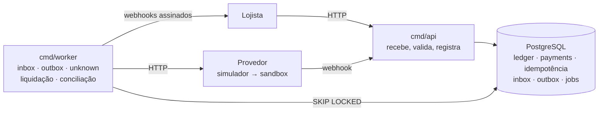

# Cross-border Pay

[](https://github.com/gengibrepower/cross-border-pay/actions/workflows/ci.yml)
[](https://github.com/gengibrepower/cross-border-pay/actions/workflows/nightly.yml)


[](LICENSE)

🇺🇸 [Read in English](README.md)

**Gateway de pagamentos cross-border em Go, feito para continuar correto sob concorrência, duplicidade e falhas parciais.**

Um lojista estrangeiro cobra em dólar. O pagador no Brasil paga em reais por PIX, boleto ou cartão. O sistema converte a moeda, registra cada centavo num ledger de partidas dobradas e repassa ao lojista em dólar.

A regra que nunca pode quebrar: **o dinheiro registrado sempre bate com o dinheiro que existe**, mesmo quando o provedor dá timeout, eventos chegam duplicados ou fora de ordem e workers morrem no meio do caminho.

> **Projeto de aprendizado, não um gateway real.** Dinheiro, clientes e provedores de pagamento são todos simulados. Taxas e cotações são ilustrativas. O projeto existe para praticar a engenharia por trás de sistemas financeiros corretos.

## O que o projeto se propõe a provar

1. **Idempotência em toda a cadeia.** API, chamadas ao provedor, eventos recebidos, webhooks enviados e jobs. Repetir nunca cobra, lança ou repassa duas vezes.
2. **Consistência do ledger sob concorrência.** Milhares de operações simultâneas, com duplicatas, e o ledger continua fechando em zero por moeda.
3. **Escrita dupla sem transação distribuída.** O banco e o provedor nunca participam da mesma transação. A intenção é gravada antes, resultado ambíguo vira `unknown` em vez de falha, e tabelas de inbox e outbox carregam os eventos de entrada e saída.
4. **Tolerância a um mundo externo hostil.** Provedores que atrasam, duplicam, reordenam ou somem, e lojistas com o endpoint fora do ar.

## O que já está provado

Todos os números abaixo são medidos, não estimados. Todo teste que toca o banco roda contra um **PostgreSQL 18 real** em container (`testcontainers-go`), nunca contra um banco mockado; os testes de domínio não fazem I/O nenhum.

| Teste | O que mostra | Resultado |
|---|---|---|
| `TestThousandsOfConcurrentTransfers` | 10 workers concorrentes lançam 5.000 transferências aleatórias entre 20 contas em duas moedas. No fim, o próprio banco é consultado sobre cada invariante. | 20/20 rodadas com `-race -count=20`, ou seja, **100.000 transferências concorrentes**. O ledger fecha em zero por moeda em todas, e transferências que estourariam o saldo são rejeitadas, nunca aplicadas pela metade. |
| `TestLedgerInvariantsAgainstPostgres` | Teste de propriedade: sequências aleatórias de transações válidas e inválidas contra o Postgres. Depois de cada passo, os saldos batem com um modelo em memória. | 100 sequências aleatórias por rodada, 20/20 rodadas |
| Propriedades do domínio do ledger | Transações aleatórias mantêm as invariantes em memória, e uma transação desbalanceada é sempre rejeitada. | 2 propriedades × 100 casos por rodada, 20/20 rodadas |
| Propriedades de câmbio | A conversão é half-even ao mais próximo, simétrica para negativos, monotônica e faz ida e volta quando a taxa é pelo menos 1. As pernas em USD de uma cotação somam zero, e, com taxa base de pelo menos 1, a conta de arredondamento nunca recebe mais de um centavo. Uma cotação gravada é relida exatamente como foi calculada, sem recálculo. | 7 propriedades × 100 casos por rodada, 20/20 rodadas |
| `TestTransitionIsExhaustive` | Cada par (estado, evento) da máquina de estados da cobrança é comparado com a seção 3.4, reescrita dentro do teste: o que está fora da tabela é `ErrInvalidTransition`, e um evento repetido que o estado já reflete é no-op. | Os 49 pares, 20/20 rodadas |
| `TestAuthenticate` | API keys contra Postgres real: chave malformada, chave desconhecida, lookup certo com segredo errado, chave certa com o modo trocado e chave revogada recebem o mesmo `401`, então a resposta não diz a um atacante qual parte errou. | 5 casos de recusa, mais um teste de mutação: uma comparação de hash que aceita qualquer segredo faz o teste falhar |
| Testes de contrato (`cmd/api`) | Cada request e resposta de `POST /v1/payments`, `GET /v1/payments/{id}` e `GET /v1/payments` passa pelo handler real e por um Postgres real e é conferido contra o `api/openapi.yaml` escrito à mão, com o `kin-openapi`. A cobrança da GameStore devolve R$ 101,50, taxa de US$ 0,60 e cotação de 30 minutos, e o `GET` devolve byte a byte o que o `POST` devolveu. Percorrer 7 cobranças em páginas de 3 vê cada uma exatamente uma vez, da mais nova para a mais antiga, e nenhuma de outro lojista; a cobrança de outro lojista, um ID desconhecido e um ID malformado recebem o mesmo `404`. | `POST`: 1 caso de sucesso e 14 de erro, e nenhum request recusado grava cobrança. `GET`: 4 casos de `404`/`401` e 6 de parâmetro inválido, cada um com seu `code` estável. 20/20 rodadas com `-race -count=20`. Trocar `id <` por `id <=` no cursor faz o teste de paginação falhar |
| Idempotência na camada de store (`internal/idempotency`) | Os oito casos da seção 4.2 contra Postgres real: resposta guardada devolvida igual, corpo diferente recusado, 4xx guardado, 5xx sem trabalho feito libera a key, 5xx depois de trabalho registrado mantém a key, keys de lojistas diferentes independentes. Uma key largada por um request que morreu é retomada do ponto em que ele parou quando a lease vence, e o request morto não consegue mais concluir nem liberar a key. O ponto de retomada desfaz junto com a transação de quem o gravou. | 20 requests simultâneos com a mesma key: exatamente 1 segue e 19 recebem `409`, 20/20 rodadas com `-race -count=20`. Tirar o `lock_token` da conclusão ou o `recovery_point` da liberação faz o teste do caso correspondente falhar |
| Idempotência pela API (`POST /v1/payments`) | A repetição recebe o mesmo 201 byte a byte, marcado com `Idempotent-Replayed: true`, e nenhuma cobrança nova; a mesma key com outra cobrança é `422`; um 4xx é guardado e devolvido de novo; lojistas diferentes com a mesma key criam cobranças diferentes. **Queda simulada:** o request cria a cobrança e morre sem guardar a resposta; a repetição recebe `409` enquanto a lease vale e, depois dela, `201` com a mesma cobrança, idêntica ao `GET`, e o banco continua com 1 cobrança e 1 cotação. No middleware, um 5xx sem trabalho feito libera a key, e um 5xx depois de um ponto de retomada a mantém e deixa a repetição retomar na hora. | 10 requests HTTP simultâneos com a mesma key criam exatamente 1 cobrança, 20/20 rodadas com `-race -count=20`. Fazer o `Create` ignorar o ponto de retomada faz o teste da queda falhar |
| Limpeza das keys (`cmd/worker`) | O job apaga, a cada hora e em lotes de 1.000, as keys com mais de 24 h, e nenhuma mais nova. Com `FOR UPDATE SKIP LOCKED`, uma key travada por outra transação é pulada sem espera e apagada na rodada seguinte. Uma rodada que falha vai para o log e não derruba o worker. | 7 keys vencidas apagadas em lotes de 3, 20/20 rodadas com `-race -count=20`. Tirar o `SKIP LOCKED` faz o `Cleanup` esperar o lock até estourar o prazo, e o teste falha |
| BR Code (`internal/brcode`) | Os 5 exemplos completos do [Manual de Padrões para Iniciação do Pix v2.10.0](https://www.bcb.gov.br/content/estabilidadefinanceira/pix/Regulamento_Pix/II_ManualdePadroesparaIniciacaodoPix.pdf) do BC são lidos com o CRC conferido, e o estático e o dinâmico são reproduzidos caractere por caractere pelo gerador. O CRC16 inclui o `6304`, como o manual manda; o CRC calculado sem ele é recusado. Valor no campo 54 sem float (`10150` ↔ `"101.50"`). | Teste de propriedade `Parse(Encode(c)) == c`: 100 casos por rodada, 20/20 rodadas; 14 payloads e 14 códigos inválidos recusados, cada um pelo motivo certo |
| `TestEntriesAreImmutable` | Triggers do Postgres rejeitam `UPDATE`, `DELETE` e `TRUNCATE` em lançamentos e transações. Correção é nova transação. | Garantido no próprio esquema |

A CI roda formatação, um `golangci-lint` rigoroso, `go test -race` com cobertura e `govulncheck` em todo pull request. Um job noturno roda tudo de novo com `-race -count=100`.

## Arquitetura

**Monólito modular** com módulos hexagonais: dois binários do mesmo módulo Go e um Postgres que é ao mesmo tempo fonte da verdade e fila. Nenhuma mensageria até a carga provar que ela é necessária.



A API só recebe e registra. Tudo que pode falhar ou demorar roda no worker, coordenado pelo Postgres. **Nenhuma chamada de rede acontece dentro de uma transação de banco.**

Cada módulo segue `internal/<módulo>/{domain,app,adapters}`. O domínio não importa HTTP, SQL nem SDK, nunca chama `time.Now()` (recebe um `Clock`) e é testado isolado.

### Fluxo de referência: GameStore

Jogo de US$ 20,00; taxa base 5,0000 BRL/USD; spread de 1,5% dá cotação de 5,0750; o pagador paga R$ 101,50; a taxa de 3% é US$ 0,60. Na confirmação, o ledger lança, em centavos:

```
BRL:  recebimentos do provedor  +10150
      câmbio (BRL)              -10150      soma BRL = 0
USD:  câmbio (USD)               -2030      (10150 / 5,0000)
      obrigação com lojista      +1940
      receita de taxas             +60
      receita de spread            +30      soma USD = 0
```

## Decisões principais

A lista completa das 57 decisões fechadas, com o raciocínio, está em [docs/escopo.md §11](docs/escopo.md). Estas são as que mais moldam o sistema:

| Decisão | Escolhido | Descartado, e por quê |
|---|---|---|
| Arquitetura | Monólito modular: binários `api` e `worker`, um módulo Go | Microsserviços com mensageria desde o início: o custo vem antes de saber onde dói |
| Fila | Postgres como fila (`SELECT … FOR UPDATE SKIP LOCKED`) para outbox e jobs | Kafka: pesado demais. NATS: só se o teste de carga mostrar motivo medido |
| Dinheiro | `int64` em minor units + tipo de moeda; decimal no JSON é rejeitado | `float64`: `20.099999` vira o centavo errado |
| Taxa de câmbio | Inteiro escalado por 10⁸, produto intermediário sem overflow, arredondamento half-even, resto lançado numa conta de arredondamento | Biblioteca decimal: dependência para algo pequeno e totalmente testável |
| Armazenamento do ledger | Postgres atrás de uma interface `Ledger`; saldo derivado dos lançamentos | Motor de ledger próprio (projeto futuro); saldo em cache, até a carga justificar |
| Isolamento | `READ COMMITTED` + `SELECT … FOR UPDATE` nas contas, travadas em ordem crescente de ID para evitar deadlock | `SERIALIZABLE` com retry: entra num benchmark comparativo |
| Imutabilidade | Lançamentos nunca são alterados nem apagados, garantido por triggers no banco; correção é nova transação | Linhas editáveis: trilha de auditoria em que não dá para confiar |
| Idempotência | Key válida por 24 h; request concorrente com a mesma key → `409` imediato; sucesso e 4xx guardados, key liberada em 5xx exceto se o provedor já foi chamado | Segurar o segundo request até o primeiro terminar: prende conexões sob retry |
| Lock da key | O `INSERT ... ON CONFLICT DO NOTHING` é o lock; a key fica com uma lease de 30 s (`locked_until`) e um `lock_token` que só quem a segura conhece | `SELECT` e depois `INSERT`: dois requests simultâneos passam pelos dois. `SELECT ... FOR UPDATE` durante o request: transação aberta durante a chamada ao provedor |
| Resposta guardada | Guardada **antes** de ser enviada, com status, corpo, `Content-Type` e `Location`, gravada com um contexto que o cliente não cancela; a repetição devolve o corpo original, inclusive o `request_id` de quem fez o trabalho | Enviar primeiro e gravar depois: se a gravação falha, o cliente viu o 201 e a repetição recebe `409` por 30 s |
| Retomada após queda | Pontos de retomada: a key guarda até onde o request chegou e o recurso criado, gravados na mesma transação desse trabalho; a repetição continua dali | Repetir tudo do zero: um request que morreu depois de criar a cobrança gera uma segunda cobrança, e na F5 uma segunda tentativa no provedor |
| Resultado ambíguo do provedor | A tentativa vai para `unknown` e é resolvida consultando o provedor ativamente (`GetAttempt` com backoff), com eventos e conciliação como rede de segurança | Tratar timeout como falha: o provedor pode ter cobrado o pagador |
| Eventos recebidos | Tabela de inbox: o handler do webhook só grava e responde `200`; o worker processa, tolerando duplicata e reordenação | Processar dentro do handler: retries do provedor e handler lento viram processamento duplo |
| Testes | Postgres real em todo teste de integração; determinismo só no simulador de provedor, controlado por seed | Banco mockado ou mundo todo simulado: perde os bugs reais de lock e isolamento |
| Erros da API | RFC 9457 `application/problem+json` com `code` estável e o `request_id` que também aparece nos logs | Formato de erro próprio: mais uma coisa para o cliente aprender, e só o status HTTP não distingue as causas |
| API keys | `sk_test_`/`sk_live_` + lookup público + segredo de 256 bits; só o SHA-256 é guardado e comparado em tempo constante; a chave é impressa uma vez pelo `cmd/admin` | bcrypt/argon2: feitos para senhas adivinháveis, somariam dezenas de milissegundos a cada request sem proteger melhor um segredo aleatório de 256 bits |
| IDs públicos | `pay_` + o UUIDv7 em base32 Crockford (26 caracteres), então os IDs ordenam por criação como texto simples | Hex: 32 caracteres para a mesma informação. Expor o UUID cru: sem prefixo de tipo para pegar um ID de cobrança passado onde se esperava um de estorno |
| Cotações | Tabela `quotes`, do `fx`, que guarda todo valor calculado, com `CHECK`s nas identidades que fazem as pernas em USD somarem zero | Colunas dentro de `payments`: cartão recota na autorização (decisão 44), então uma cobrança pode ter mais de uma cotação |
| Paginação | Keyset por `(merchant_id, id)`, da mais nova para a mais antiga, com cursor opaco em `next_cursor` (`null` na última página); `limit` de 1 a 100, padrão 20 | `OFFSET`: fica mais lento a cada página e pula ou repete linhas quando chega cobrança nova. `starting_after=pay_…`: funciona, mas trava o formato do cursor no ID |
| BR Code | Codec próprio, só ASCII imprimível; o simulador emite o código estático com valor e txid | Biblioteca de terceiros: dependência para ~380 linhas testáveis contra o manual. Código dinâmico no simulador: o valor fica num JSON assinado (JWS) hospedado na URL, sem relação com o que a F5 prova |
| HTTP | Roteador da stdlib `net/http`; OpenAPI escrito à mão, validado nos testes de contrato | Frameworks e código gerado: mais a explicar, pouco ganho com os padrões de método+caminho do Go |

## Status

O plano é dividido em fases, cada uma com definição de "pronto" escrita ([docs/escopo.md §12](docs/escopo.md)).

| Fase | Entrega | Status |
|---|---|---|
| F0 | Esqueleto, CI, Postgres real nos testes | ✅ pronta |
| F1 | Dinheiro e câmbio: conversão half-even, cotação com spread, taxa e validade | ✅ pronta |
| F2 | Ledger com invariantes sob concorrência | ✅ pronta |
| F3 | Cobranças, máquina de estados, API base | ✅ pronta |
| F4 | Idempotência | ✅ pronta |
| F5 | PIX simulado, inbox, confirmação | ⏳ em andamento |
| F6 | Outbox e webhooks; GameStore ponta a ponta por HTTP | planejada |
| F7 | Estornos e liquidação | planejada |
| F8 | Cartão, boleto, chargebacks | planejada |
| F9 | Simulador hostil, conciliação CNAB 240, sandbox Efí | planejada |
| F10 | Deploy público em produção | planejada |

## Rodando localmente

Você precisa do [mise](https://mise.jdx.dev) e do Docker. O mise fixa Go, `golangci-lint`, `sqlc` e `govulncheck` nas mesmas versões da CI.

```sh
mise install          # ferramentas nas versões fixadas
mise run test         # go test -race ./... (sobe os containers de Postgres sozinho)

mise run db           # Postgres local via docker compose
mise run migrate      # aplica as migrations embutidas
go run ./cmd/admin merchant create -name GameStore -mode test   # imprime a API key uma única vez
go run ./cmd/api      # /healthz e /readyz em :8080; FX_USD_BRL_RATE define a taxa base (padrão 5.0000)
go run ./cmd/worker   # jobs em segundo plano; hoje, a limpeza das keys de idempotência com mais de 24 h
```

Criando a cobrança da GameStore com a chave que o `cmd/admin` imprimiu:

```sh
curl -s localhost:8080/v1/payments \
  -H "Authorization: Bearer sk_test_..." -H "Idempotency-Key: order-123" \
  -d '{"amount": {"value": 2000, "currency": "USD"}, "method": "pix", "reference": "order-123"}'
# 201: pending, o pagador paga {"value": 10150, "currency": "BRL"}, taxa 60, líquido 1940, cotação válida por 30 min
# O mesmo comando de novo devolve o mesmo 201 com Idempotent-Replayed: true, sem criar outra cobrança

curl -s localhost:8080/v1/payments/pay_... -H "Authorization: Bearer sk_test_..."
curl -s "localhost:8080/v1/payments?limit=20&status=pending" -H "Authorization: Bearer sk_test_..."
# 200: {"data": [...], "next_cursor": null}; passe next_cursor como ?cursor= para a próxima página
```

O contrato é o [api/openapi.yaml](api/openapi.yaml).

Outras tarefas: `mise run lint`, `mise run fmt`, `mise run vuln`, `mise run test:stress` (a rodada noturna com `-count=100`), `mise run gen` (`sqlc`).

## Estrutura do repositório

```
cmd/
  api/        servidor HTTP
  worker/     jobs em segundo plano (limpeza de idempotência) com shutdown gracioso
  migrate/    aplica as migrations do goose embutidas
  admin/      tarefas de operação: criar lojista e API key, revogar chave
internal/
  money/      Money e Currency em minor units
  brcode/     BR Code do PIX: TLV EMV e CRC16, gerador e leitor
  fx/         taxas, conversão, cotações
  ledger/     transações de partidas dobradas, invariantes, adapter Postgres
  merchants/  lojistas, API keys (só hash), middleware de autenticação
  payments/   máquina de estados da cobrança, criação, handlers HTTP
  idempotency/ keys de idempotência: lock, lease, pontos de retomada
  platform/   config, logs, relógio, Postgres (WithTx), runner de workers, HTTP (erros RFC 9457, request ID)
api/          openapi.yaml, o contrato escrito à mão
migrations/   migrations SQL, embutidas nos binários
docs/         escopo, regras e decisões
```

## Stack

Go 1.27 · PostgreSQL 18 · `pgx/v5` · `sqlc` · `goose` (como biblioteca) · `log/slog` · `testcontainers-go` · `rapid` (testes de propriedade) · `golangci-lint` v2 + `gofumpt` · GitHub Actions · mise

## Hospedagem (planejada, F10)

Uma VM Linux rodando a mesma stack do Docker Compose, com Caddy para HTTPS automático, no Azure. Backup com restauração testada, deploy pela CI, OpenTelemetry + Prometheus + Grafana com dashboard público, números de carga do k6 em `docs/benchmarks.md` e uma conta de demonstração com limites.

## Regulação

Não é parecer jurídico. Processar dinheiro de terceiros no Brasil exige autorização do Banco Central como instituição de pagamento, e é por isso que nenhum dinheiro real passa por aqui. Impostos (IOF) são no máximo uma taxa configurável. KYC e PLD/FT ficam fora do escopo, mas as trilhas de auditoria do ledger e da inbox mostram onde entrariam. Nenhum número de cartão é guardado, só tokens fictícios, e dados pessoais são mascarados nos logs (minimização da LGPD).

## Autor

**TODO: nome completo**, estudante de Ciência da Computação na PUCPR (Curitiba).

[GitHub](https://github.com/gengibrepower) · TODO: LinkedIn

## Licença

MIT. Veja [LICENSE](LICENSE).
