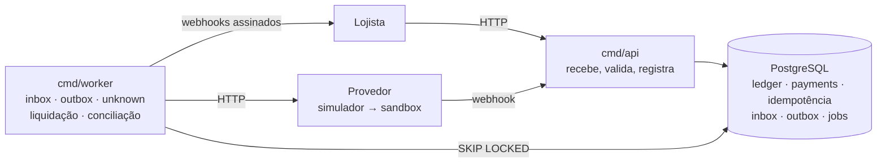

# Cross-border Pay

[](https://github.com/gengibrepower/cross-border-pay/actions/workflows/ci.yml)
[](https://github.com/gengibrepower/cross-border-pay/actions/workflows/nightly.yml)


[](LICENSE)

🇺🇸 [Read in English](README.md)

**Gateway de pagamentos cross-border em Go, feito para continuar correto sob concorrência, duplicidade e falhas parciais.**

Um lojista estrangeiro cobra em dólar. O pagador no Brasil paga em reais por PIX, boleto ou cartão. O sistema converte a moeda, registra cada centavo num ledger de partidas dobradas e repassa ao lojista em dólar.

A regra que nunca pode quebrar: **o dinheiro registrado sempre bate com o dinheiro que existe**, mesmo quando o provedor dá timeout, eventos chegam duplicados ou fora de ordem e workers morrem no meio do caminho.

> **Projeto de aprendizado, não um gateway real.** Dinheiro, clientes e provedores de pagamento são todos simulados. Taxas e cotações são ilustrativas. O projeto existe para praticar a engenharia por trás de sistemas financeiros corretos.

## O que o projeto se propõe a provar

1. **Idempotência em toda a cadeia.** API, chamadas ao provedor, eventos recebidos, webhooks enviados e jobs. Repetir nunca cobra, lança ou repassa duas vezes.
2. **Consistência do ledger sob concorrência.** Milhares de operações simultâneas, com duplicatas, e o ledger continua fechando em zero por moeda.
3. **Escrita dupla sem transação distribuída.** O banco e o provedor nunca participam da mesma transação. A intenção é gravada antes, resultado ambíguo vira `unknown` em vez de falha, e tabelas de inbox e outbox carregam os eventos de entrada e saída.
4. **Tolerância a um mundo externo hostil.** Provedores que atrasam, duplicam, reordenam ou somem, e lojistas com o endpoint fora do ar.

## O que já está provado

Todos os números abaixo são medidos, não estimados. Todo teste que toca o banco roda contra um **PostgreSQL 18 real** em container (`testcontainers-go`), nunca contra um banco mockado; os testes de domínio não fazem I/O nenhum.

| Teste | O que mostra | Resultado |
|---|---|---|
| `TestThousandsOfConcurrentTransfers` | 10 workers concorrentes lançam 5.000 transferências aleatórias entre 20 contas em duas moedas. No fim, o próprio banco é consultado sobre cada invariante. | 20/20 rodadas com `-race -count=20`, ou seja, **100.000 transferências concorrentes**. O ledger fecha em zero por moeda em todas, e transferências que estourariam o saldo são rejeitadas, nunca aplicadas pela metade. |
| `TestLedgerInvariantsAgainstPostgres` | Teste de propriedade: sequências aleatórias de transações válidas e inválidas contra o Postgres. Depois de cada passo, os saldos batem com um modelo em memória. | 100 sequências aleatórias por rodada, 20/20 rodadas |
| Propriedades do domínio do ledger | Transações aleatórias mantêm as invariantes em memória, e uma transação desbalanceada é sempre rejeitada. | 2 propriedades × 100 casos por rodada, 20/20 rodadas |
| Propriedades de câmbio | A conversão é half-even ao mais próximo, simétrica para negativos, monotônica e faz ida e volta quando a taxa é pelo menos 1. As pernas em USD de uma cotação somam zero, e, com taxa base de pelo menos 1, a conta de arredondamento nunca recebe mais de um centavo. Uma cotação gravada é relida exatamente como foi calculada, sem recálculo. | 7 propriedades × 100 casos por rodada, 20/20 rodadas |
| `TestTransitionIsExhaustive` | Cada par (estado, evento) da máquina de estados da cobrança é comparado com a seção 3.4, reescrita dentro do teste: o que está fora da tabela é `ErrInvalidTransition`, e um evento repetido que o estado já reflete é no-op. | Os 49 pares, 20/20 rodadas |
| `TestAuthenticate` | API keys contra Postgres real: chave malformada, chave desconhecida, lookup certo com segredo errado, chave certa com o modo trocado e chave revogada recebem o mesmo `401`, então a resposta não diz a um atacante qual parte errou. | 5 casos de recusa, mais um teste de mutação: uma comparação de hash que aceita qualquer segredo faz o teste falhar |
| Testes de contrato (`cmd/api`) | Cada request e resposta de `POST /v1/payments`, `GET /v1/payments/{id}` e `GET /v1/payments` passa pelo handler real e por um Postgres real e é conferido contra o `api/openapi.yaml` escrito à mão, com o `kin-openapi`. A cobrança da GameStore devolve R$ 101,50, taxa de US$ 0,60 e cotação de 30 minutos, e o `GET` devolve byte a byte o que o `POST` devolveu. Percorrer 7 cobranças em páginas de 3 vê cada uma exatamente uma vez, da mais nova para a mais antiga, e nenhuma de outro lojista; a cobrança de outro lojista, um ID desconhecido e um ID malformado recebem o mesmo `404`. | `POST`: 1 caso de sucesso e 14 de erro, e nenhum request recusado grava cobrança. `GET`: 4 casos de `404`/`401` e 6 de parâmetro inválido, cada um com seu `code` estável. 20/20 rodadas com `-race -count=20`. Trocar `id <` por `id <=` no cursor faz o teste de paginação falhar |
| Idempotência na camada de store (`internal/idempotency`) | Os oito casos da seção 4.2 contra Postgres real: resposta guardada devolvida igual, corpo diferente recusado, 4xx guardado, 5xx sem trabalho feito libera a key, 5xx depois de trabalho registrado mantém a key, keys de lojistas diferentes independentes. Uma key largada por um request que morreu é retomada do ponto em que ele parou quando a lease vence, e o request morto não consegue mais concluir nem liberar a key. O ponto de retomada desfaz junto com a transação de quem o gravou. | 20 requests simultâneos com a mesma key: exatamente 1 segue e 19 recebem `409`, 20/20 rodadas com `-race -count=20`. Tirar o `lock_token` da conclusão ou o `recovery_point` da liberação faz o teste do caso correspondente falhar |
| Idempotência pela API (`POST /v1/payments`) | A repetição recebe o mesmo 201 byte a byte, marcado com `Idempotent-Replayed: true`, e nenhuma cobrança nova; a mesma key com outra cobrança é `422`; um 4xx é guardado e devolvido de novo; lojistas diferentes com a mesma key criam cobranças diferentes. **Queda simulada:** o request cria a cobrança e morre sem guardar a resposta; a repetição recebe `409` enquanto a lease vale e, depois dela, `201` com a mesma cobrança, idêntica ao `GET`, e o banco continua com 1 cobrança e 1 cotação. No middleware, um 5xx sem trabalho feito libera a key, e um 5xx depois de um ponto de retomada a mantém e deixa a repetição retomar na hora. | 10 requests HTTP simultâneos com a mesma key criam exatamente 1 cobrança, 20/20 rodadas com `-race -count=20`. Fazer o `Create` ignorar o ponto de retomada faz o teste da queda falhar |
| Limpeza das keys (`cmd/worker`) | O job apaga, a cada hora e em lotes de 1.000, as keys com mais de 24 h, e nenhuma mais nova. Com `FOR UPDATE SKIP LOCKED`, uma key travada por outra transação é pulada sem espera e apagada na rodada seguinte. Uma rodada que falha vai para o log e não derruba o worker. | 7 keys vencidas apagadas em lotes de 3, 20/20 rodadas com `-race -count=20`. Tirar o `SKIP LOCKED` faz o `Cleanup` esperar o lock até estourar o prazo, e o teste falha |
| BR Code (`internal/brcode`) | Os 5 exemplos completos do [Manual de Padrões para Iniciação do Pix v2.10.0](https://www.bcb.gov.br/content/estabilidadefinanceira/pix/Regulamento_Pix/II_ManualdePadroesparaIniciacaodoPix.pdf) do BC são lidos com o CRC conferido, e o estático e o dinâmico são reproduzidos caractere por caractere pelo gerador. O CRC16 inclui o `6304`, como o manual manda; o CRC calculado sem ele é recusado. Valor no campo 54 sem float (`10150` ↔ `"101.50"`). | Teste de propriedade `Parse(Encode(c)) == c`: 100 casos por rodada, 20/20 rodadas; 14 payloads e 14 códigos inválidos recusados, cada um pelo motivo certo |
| Tentativas no provedor (`payments`) | Cada par (estado, evento) da máquina de estados da tentativa é comparado com a seção 3.5, reescrita dentro do teste; uma resposta ambígua nunca recusa a tentativa, e o evento de pagamento pode chegar antes da resposta da criação. Contra Postgres real, uma cobrança tem no máximo uma tentativa viva (índice único parcial: só a recusa libera), e os eventos de uma tentativa são serializados por lock de linha. | Os 30 pares. 20 criações simultâneas para a mesma cobrança deixam exatamente 1 tentativa, e 8 eventos accept/reject simultâneos na mesma tentativa a mudam exatamente uma vez, 25 tentativas por rodada, 20/20 rodadas com `-race -count=20`. Tirar o `FOR UPDATE` ou o `WHERE` do índice faz esses testes falharem |
| Simulador PIX (`cmd/pixsim`) | Um provedor HTTP real, com cobranças em memória e falhas sob comando: `reject`, `fail_before` (500 sem fazer nada), `timeout_after` (a cobrança é criada e a resposta nunca chega) e `delay`. Depois de um `timeout_after`, a busca pelo ID da nossa tentativa encontra a cobrança, e repetir com a mesma key devolve essa mesma cobrança. Todo BR Code emitido é lido pelo `internal/brcode`. Só a recusa explícita chega à porta de pagamentos como `Rejected`; um 500, um timeout ou uma resposta desconhecida é erro, e a tentativa vai para `unknown`. | Mesma seed e as mesmas 50 keys enviadas em paralelo e em ordem inversa geram as mesmas cobranças, byte a byte, que enviadas uma a uma; 8 requests malformados recusados com `400`. 20/20 rodadas com `-race -count=20`. 10 mutantes mortos, entre eles semear pela ordem de chegada, criar a cobrança depois do travamento em vez de antes e ler um 500 como recusa |
| Eventos do simulador | Pagar uma cobrança envia um evento `charge.paid` para `PIXSIM_WEBHOOK_URL`, assinado com HMAC-SHA256 sobre o timestamp e o corpo. O `pixsim.VerifyEvent` recusa corpo adulterado, segredo errado, timestamp trocado e qualquer assinatura a mais de 5 minutos de agora, então uma entrega capturada não pode ser reenviada depois. O ID do evento sai da seed, e a reentrega (`/control/events/{id}/deliver`) manda os mesmos bytes assinados de novo, para que o receptor descarte duplicatas pelo ID. Pagar duas vezes não envia nada novo; um webhook que falha não desfaz o pagamento; um pagador que desiste não corta a entrega. O gateway os recebe em `POST /v1/providers/pixsim/events` (o inbox, abaixo). | 8 falsificações recusadas e 5 corpos assinados malformados recusados, entre eles um valor decimal. 20/20 rodadas com `-race -count=20`. 17 mutantes mortos, entre eles comparar só a última assinatura, tirar o timestamp ou o corpo do MAC, derivar o ID do evento sem a key da cobrança e entregar com o contexto do pagador |
| Tentativa PIX na criação (`POST /v1/payments`) | Cada cobrança ganha sua tentativa no provedor e um BR Code que é lido como R$ 101,50, idêntico no `POST`, no `GET` e na lista. Uma recusa é `201` com `pix.status: failed`; um timeout depois de o provedor agir, ou um `500` dele, é `201` com `processing` e a tentativa em `unknown`, limitado pelo timeout de 300 ms do teste. **Quedas em cada passo:** depois da primeira transação (tentativa `created`), a repetição chama o provedor uma vez; depois de `sent`, não chama de novo e marca `unknown`; depois da resposta gravada, só responde. Um cliente que desconecta no meio da chamada não a interrompe: a tentativa termina `accepted`. | 10 requests simultâneos com a mesma key e uma repetição: 1 chamada ao provedor, 1 tentativa. 20/20 rodadas com `-race -count=20`. 11 mutantes mortos, entre eles chamar de novo a partir de `sent`, tirar o `WithoutCancel`, tirar o timeout do serviço, ler erro do provedor como recusa e mostrar a tentativa mais antiga em vez da mais recente |
| Resolvedor de `unknown` (`cmd/worker`) | Tentativas ambíguas são consultadas no provedor, nunca criadas de novo (decisão 17). Uma cobrança que o provedor criou enquanto a nossa chamada estourava o tempo termina `accepted` com o BR Code, ou `succeeded` se foi paga no meio-tempo. "Não encontrada" é repetida durante 1 minuto de carência e depois vira `rejected`. Um request que morreu depois de gravar `sent` é retomado quando passa 1 minuto parado. Consultas que falham esperam 5 s, 10 s, 20 s… até 5 min, e às 24 h a tentativa é escalada e não é mais consultada. Um worker que morre segurando uma tentativa só a atrasa até a lease vencer. | Backoff: 292 consultas ao longo de 24 h, cada espera conferida. 4 resolvedores simultâneos sobre 50 tentativas: 50 reivindicações e 50 consultas, uma por tentativa. 20/20 rodadas com `-race -count=20`. 10 mutantes mortos, entre eles tirar o `SKIP LOCKED` (90 consultas para 50 tentativas), não empurrar a lease (85), recusar no primeiro "não encontrada" e nunca escalar |
| Inbox (`internal/events`) | O webhook confere a assinatura, grava o evento com os bytes e o cabeçalho exatos com que chegou e responde `200`, também para duplicata; só uma falha ao gravar pede reentrega. Um worker reivindica os eventos vencidos com `FOR UPDATE SKIP LOCKED` e aplica cada um na transação que grava o seu status, então o efeito e o status entram juntos ou não entram. O `charge.paid` leva a tentativa que ele nomeia a `succeeded` quando o valor bate com a cotação. Um para tentativa ainda não gravada é repetido após 5 s, 10 s, 20 s… até 5 min, e falha em 24 h; um que contradiz a tentativa (outro valor ou outro ID de cobrança, tentativa recusada) falha na hora e não muda nada. Eventos de um mesmo pagamento são aplicados um por vez atrás do lock da linha dele, e esse lock não espera a checagem de chave estrangeira. | 100 entregas concorrentes do mesmo evento: todas `200`, 1 linha. 5 requests recusados (assinatura, ilegível, sem ID, provedor desconhecido, acima de 64 KiB), nenhum gravado. 4 processadores sobre 50 eventos: cada um aplicado 1 vez. 6 eventos divergentes deixam a tentativa como estava. 20/20 rodadas com `-race -count=20`. 25 mutantes mortos, entre eles tirar o `SKIP LOCKED`, o `ON CONFLICT` ou a guarda de `pending` do retry atrasado, gravar o status depois de o handler falhar, parar o lote no primeiro erro, pular a checagem de valor e usar `FOR UPDATE` no lugar de `FOR NO KEY UPDATE` |
| `TestThousandConcurrentConfirmationsPostOnce` | Confirmação (`payments` + `ledger`): uma tentativa que vira `succeeded`, pelo evento do provedor ou pelo resolvedor, leva a cobrança a `paid` e lança a transação da seção 3.3 nessa mesma transação de banco. 1.000 confirmações da mesma cobrança rodam ao mesmo tempo, metade por cada caminho. Um ledger que não consegue lançar deixa a tentativa e a cobrança como estavam; uma cobrança já `paid` não é lançada de novo; cada lojista tem a sua própria conta a receber, criada na primeira confirmação dele. Todo caminho trava a cobrança, depois a tentativa, depois as contas: um teste segura o lock da cobrança e confere com `NOWAIT` que a confirmação que espera não pegou o da tentativa. | **Exatamente 1 transação contábil e 1 `payment.paid` para 1.000 confirmações**, com os saldos do GameStore ao centavo (R$ 101,50 de entrada, US$ 19,40 devidos, US$ 0,60 de taxa, US$ 0,30 de spread), 20/20 rodadas com `-race -count=20`. Qualquer cotação confirma numa transação balanceada e sem perna zerada: 100 casos por rodada, 20/20 rodadas. 50 primeiras confirmações concorrentes de um lojista criam 1 conta. 14 mutantes mortos, entre eles travar a tentativa antes da cobrança, `FOR KEY SHARE` na cobrança, lançar cobrança já paga, tirar a referência do ledger e uma conta a receber única para todos os lojistas |
| Outbox (`payment.paid`) | A confirmação grava `payment.paid` em `outbox_events` na própria transação (seção 4.5), com o `payment_version` incrementado pelo mesmo `UPDATE` que muda o status. O payload é guardado com os bytes exatos que toda entrega vai enviar e assinar, e validado contra o schema `PaymentEvent` do `api/openapi.yaml`; o `payment_id`, o `status` e o `amount` dele batem com o `GET` da cobrança. Uma outbox que recusa o evento desfaz a tentativa, a cobrança e o lançamento. A entrega está na linha "Entrega de webhooks". | 1 evento por cobrança sob as 1.000 confirmações concorrentes acima, 20/20 rodadas com `-race -count=20`. 10 mutantes mortos, entre eles não gravar o evento, ignorar o erro da outbox, não incrementar a versão, a versão antiga no payload, o valor em BRL do pagador no `data` e guardar o payload como `jsonb` |
| Expiração (`cmd/worker`) | Um job reivindica cobranças pendentes com cotação vencida (`FOR NO KEY UPDATE SKIP LOCKED`, depois uma lease de 1 minuto) e consulta o provedor antes de decidir: paga em dia vira confirmada; senão, expirada com `payment.expired` na outbox. Em dia é o `paid_at` do provedor contra o `expires_at` da cotação, nunca a hora em que a notícia chegou, e o `confirm` aplica a mesma regra aos eventos, então o job e o evento concordam, chegue quem chegar primeiro. Um provedor que não responde não decide nada: a cobrança espera a lease. **A corrida:** o pagador paga 2 s antes de vencer e o evento ainda não chegou quando o job roda; o job acha o pagamento e confirma, e o evento que chega 3 s depois é no-op. Pago 1 s atrasado, pelo job ou pelo evento, nunca é confirmado: o dinheiro fica retido para revisão (próxima linha). | 4 jobs simultâneos sobre 50 cobranças: cada uma expirada 1 vez, com uma consulta cada. 20/20 rodadas com `-race -count=20`. 17 mutantes mortos, entre eles julgar o atraso pelo nosso relógio, expirar sem consultar o provedor ou depois de uma consulta que falhou, tratar o instante de vencimento como em dia, `Expire` sem reconferir status ou prazo sob o lock, tirar o `SKIP LOCKED` e não empurrar a lease |
| Dinheiro sem destino (seção 4.4) | Dinheiro confirmado pelo provedor entra sempre no ledger; a dúvida é só para onde. Um pagamento que não pode confirmar a cobrança (atrasado, com outro valor, numa tentativa recusada ou numa segunda cobrança) é lançado de `provider_receivables:BRL` para `divergence:BRL` e abre um caso de revisão em `review_cases` (módulo `reconciliation`, na mesma transação). A cobrança não muda, e a tentativa vira `succeeded` quando a máquina de estados permite. Um caso por cobrança no provedor: a chave única é a primeira barreira e a referência única do ledger a segunda, então o evento, o resolvedor e o job de expiração lançam uma vez só, juntos. A conferência de valor agora roda no domínio para os três caminhos; antes, só o evento comparava valores, e o resolvedor confirmava qualquer pagamento que o provedor dissesse estar pago. Um evento que não pode ser retido (outra moeda) fica `failed` e não grava nada: um savepoint desfaz o que ele gravou antes, já que o inbox commita o status de falha. | Pago 1 s atrasado, com o job primeiro, com o evento primeiro e com os dois ao mesmo tempo: 1 caso e R$ 101,50 retidos em cada um, com o ledger fechando em zero por moeda. 20 entregas simultâneas do mesmo evento divergente: 1 caso, 1 lançamento. Pelo worker com o evento do próprio simulador: cobrança `expired`, tentativa `succeeded`, R$ 101,50 em `divergence:BRL`. 20/20 rodadas com `-race -count=20`. 16 mutantes mortos, entre eles lançar com o caso já aberto, tirar a conferência de valor, reter o valor cotado em vez do pago, tirar o savepoint, o job de expiração parar depois de liquidar e confirmar a cada mudança de uma tentativa já `succeeded` |
| Endpoint de webhook e SSRF no cadastro | `PUT /v1/webhook-endpoint` guarda a URL do lojista, recusada quando não é `https` ou aponta para dentro de uma rede: loopback, faixas privadas, link-local e metadados de cloud (`169.254.169.254`, também como `::ffff:169.254.169.254`), CGNAT, faixas reservadas, nomes `localhost`/`.internal`/`.local` e hosts numéricos como `2130706433`, que alguns resolvedores leem como `127.0.0.1`. Sem DNS no cadastro: o nome pode passar a resolver para outro lugar, então a entrega confere o IP depois do DNS (linha abaixo). O segredo de assinatura não é guardado: é derivado de uma chave fora do banco, do lojista e de uma versão; a rotação é condicionada à versão atual, então uma rotação repetida mostra o mesmo segredo em vez de rotacionar duas vezes. | 35 IPs nas bordas de cada faixa e 31 URLs, cada um sob a política estrita e a de desenvolvimento. 20 rotações simultâneas a partir da mesma versão: 1 rotação, o mesmo segredo nas 20 respostas. Uma troca de URL que leu a versão antes de uma rotação concorrente não a desfaz, forçado segurando a troca aberta até a rotação esperar no lock. Nenhum `whsec_` na linha guardada nem nos logs. 20/20 rodadas com `-race -count=20`. 22 mutantes mortos, entre eles tirar o lock do lojista, o desmapeamento `::ffff:`, a checagem de faixa privada ou de CGNAT, a de host numérico, abrir metadados em desenvolvimento, a rotação repetida rotacionar de novo e o `Cache-Control: no-store` |
| Entrega de webhooks (`internal/webhooks`) | O worker reivindica os eventos vencidos da outbox com `FOR UPDATE SKIP LOCKED` e uma lease (`next_attempt_at` empurrado para depois do timeout + 1 min), faz commit e só então posta, fora de qualquer transação (seção 4.3); o resultado entra em outra transação curta. `attempts` cerca a reivindicação: depois que a lease venceu e outro worker pegou o evento, a primeira não consegue mais reagendar nem desistir dele, e um 2xx, que é fato, ainda é gravado. Cada post leva `Webhook-Signature: t=…,v1=…` (HMAC-SHA256 do timestamp e do corpo guardado), com um segundo `v1` do segredo anterior por 24 h depois de uma rotação. Só 2xx é sucesso: redirect não é seguido, e o IP é conferido de novo no `connect`, depois do DNS, pela mesma política do cadastro. Falha espera um sorteio em [0, 30 s · 2ⁿ⁻¹], até 6 h (decisão 23), e vira `failed` 72 h depois da criação. Cada rodada pega até 4 eventos por lojista, os lojistas com evento mais antigo primeiro. | **Teste citado 4:** o worker é morto no meio da segunda rodada de 100 eventos de 5 lojistas, com 10 posts recebidos pelo lojista e não respondidos; depois do reinício e do fim da lease, os 100 são entregues, os 10 cortados duas vezes e os outros 90 uma vez, e os cortados não ganham retry nem erro registrado. 4 workers sobre 300 eventos de 10 lojistas: cada um postado 1 vez, nenhuma assinatura inválida. 13 casos de decisão, 7 falsificações recusadas, 10 endereços na checagem pós-DNS. 20/20 rodadas com `-race -count=20`. 21 mutantes mortos, entre eles tirar o `FOR UPDATE SKIP LOCKED`, o limite por lojista, a cerca de `attempts`, a margem da lease, o contexto desacoplado do 2xx, o `CheckRedirect`, a checagem pós-DNS, o timestamp do MAC e o prazo do segredo anterior |
| Destino desativado e limpeza (decisão 24) | Cada rodada informa o breaker de cada lojista uma vez: um 2xx encerra a sequência de falhas, e uma falha 72 h depois da primeira sem sucesso no meio desativa o endpoint, num único `UPDATE` condicional, então só uma de muitas falhas simultâneas desativa e avisa. Desativado, o endpoint não recebe post: os eventos esperam com o backoff normal e falham em 72 h, e falhas cortadas pelo shutdown não contam. O aviso é o `GET /v1/webhook-endpoint`, que mostra `failing_since`, `disabled_at` e `disabled_reason`, e uma linha `ERROR` no log para o operador; qualquer `PUT`, com a mesma URL também, reativa. Um job horário apaga, em lotes de 1.000 com `SKIP LOCKED`, os eventos entregues há mais de 30 dias; `pending` e `failed` ficam. O teste do `GET` achou um bug do #32: os horários lidos do banco saíam no fuso local (`-03:00`), e agora saem em UTC (seção 4.9). | 20 falhas simultâneas na marca de 72 h: 1 desativa. Nenhum post a um destino desativado, e a entrega volta depois do `PUT`. Uma rodada com 2xx e 500 misturados encerra a sequência. 5 entregues no corte apagados em 3 lotes; o entregue 1 µs depois do corte, o `failed` e o `pending` ficam. 20/20 rodadas com `-race -count=20`. 15 mutantes mortos, entre eles `<` no lugar de `<=` na marca, cada falha reiniciar a sequência, um sucesso reativar um destino desativado, postar em destino desativado, contar falhas do shutdown, a limpeza apagar `failed`, a retenção de 3 dias e ler sem UTC |
| `TestEntriesAreImmutable` | Triggers do Postgres rejeitam `UPDATE`, `DELETE` e `TRUNCATE` em lançamentos e transações. Correção é nova transação. | Garantido no próprio esquema |

A CI roda formatação, um `golangci-lint` rigoroso, `go test -race` com cobertura e `govulncheck` em todo pull request. Um job noturno roda tudo de novo com `-race -count=100`.

## Arquitetura

**Monólito modular** com módulos hexagonais: dois binários do mesmo módulo Go e um Postgres que é ao mesmo tempo fonte da verdade e fila. Nenhuma mensageria até a carga provar que ela é necessária.



A API só recebe e registra. Tudo que pode falhar ou demorar roda no worker, coordenado pelo Postgres. **Nenhuma chamada de rede acontece dentro de uma transação de banco.**

Cada módulo segue `internal/<módulo>/{domain,app,adapters}`. O domínio não importa HTTP, SQL nem SDK, nunca chama `time.Now()` (recebe um `Clock`) e é testado isolado.

### Fluxo de referência: GameStore

Jogo de US$ 20,00; taxa base 5,0000 BRL/USD; spread de 1,5% dá cotação de 5,0750; o pagador paga R$ 101,50; a taxa de 3% é US$ 0,60. Na confirmação, o ledger lança, em centavos:

```
BRL:  recebimentos do provedor  +10150
      câmbio (BRL)              -10150      soma BRL = 0
USD:  câmbio (USD)               -2030      (10150 / 5,0000)
      obrigação com lojista      +1940
      receita de taxas             +60
      receita de spread            +30      soma USD = 0
```

## Decisões principais

A lista completa das 57 decisões fechadas, com o raciocínio, está em [docs/escopo.md §11](docs/escopo.md). Estas são as que mais moldam o sistema:

| Decisão | Escolhido | Descartado, e por quê |
|---|---|---|
| Arquitetura | Monólito modular: binários `api` e `worker`, um módulo Go | Microsserviços com mensageria desde o início: o custo vem antes de saber onde dói |
| Fila | Postgres como fila (`SELECT … FOR UPDATE SKIP LOCKED`) para outbox e jobs | Kafka: pesado demais. NATS: só se o teste de carga mostrar motivo medido |
| Dinheiro | `int64` em minor units + tipo de moeda; decimal no JSON é rejeitado | `float64`: `20.099999` vira o centavo errado |
| Taxa de câmbio | Inteiro escalado por 10⁸, produto intermediário sem overflow, arredondamento half-even, resto lançado numa conta de arredondamento | Biblioteca decimal: dependência para algo pequeno e totalmente testável |
| Armazenamento do ledger | Postgres atrás de uma interface `Ledger`; saldo derivado dos lançamentos | Motor de ledger próprio (projeto futuro); saldo em cache, até a carga justificar |
| Isolamento | `READ COMMITTED` + `SELECT … FOR UPDATE` nas contas, travadas em ordem crescente de ID para evitar deadlock | `SERIALIZABLE` com retry: entra num benchmark comparativo |
| Imutabilidade | Lançamentos nunca são alterados nem apagados, garantido por triggers no banco; correção é nova transação | Linhas editáveis: trilha de auditoria em que não dá para confiar |
| Idempotência | Key válida por 24 h; request concorrente com a mesma key → `409` imediato; sucesso e 4xx guardados, key liberada em 5xx exceto se o provedor já foi chamado | Segurar o segundo request até o primeiro terminar: prende conexões sob retry |
| Lock da key | O `INSERT ... ON CONFLICT DO NOTHING` é o lock; a key fica com uma lease de 30 s (`locked_until`) e um `lock_token` que só quem a segura conhece | `SELECT` e depois `INSERT`: dois requests simultâneos passam pelos dois. `SELECT ... FOR UPDATE` durante o request: transação aberta durante a chamada ao provedor |
| Resposta guardada | Guardada **antes** de ser enviada, com status, corpo, `Content-Type` e `Location`, gravada com um contexto que o cliente não cancela; a repetição devolve o corpo original, inclusive o `request_id` de quem fez o trabalho | Enviar primeiro e gravar depois: se a gravação falha, o cliente viu o 201 e a repetição recebe `409` por 30 s |
| Retomada após queda | Pontos de retomada: a key guarda até onde o request chegou e o recurso criado, gravados na mesma transação desse trabalho; a repetição continua dali | Repetir tudo do zero: um request que morreu depois de criar a cobrança gera uma segunda cobrança, e na F5 uma segunda tentativa no provedor |
| Resultado ambíguo do provedor | A tentativa vai para `unknown` e é resolvida consultando o provedor ativamente (`GetAttempt` com backoff), com eventos e conciliação como rede de segurança | Tratar timeout como falha: o provedor pode ter cobrado o pagador |
| Eventos recebidos | Tabela de inbox: o handler do webhook só grava e responde `200`; o worker processa, tolerando duplicata e reordenação | Processar dentro do handler: retries do provedor e handler lento viram processamento duplo |
| Aplicar um evento | O handler roda dentro da transação que reivindicou o evento e grava o seu status | Duas transações: uma queda entre elas deixa o efeito aplicado com o evento ainda pendente, ou o evento concluído sem o efeito |
| Evento que não dá para aplicar | Tentativa ainda não gravada: repetido com backoff, `failed` em 24 h (decisão 52). Contradiz o que o gateway sabe: `failed` na hora, para uma pessoa olhar. Tipo que ninguém trata: `ignored` | Repetir tudo: um valor errado seria repetido por um dia e nunca ficaria certo |
| Reentrega com outro corpo | O primeiro corpo fica como prova; o segundo vai só para o log | Sobrescrever: a prova gravada deixaria de ser o que o provedor assinou primeiro |
| Lock do pagamento nos eventos | `FOR NO KEY UPDATE`, o lock que um `UPDATE` comum pega: eventos de um pagamento rodam um por vez | `FOR UPDATE`: espera também o `KEY SHARE` de todo insert de linha que aponta para o pagamento, como uma tentativa nova |
| Onde a confirmação acontece | Na única função que move tentativas, quando uma vira `succeeded`: o evento do provedor e o resolvedor passam os dois por ela | Só no handler do evento: um pagamento que o resolvedor achasse nunca chegaria ao ledger |
| Ordem de lock | Cobrança (`FOR NO KEY UPDATE`), depois tentativa, depois contas do ledger em ordem crescente, em todo caminho | Cada caminho na sua ordem: o evento travava cobrança e depois tentativa, e o resolvedor, ao confirmar, travaria tentativa e depois cobrança, um deadlock esperando para acontecer |
| Invariante 7, uma confirmação por cobrança | Duas barreiras: o lock da cobrança com a máquina de estados (`paid` + `confirm` é no-op), e uma referência única no ledger, `payment:<id>:confirm`, que recusa um segundo lançamento se a primeira barreira um dia falhar | Confiar só no status: um bug em um caminho e o dinheiro é contado duas vezes |
| Plano de contas | As contas do gateway vêm de uma migration com códigos fixos; a conta a receber de cada lojista é criada na primeira confirmação dele (`INSERT … ON CONFLICT DO NOTHING`, depois `SELECT`) | Criar a conta junto com o lojista: `merchants` teria de conhecer o ledger, e os lojistas existentes precisariam de backfill |
| Outbox entre módulos | `payments` declara uma porta `Outbox` que recebe a transação dele; o `cmd` liga o adapter de `events` por uma ponte, e nenhum dos dois módulos importa o outro | `payments` importando `events`: uma dependência que a tabela de módulos não tem. Uma outbox de `payments`: a outbox é de `events` |
| Evento guardado | O evento inteiro como `bytea`, exatamente os bytes que toda entrega envia, com um ID de `uuidv7()` tirado na mesma transação antes de montar o JSON | `jsonb`: reordena chaves e tira espaços, e os bytes guardados deixam de ser os assinados. Montar o envelope na entrega: a linha deixa de ser o evento |
| Ordem dos eventos | `payments.version`, incrementado pelo `UPDATE` que muda o status e enviado como `payment_version` | Contar eventos: nem toda transição vai emitir um |
| Formato do evento | `PaymentEvent` em `components/schemas` do documento OpenAPI 3.0, conferido contra os bytes guardados num teste de contrato | `webhooks:` do OpenAPI 3.1: o lugar certo, mas exige migrar o documento inteiro e o validador por um schema |
| O que é atraso | `paid_at` do provedor no `expires_at` da cotação ou depois; pagamento sem `paid_at` é atrasado | A nossa hora de processamento: o pagador pagaria pelo atraso da nossa fila e do provedor |
| Expirar | Só depois de o provedor dizer que o pagamento não foi feito em dia; sem resposta, sem decisão, de novo depois da lease | Prazo de tolerância: deixa a corrida mais rara, não impossível. Permitir `expired → paid`: a seção 3.4 faz `expired` terminal, e o lojista veria uma cobrança voltar |
| "Toda leitura confere o prazo" (seção 4.6) | Aplicado a decisões: o `confirm` confere o `paid_at` mesmo se o job não rodou; o `GET` mostra o status gravado | Calcular `expired` na leitura: uma cobrança mostrada como expirada ainda poderia ser confirmada pelo job, um status andando para trás |
| Fila de expiração | `payments.expiry_check_at`, preenchido com o vencimento da cotação e usado como lease, com um `CHECK` de que só cobrança pendente tem um, e índice parcial | `JOIN` com `quotes` a cada rodada: nenhum índice atende, e ele lê todas as cobranças pendentes |
| Dono da fila de revisão | O módulo `reconciliation` (seção 2.1), por enquanto só com `review_cases`; o `payments` abre casos por uma porta ligada no `cmd`, como a outbox | Tabela no `payments`: a F9 precisaria de uma segunda fila ou de uma migração de dados. O `failed` do inbox: não guarda lançamento, e o job de expiração não tem evento |
| Pagamento de cobrança fechada | Atrasado ou com outro valor: tentativa `succeeded` (o provedor tem o dinheiro), cobrança intocada, dinheiro retido | Desfazer tudo, como antes: o dinheiro ficava fora do ledger, e um evento atrasado deixava a tentativa pela metade |
| Segredo do webhook | Derivado: HMAC-SHA256 de uma chave guardada fora do banco (`WEBHOOK_SIGNING_KEY`), do lojista e de uma versão; a tabela guarda só a versão | Hash, como a seção 6 pedia para as API keys: hash não assina, e o HMAC precisa do segredo. Criptografado com AES-GCM: a mesma proteção contra um dump, com nonce, formato e troca de chave para acertar |
| Repetir uma rotação | Condicionada à versão atual (`rotate_secret_from`): a repetição a encontra rotacionada e mostra o mesmo segredo | `Idempotency-Key`: a resposta guardada teria o segredo em texto puro |
| Onde mora a regra de SSRF | `internal/platform/ssrf`, pura, usada por merchants no cadastro e por webhooks na entrega | Dentro de webhooks: merchants a importaria, contra a seção 2.1. Uma cópia em cada: duas listas de faixas bloqueadas para manter iguais |
| Entregar sem transação aberta | Lease: a reivindicação empurra `next_attempt_at` para depois do timeout + 1 min e incrementa `attempts`, faz commit, e o POST roda fora de transação; um worker que morre deixa a lease vencer | Segurar o `FOR UPDATE` durante o POST: rede dentro da transação (seção 4.3), e um lojista lento prende conexões do pool |
| Estado da entrega | Colunas em `outbox_events`: um endpoint por lojista, uma entrega por evento | Tabela `webhook_deliveries` por tentativa: histórico, mas um join e uma limpeza a mais, que só se pagam com vários endpoints por lojista |
| Isolamento por lojista | No claim: até 4 eventos por lojista por rodada, lojistas com o evento mais antigo primeiro, e timeout curto. O limite vale por processo de worker | Semáforo em memória: também por processo, e um lote podia ser tomado por um lojista só. Limite global: contar leases ativas sob um advisory lock por lojista, quando houver mais de um worker |
| Assinatura do webhook | `Webhook-Signature: t=…,v1=…`, o mesmo esquema do simulador; depois de uma rotação, um segundo `v1` do segredo anterior por 24 h | Standard Webhooks: um segundo esquema no repositório. Assinar com o anterior até a próxima rotação: um segredo vazado e rotacionado continuaria valendo |
| SSRF na entrega | `net.Dialer.Control` confere o IP já resolvido antes do `connect`, sem proxy e sem seguir redirect | Resolver, conferir e depois conectar: o nome pode responder outro IP entre as duas consultas |
| Ordem das entregas | Não garantida: o lojista ignora `payment_version` menor que a última (seção 4.5) | Serializar por pagamento: vazão menor para uma garantia que o envelope já dá |
| Aviso de destino desativado | O estado no `GET /v1/webhook-endpoint` e uma linha `ERROR` no log | Webhook: é o destino que caiu. Tabela de notificações: um canal sem ninguém para ler até haver painel. E-mail: fora do escopo |
| Reativar | Qualquer `PUT` do endpoint, com a mesma URL também; se não estiver consertado, volta a desativar em 72 h | Um campo `enabled`: quem só corrige a URL o esquece e continua desativado |
| Eventos de destino desativado | Esperam com o backoff normal, sem post, e falham em 72 h | Filtrar no claim com `JOIN` em `webhook_endpoints`: a query de `events` leria uma tabela de `merchants` (seção 2.1) |
| Retenção dos entregues | 30 dias, em lotes de 1.000 por hora; `failed` e `pending` nunca | 7 dias: menos linhas, menos tempo para o lojista investigar |
| Webhooks em desenvolvimento | `WEBHOOK_ALLOW_PRIVATE` libera faixas privadas e `http`, nunca metadados de cloud; falso por padrão | Liberar para chaves `sk_test_`: uma chave de teste em produção abriria SSRF |
| Testes | Postgres real em todo teste de integração; determinismo só no simulador de provedor, controlado por seed | Banco mockado ou mundo todo simulado: perde os bugs reais de lock e isolamento |
| Erros da API | RFC 9457 `application/problem+json` com `code` estável e o `request_id` que também aparece nos logs | Formato de erro próprio: mais uma coisa para o cliente aprender, e só o status HTTP não distingue as causas |
| API keys | `sk_test_`/`sk_live_` + lookup público + segredo de 256 bits; só o SHA-256 é guardado e comparado em tempo constante; a chave é impressa uma vez pelo `cmd/admin` | bcrypt/argon2: feitos para senhas adivinháveis, somariam dezenas de milissegundos a cada request sem proteger melhor um segredo aleatório de 256 bits |
| IDs públicos | `pay_` + o UUIDv7 em base32 Crockford (26 caracteres), então os IDs ordenam por criação como texto simples | Hex: 32 caracteres para a mesma informação. Expor o UUID cru: sem prefixo de tipo para pegar um ID de cobrança passado onde se esperava um de estorno |
| Cotações | Tabela `quotes`, do `fx`, que guarda todo valor calculado, com `CHECK`s nas identidades que fazem as pernas em USD somarem zero | Colunas dentro de `payments`: cartão recota na autorização (decisão 44), então uma cobrança pode ter mais de uma cotação |
| Paginação | Keyset por `(merchant_id, id)`, da mais nova para a mais antiga, com cursor opaco em `next_cursor` (`null` na última página); `limit` de 1 a 100, padrão 20 | `OFFSET`: fica mais lento a cada página e pula ou repete linhas quando chega cobrança nova. `starting_after=pay_…`: funciona, mas trava o formato do cursor no ID |
| BR Code | Codec próprio, só ASCII imprimível; o simulador emite o código estático com valor e txid | Biblioteca de terceiros: dependência para ~380 linhas testáveis contra o manual. Código dinâmico no simulador: o valor fica num JSON assinado (JWS) hospedado na URL, sem relação com o que a F5 prova |
| Tentativas no provedor | Gravadas como `created` antes da chamada ao provedor, uma tentativa viva por cobrança garantida por índice único parcial, toda mudança pela máquina de estados sob lock de linha | Chamar primeiro e gravar depois: uma queda no meio da chamada não deixa rastro de um pagador que talvez tenha sido cobrado. Unicidade só no código: dois requests simultâneos passam |
| Erros do provedor | Recusa é um resultado (`Rejected`); qualquer erro, e qualquer resultado que o adapter deixou sem preencher, leva a tentativa a `unknown` | Sentinela `ErrAmbiguous` vinda do adapter: um erro que ele esqueça de embrulhar seria lido como falha definitiva, o erro caro |
| Simulador de provedor | Servidor HTTP real com cobranças em memória; toda escolha aleatória sai de um gerador semeado pela seed e pela key de idempotência; falhas roteirizadas por `/control/faults`. O cliente fala só os tipos do simulador, e uma tradução de ~60 linhas em `payments` os adapta à porta | Fake no mesmo processo: nunca produz um timeout de verdade. Um gerador único para o simulador: requests simultâneos sorteariam em ordem diferente a cada rodada. O adapter dentro de `providers` devolvendo tipos de `payments`: inverte a dependência entre módulos do escopo |
| txid do PIX | Escolhido pelo simulador (25 caracteres tirados da seed) e devolvido com a cobrança; o ID da nossa tentativa viaja como `Idempotency-Key` | Compactar os 26 caracteres do ID da tentativa em 25, tirando os bits de versão e variante do UUIDv7: sem perda, mas engenhosidade sem ganho |
| Assinatura dos eventos do simulador | `Pixsim-Signature: t=<unix>,v1=<hex HMAC-SHA256(segredo, t.corpo)>`, comparada com `hmac.Equal` e tolerância de 5 minutos; vários `v1` aceitos, para o segredo poder ser trocado | Assinar só o corpo: uma entrega capturada pode ser reenviada para sempre. Um token fixo no cabeçalho: não prova nada sobre o corpo. mTLS: papel do provedor real (F9), não do simulador |
| Escritas em volta da chamada ao provedor | Cobrança, cotação, tentativa `created` e ponto de retomada numa transação; `sent` gravado antes da chamada; a resposta gravada depois. Assim, `created` prova que o provedor nunca foi chamado, e só `sent` é ambíguo | Não gravar `sent`: uma queda depois da primeira transação não distinguiria "nunca chamou" de "talvez tenha chamado", e toda queda terminaria em `unknown` |
| Resposta da criação | Sempre `201` quando a cobrança existe, com `pix.status` `ready` (com o BR Code), `processing` ou `failed`; os estados internos da tentativa não vazam | `5xx` enquanto `unknown`: o cliente repetiria um request que já fez o trabalho. `422` na recusa: esconderia uma cobrança que existe |
| Reivindicar consultas ao provedor | `UPDATE … SET next_check_at = now + 1 min WHERE id IN (SELECT … FOR UPDATE SKIP LOCKED)`: o lock de linha dura só essa transação curta, e o `next_check_at` empurrado é uma lease que afasta os outros workers durante a chamada | `FOR UPDATE` mantido durante a consulta: transação aberta atravessando a rede. Coluna `claimed_until` separada: duas colunas para o que o `next_check_at` já faz |
| Provedor responde "não encontrada" | Tratada como ambígua até 1 minuto depois da criação da tentativa, e então `rejected`: o nosso create desistiu em 5 s, nada mais pode chegar | Chamar o create de novo com a mesma key: o provedor deduplicaria, mas um QR que aparece minutos depois de o lojista ver `processing` é um comportamento que ninguém pediu |
| HTTP | Roteador da stdlib `net/http`; OpenAPI escrito à mão, validado nos testes de contrato | Frameworks e código gerado: mais a explicar, pouco ganho com os padrões de método+caminho do Go |

## Status

O plano é dividido em fases, cada uma com definição de "pronto" escrita ([docs/escopo.md §12](docs/escopo.md)).

| Fase | Entrega | Status |
|---|---|---|
| F0 | Esqueleto, CI, Postgres real nos testes | ✅ pronta |
| F1 | Dinheiro e câmbio: conversão half-even, cotação com spread, taxa e validade | ✅ pronta |
| F2 | Ledger com invariantes sob concorrência | ✅ pronta |
| F3 | Cobranças, máquina de estados, API base | ✅ pronta |
| F4 | Idempotência | ✅ pronta |
| F5 | PIX simulado, inbox, confirmação | ✅ pronta |
| F6 | Outbox e webhooks; GameStore ponta a ponta por HTTP | ⏳ em andamento: entrega e desativação prontas |
| F7 | Estornos e liquidação | planejada |
| F8 | Cartão, boleto, chargebacks | planejada |
| F9 | Simulador hostil, conciliação CNAB 240, sandbox Efí | planejada |
| F10 | Deploy público em produção | planejada |

## Rodando localmente

Você precisa do [mise](https://mise.jdx.dev) e do Docker. O mise fixa Go, `golangci-lint`, `sqlc` e `govulncheck` nas mesmas versões da CI.

```sh
mise install          # ferramentas nas versões fixadas
mise run test         # go test -race ./... (sobe os containers de Postgres sozinho)

mise run db           # Postgres local via docker compose
mise run migrate      # aplica as migrations embutidas
go run ./cmd/admin merchant create -name GameStore -mode test   # imprime a API key uma única vez
mise run pixsim      # simulador PIX em :8090; PIXSIM_SEED escolhe a seed (padrão 1); eventos vão para o webhook da API (PIXSIM_WEBHOOK_URL) assinados com PIXSIM_WEBHOOK_SECRET, ambos definidos no mise.toml
go run ./cmd/api      # :8080; FX_USD_BRL_RATE define a taxa base (padrão 5.0000), PIXSIM_URL o simulador (padrão http://localhost:8090); PIXSIM_WEBHOOK_SECRET verifica os eventos dele; WEBHOOK_SIGNING_KEY (32 bytes ou mais) deriva os segredos de webhook dos lojistas
go run ./cmd/worker   # jobs em segundo plano: aplica eventos do inbox, resolve tentativas unknown, expira cobranças e entrega webhooks a cada segundo (WEBHOOK_TIMEOUT por post, padrão 5s), apaga keys de idempotência com mais de 24 h e eventos entregues há mais de 30 dias
```

Criando a cobrança da GameStore com a chave que o `cmd/admin` imprimiu:

```sh
curl -s localhost:8080/v1/payments \
  -H "Authorization: Bearer sk_test_..." -H "Idempotency-Key: order-123" \
  -d '{"amount": {"value": 2000, "currency": "USD"}, "method": "pix", "reference": "order-123"}'
# 201: pending, o pagador paga {"value": 10150, "currency": "BRL"}, taxa 60, líquido 1940, cotação válida por 30 min,
#      pix {"status": "ready", "br_code": "000201...6304XXXX"}
# O mesmo comando de novo devolve o mesmo 201 com Idempotent-Replayed: true, sem criar outra cobrança

curl -s localhost:8080/v1/payments/pay_... -H "Authorization: Bearer sk_test_..."
curl -s "localhost:8080/v1/payments?limit=20&status=pending" -H "Authorization: Bearer sk_test_..."
# 200: {"data": [...], "next_cursor": null}; passe next_cursor como ?cursor= para a próxima página
```

Cadastrando o endpoint de webhook e rotacionando o segredo:

```sh
curl -s -X PUT localhost:8080/v1/webhook-endpoint -H "Authorization: Bearer sk_test_..." \
  -d '{"url": "https://gamestore.example/hooks"}'
# 200: {"url": ..., "secret_version": 1, "secret": "whsec_..."}; o segredo só aparece aqui
curl -s -X PUT localhost:8080/v1/webhook-endpoint -H "Authorization: Bearer sk_test_..." \
  -d '{"url": "https://gamestore.example/hooks", "rotate_secret_from": 1}'
# 200: secret_version 2 com o segredo dele; o mesmo comando de novo o mostra de novo sem rotacionar
curl -s localhost:8080/v1/webhook-endpoint -H "Authorization: Bearer sk_test_..."
# 200: sem o segredo; com disabled_at e disabled_reason se 72 h só de falhas pararam as entregas (qualquer PUT reativa)
```

Com o worker rodando, cada evento chega a essa URL com `Webhook-Signature: t=<unix>,v1=<hex>`, o HMAC-SHA256 de `t`, um ponto e o corpo, com o segredo como chave; o schema `PaymentEvent` do OpenAPI descreve o corpo e como conferir.

O contrato é o [api/openapi.yaml](api/openapi.yaml).

Outras tarefas: `mise run lint`, `mise run fmt`, `mise run vuln`, `mise run test:stress` (a rodada noturna com `-count=100`), `mise run gen` (`sqlc`).

## Estrutura do repositório

```
cmd/
  api/        servidor HTTP
  worker/     jobs em segundo plano (resolvedor de tentativas unknown, limpeza de idempotência) com shutdown gracioso
  migrate/    aplica as migrations do goose embutidas
  admin/      tarefas de operação: criar lojista e API key, revogar chave
  pixsim/     simulador de provedor PIX: seed, falhas sob comando, "pagar agora", eventos assinados
internal/
  money/      Money e Currency em minor units
  brcode/     BR Code do PIX: TLV EMV e CRC16, gerador e leitor
  fx/         taxas, conversão, cotações
  ledger/     transações de partidas dobradas, invariantes, adapter Postgres
  merchants/  lojistas, API keys (só hash), middleware de autenticação
  payments/   máquinas de estados da cobrança e da tentativa, criação, handlers HTTP, porta do provedor
  providers/  clientes e simuladores de provedores (pixsim)
  idempotency/ keys de idempotência: lock, lease, pontos de retomada
  platform/   config, logs, relógio, Postgres (WithTx), runner de workers, HTTP (erros RFC 9457, request ID)
api/          openapi.yaml, o contrato escrito à mão
migrations/   migrations SQL, embutidas nos binários
docs/         escopo, regras e decisões
```

## Stack

Go 1.27 · PostgreSQL 18 · `pgx/v5` · `sqlc` · `goose` (como biblioteca) · `log/slog` · `testcontainers-go` · `rapid` (testes de propriedade) · `golangci-lint` v2 + `gofumpt` · GitHub Actions · mise

## Hospedagem (planejada, F10)

Uma VM Linux rodando a mesma stack do Docker Compose, com Caddy para HTTPS automático, no Azure. Backup com restauração testada, deploy pela CI, OpenTelemetry + Prometheus + Grafana com dashboard público, números de carga do k6 em `docs/benchmarks.md` e uma conta de demonstração com limites.

## Regulação

Não é parecer jurídico. Processar dinheiro de terceiros no Brasil exige autorização do Banco Central como instituição de pagamento, e é por isso que nenhum dinheiro real passa por aqui. Impostos (IOF) são no máximo uma taxa configurável. KYC e PLD/FT ficam fora do escopo, mas as trilhas de auditoria do ledger e da inbox mostram onde entrariam. Nenhum número de cartão é guardado, só tokens fictícios, e dados pessoais são mascarados nos logs (minimização da LGPD).

## Autor

**TODO: nome completo**, estudante de Ciência da Computação na PUCPR (Curitiba).

[GitHub](https://github.com/gengibrepower) · TODO: LinkedIn

## Licença

MIT. Veja [LICENSE](LICENSE).
